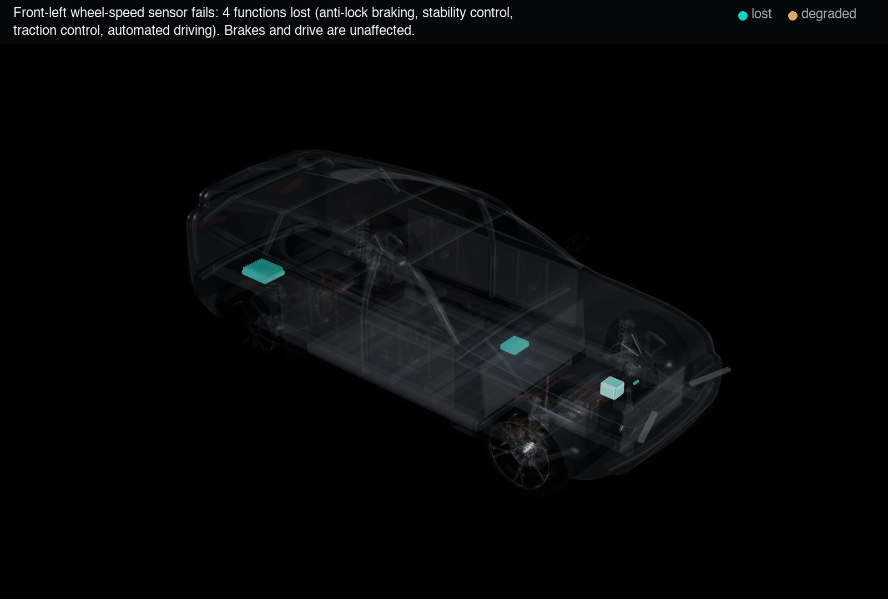
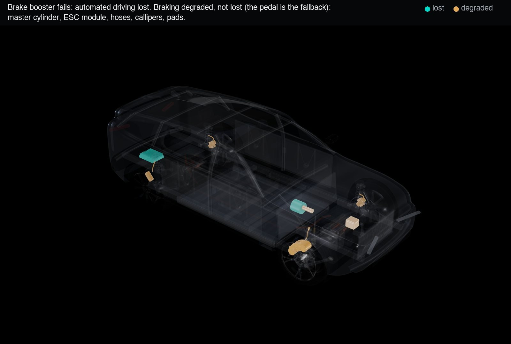
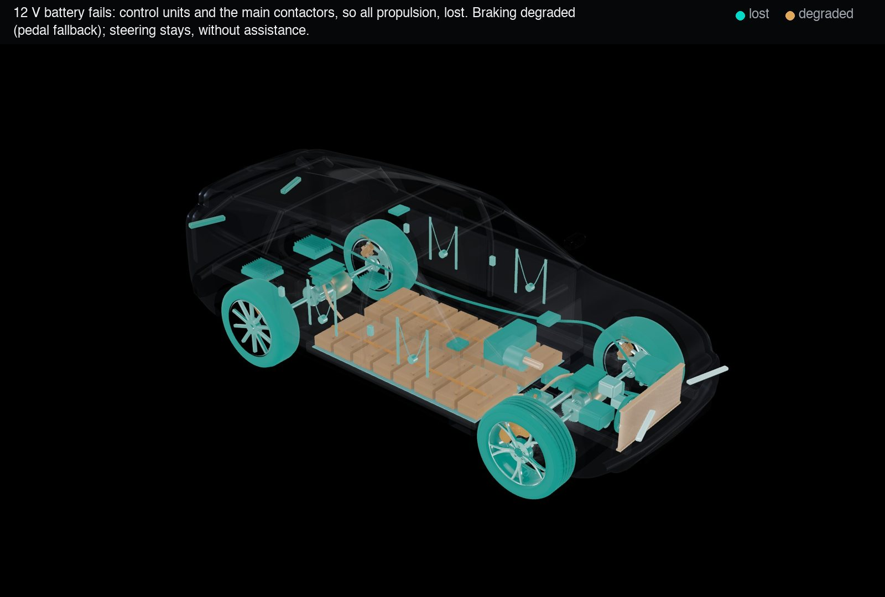
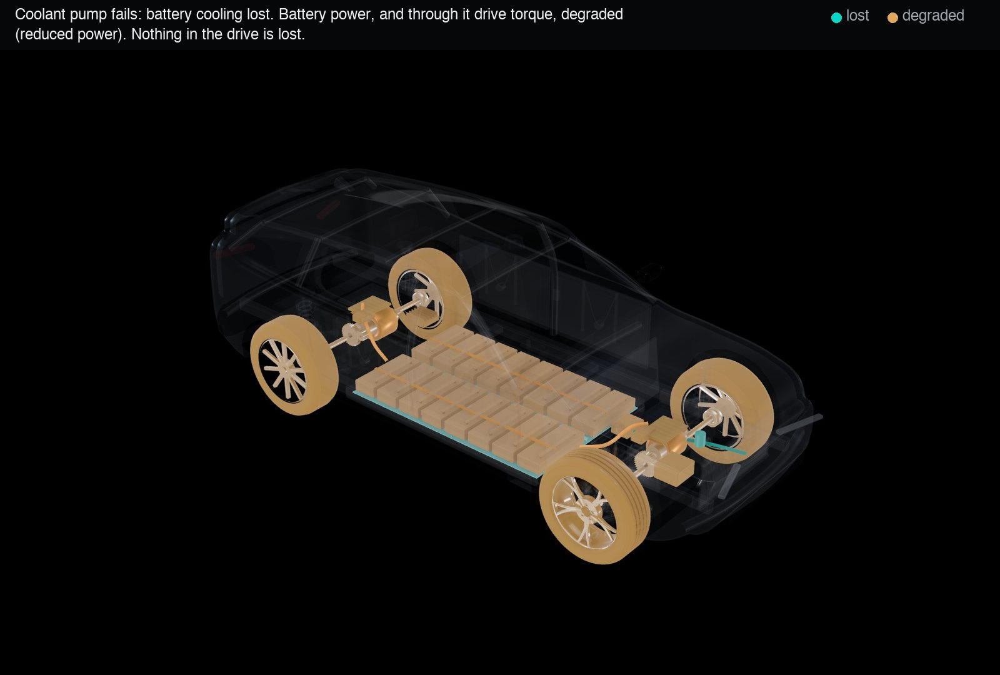
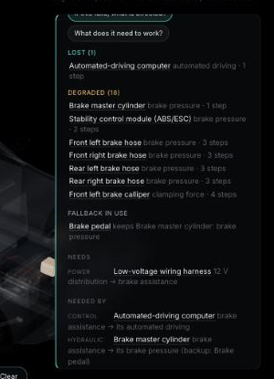

# C1 review: wheelbase baseline and function-level dependency semantics (30 October 2026)

Status: **for review.** Branch `feature/m2.2-mechanical`; nothing merged into `main`. The semantic browsing
interface (C2) has not started.

## 1. Wheelbase moved to 3.03 m

Done first, as agreed; details and before/after views in [docs/wheelbase/README.md](../wheelbase/README.md).
The axles moved (front +14.3 cm, rear -1.3 cm) and the body stayed. Wheels, suspension, steering, drive units
and wheel arches follow; a packaging check found two 1-2 cm clashes in the front compartment, fixed by moving
two units 4 cm. Explosion verified. Component ids unchanged.

## 2. What changed in the semantics

The model and the expected outcomes were written down and committed **before** any logic
(`docs/dependency-semantics.md`, section C1). In short:

- **Failure states belong to functions, not whole components.** A failed wheel-speed sensor takes away the
  ESC module's *anti-lock braking*, not its *brake pressure*. Functions are TypeDB entities
  (`vehicle-function`, 48 of them).
- **Every dependency is a four-role relation**: the dependent and its affected function, the provider and
  the function it supplies. It is one of three families: `physical-dependency`, `operational-dependency`
  or `control-dependency`.
- **Each dependency says what a loss does** (`loss-effect`: lost or degraded) and, optionally, **what a
  degradation does** (`degradation-effect`). This is how degradation propagates only where engineering
  says it does. Reduced battery power reduces drive power; one camera fewer narrows perception and stops
  there; stability control becoming unavailable makes automated driving unavailable.
- **Fallbacks** are their own relation, `fallback (protected: <a dependency>, backup: <component>)`. Six
  are modelled: the pedal and the booster back each other up for brake pressure, and the master cylinder
  backs up each brake hose when the ESC module fails (its valves fail open).
- **Two new components** were needed for honest braking: `brake-pedal` and `master-cylinder`. They have
  stable ids, simple procedural geometry and entries in `docs/component-ids.md`.
- **Reasoning runs in TypeDB:** two mutually recursive functions, `lost_steps` and `degraded_steps`.

## 3. The ten failures: expected and actual

All ten match the table written before implementation (tests `api/tests/test_impact.py`).

| Failure | Lost | Degraded | Fallback in use | As expected |
|---|---|---|---|---|
| Wheel-speed sensor (FL) | 4: anti-lock braking, stability control, traction control, automated driving | 0 | | yes |
| Brake booster | 1: automated driving | 18: master cylinder, ESC, hoses, callipers, pads | pedal | yes |
| 12 V battery | 78: control units, contactors, all propulsion | 37: braking (pedal), battery modules, radiator | pedal | yes |
| Coolant pump | 3: coolant flow, cell cooling | 57: modules, pack, inverters, drive torque (reduced) | | yes |
| Power-steering motor | 2: steering assistance, automated driving | 0 | | yes |
| Front gate driver | 15: front drive train to the front tyres | 0 (rear untouched) | | yes |
| Battery module 5 | 45: series string, so all propulsion | 1: cell cooling | | yes |
| ESC module | 1: automated driving | 16: hoses, callipers, pads | master cylinder (4 hoses) | yes |
| Brake hose (FL) | 3: that calliper and its pads | 0 | | yes |
| Steering rack | 3: tie rods, automated driving | 0 | | yes |

The headline correction: **a failed wheel-speed sensor no longer "stops" 50 components.** It loses four
functions, and no brake or drive function is affected.

## 4. Screenshots

Lost functions glow teal, degraded ones amber, everything else is ghosted (assembled view, so the
highlighted parts are seen through the body).






The panel groups the answer as *Lost / Degraded / Fallback in use* and names the function each time
(brake booster shown): 

## 5. TypeQL

The function that decides "lost" (in `schema/functions.tql`):

```
fun lost_steps($start: component) -> { component, vehicle-function, component, vehicle-function }:
  match
    $d isa dependency (provider: $p, required-function: $g, dependent: $c, affected-function: $f);
    {
      $d has loss-effect "lost";
      not { fallback (protected: $d, backup: $b); not { $b is $start; }; };
      { $p is $start; } or { let $p0, $g0, $p, $g in lost_steps($start); };
    } or {
      $d has degradation-effect "lost";
      let $p1, $g1, $p, $g in degraded_steps($start);
    };
  return { $p, $g, $c, $f };
```

`degraded_steps` mirrors it (a loss that only degrades, a loss with a working fallback, or a degradation
passed on). Asking for the impact of the brake booster:

```
match
  $start isa component, has component-id "brake-booster";
  let $p, $g, $c, $f in lost_steps($start);
  dependency (provider: $p, required-function: $g, dependent: $c, affected-function: $f), has dependency-kind $kind;
fetch { "from": $p.component-id, "needs": $g.function-name, "to": $c.component-id, "to-name": $c.name,
        "function": $f.function-name, "kind": $kind };
```

→ `{ "from": "brake-booster", "needs": "brake assistance", "to": "ad-compute", "function": "automated driving", "kind": "control" }`

Every panel still lists its exact queries under "Show the TypeQL".

## 6. Tests

| Suite | Result |
|---|---|
| API and TypeDB (pytest, real server, disposable database) | **40 passed** (24.7 s) |
| of which: the ten expected-outcome scenarios | 10 passed |
| of which: independent Python oracle, **every one of the 328 components** as the failed part, compared with TypeDB | passed (identical for all 328) |
| of which: model integrity (every dependency has a family, effect and both functions; fallbacks only protect losses) | passed |
| Web unit tests (vitest) | **29 passed** (new: rebuild keeps assembled poses) |
| Web against the live API | **3 passed** |
| Type check and production build | pass |

The oracle applies the exact rule for fallbacks (a backup only counts if it keeps all its functions in that
failure). TypeDB uses a simpler rule (the backup is not the failed part). Agreement on all 328 failures
shows the simpler rule is sound for this data; the test will catch it if new data breaks that.

## 7. Performance

API answers, median of five, M2 Pro, TypeDB included:

| Question | Time | Queries |
|---|---|---|
| Failure impact (recursive, function by function) | 240-360 ms | 3 |
| Requirements (reverse walk) | 92 ms | 2 |
| Component details / relationships | 3-5 ms | 2 / 5 |

The impact answer is slower than before (17 ms) because it now reasons over (component, function) pairs
with two mutually recursive functions. Fast enough for clicking. The 3D frame rate is unaffected (the
highlight only swaps materials). Full browser performance is measured at C3a and C3b, as planned.

## 8. Found and fixed along the way

**Bug: the Blender-built corner could drift away from the car.** After a hot reload (and in principle any
rebuild) while the vehicle was exploded, the rebuild re-read the shared model objects' moved positions as
their "home". The assembled pose is now recorded once, when a model is first used, with a regression test.
Seen only during development, but a real defect.

## 9. Limitations

- **Single-failure analysis.** Each answer assumes one component fails. Combinations are not modelled.
- **Qualitative degradation.** "Degraded" carries no amount (how much power, how much braking).
- **Functions are per component.** Vehicle-level functions ("the vehicle can brake", "the vehicle can
  drive") are not modelled yet. They would be a natural next step for the Questions tab (for example,
  single points of failure for propulsion).
- **Simplified engineering.** The dependency data is plausible for a concept vehicle but simplified (for
  example, one ESC module covers anti-lock braking and stability control; no redundant 12 V supply). The
  simplifications are in `docs/dependency-semantics.md`.
- Screenshots come from the in-app browser at its size limit; C2 will be reviewed at full desktop size in a
  normal browser window.

## Commits

See the branch history (`git log`): wheelbase (`b97d0e2`), expected outcomes (`5a18692`), then the
function-level model, interface, fix and this report.
