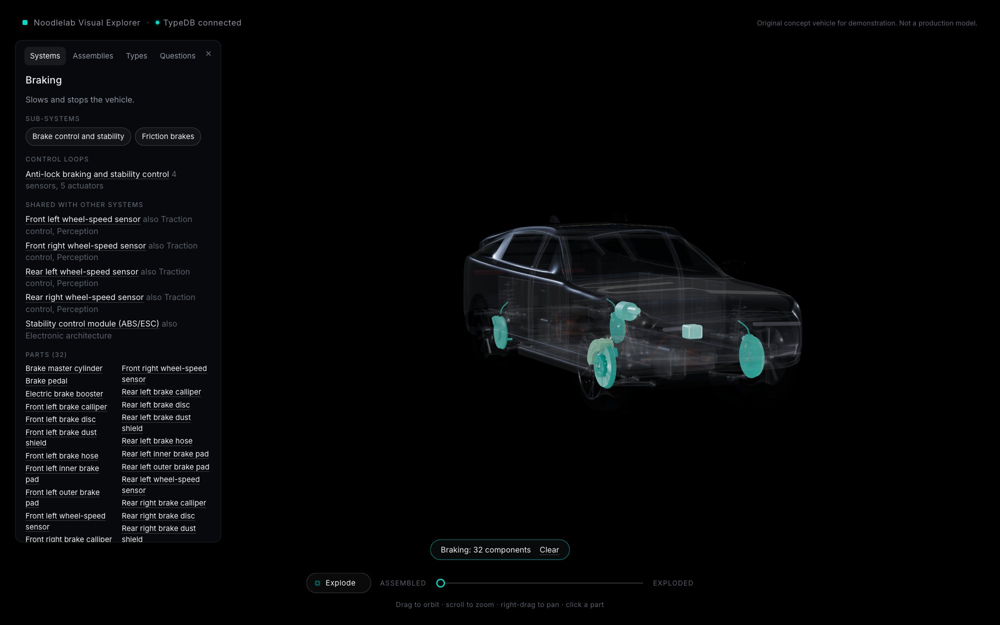
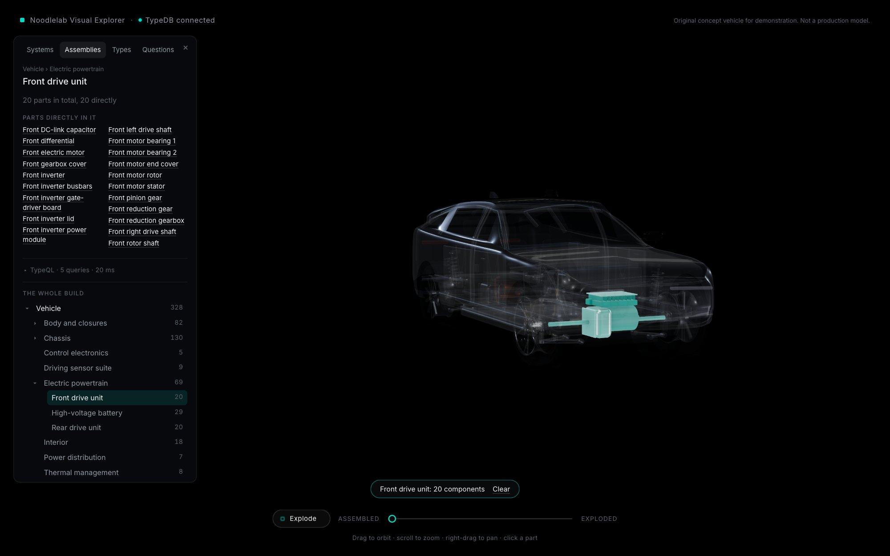
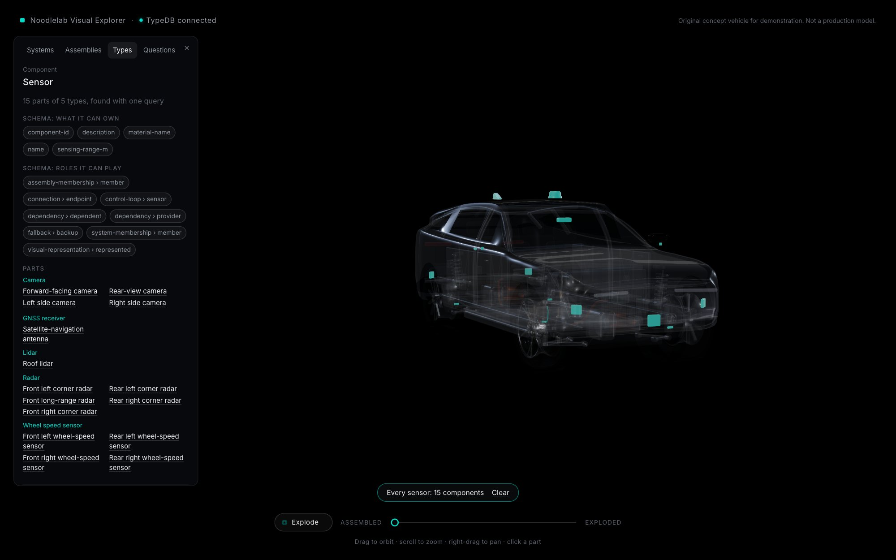
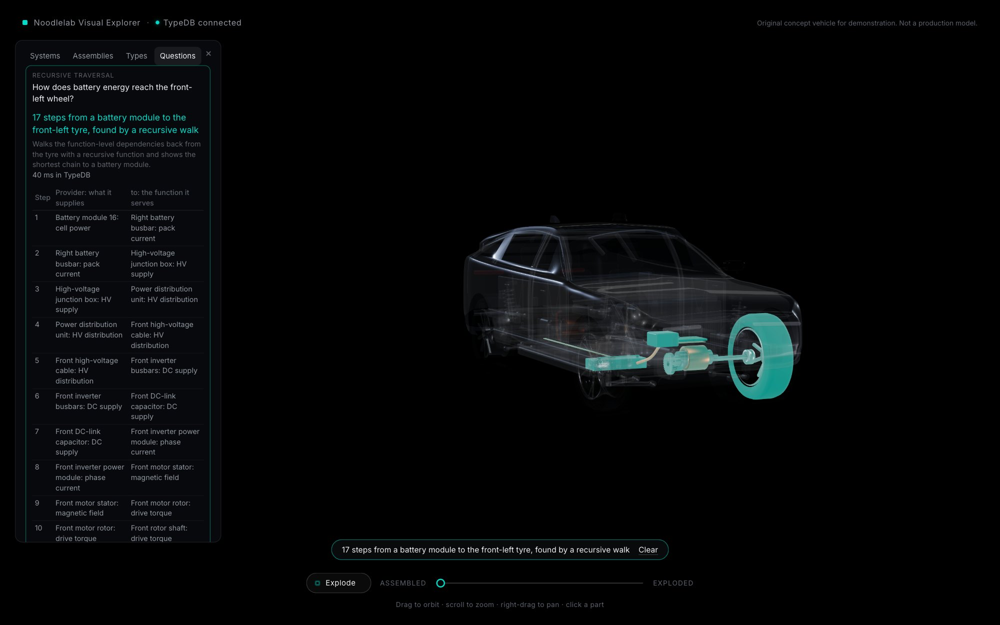
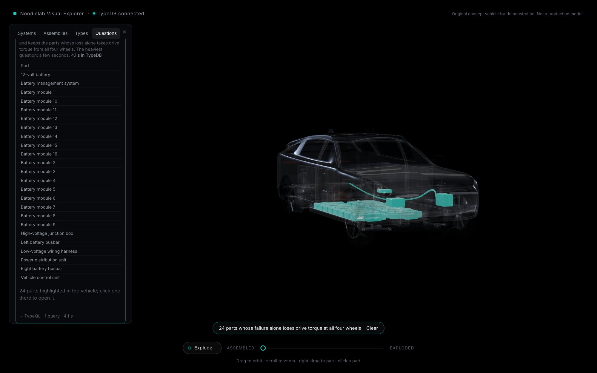
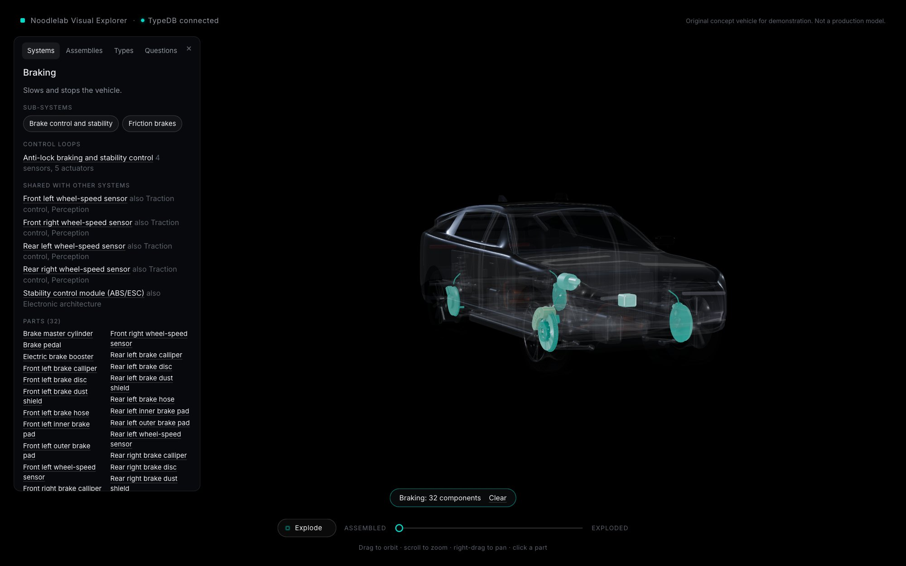
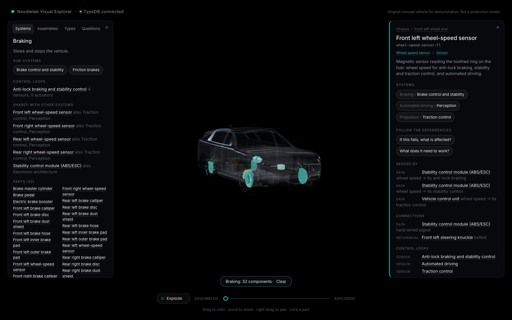
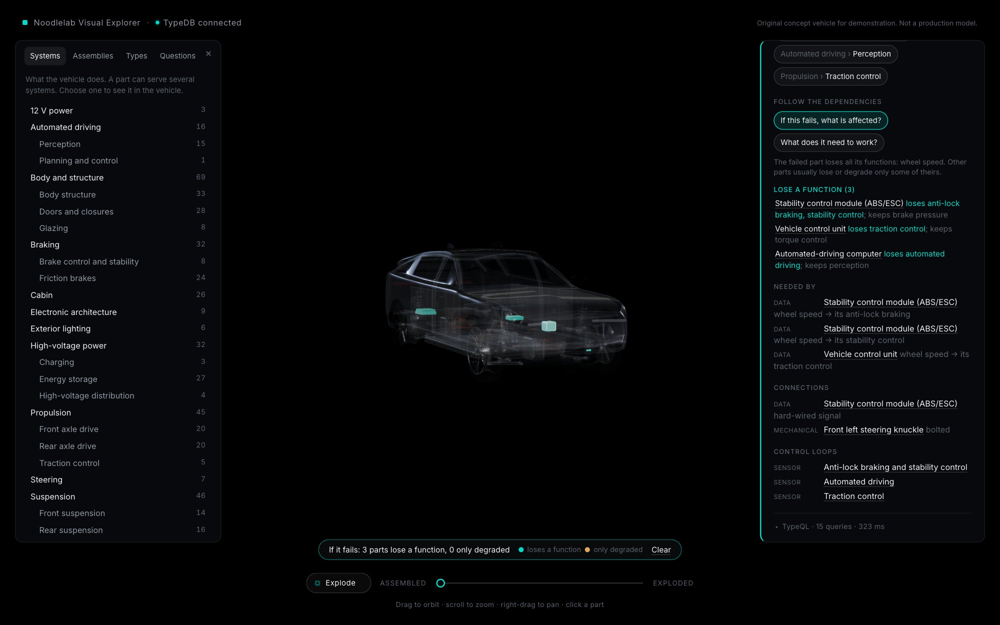
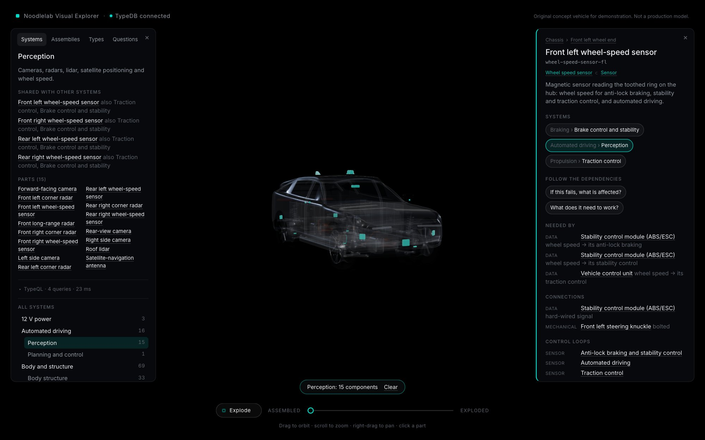
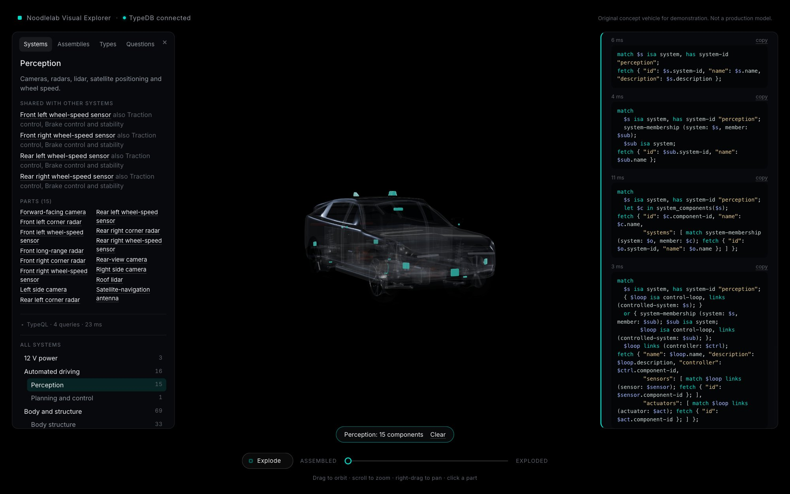

# C2 review: the semantic browser (30 October 2026)

Status: **for review.** Branch `feature/m2.2-mechanical`; nothing merged into `main`. C3a (drive units) has not
started.

Screenshots: a separate headless Google Chrome (the real engine, on the M2 Pro's GPU), 1600 x 1000 at 2x,
driven by `scripts/browser/review.py`, so they can be regenerated exactly.

## What is new

A left-hand **explorer** opens when exploring the vehicle. It has four views of TypeDB's model, none of which
needs a part to be selected first:

| View | What it shows | TypeDB capability made visible |
|---|---|---|
| **Systems** | The functional tree with member counts; a system's sub-systems, control loops, the parts it shares with other systems, and all its parts | Multiple membership (one part, several systems); recursive sub-system membership; four-role control loops |
| **Assemblies** | The physical build as an expandable tree with total counts; an assembly's path, sub-assemblies and parts | Recursive containment (counts through every level) |
| **Types** | The component type hierarchy with counts; a type's schema (what it can own, which roles it can play) and every instance, grouped by subtype | Polymorphism: one query for "sensor" returns cameras, radars, lidar, satellite and wheel-speed sensors; the schema read from the database itself |
| **Questions** | Eight live questions with a one-line answer, a table and the parts highlighted | Aggregates, polymorphic aggregates, pipelines (count then filter), cross-system relations, relation subtypes, recursive traversal, function-level failure reasoning over every part |

Choosing anything **highlights it in 3D** and ghosts the rest. Every part named in the explorer opens its
**component panel**; the component panel's system, assembly and type links open the matching explorer view.
With both panels open, the picture shifts and the lens widens so the vehicle sits in the free space between
them (the camera the viewer controls never moves).

**TypeQL is one click away everywhere, never in the way:** a shared viewer collapsed to one quiet line
("TypeQL · 5 queries · 15 ms"), open to show each query exactly as it ran, its execution time in TypeDB and a
copy button.

**Failure consequences are shown function by function.** The impact list reads per part, for example "Stability
control module: loses anti-lock braking, stability control; keeps brake pressure", states that the failed part
itself loses all its functions, and separates parts that lose a function (teal) from those only degraded
(amber), with fallbacks in use.

## Screenshots

**Systems.** Braking: sub-systems, its control loop, parts shared with traction control and perception, all
32 parts highlighted. 

**Assemblies.** Electric powertrain > front drive unit. 

**Types.** Sensor: 15 parts of 5 types from one query, with the schema card. 

**Questions.** How battery energy reaches the front-left wheel: 17 steps, highlighted along the car.


**Questions.** Single failures that stop all propulsion: 24 parts, from the failure reasoning run for every
part at once. 

**Navigation round trip** (explorer → 3D → component panel → failure → back to the explorer):
1. Systems › Braking: 
2. Click "Front left wheel-speed sensor" in the shared list: the component panel opens and stays alongside. 
3. "If this fails, what is affected?": three parts lose a function, each keeping its others. 
4. Click its "Perception" system: the explorer switches to that system and the 3D highlight follows. 

**The TypeQL viewer**, open, with each query's time. 

## Representative TypeQL and results

Polymorphism, every sensor by its most specific type (2 ms):
```
match $x isa sensor; $x isa! $type;
reduce $n = count groupby $type;
fetch { "type": $type, "n": $n };
```
→ radar 5, camera 4, wheel-speed sensor 4, lidar 1, GNSS receiver 1.

A pipeline, parts in more than one system (2 ms):
```
match $c isa component; system-membership (system: $s, member: $c);
reduce $n = count groupby $c;
match $n > 1;
fetch { "id": $c.component-id, "name": $c.name, "systems": $n, ... };
```
→ 14 parts (the four wheel-speed sensors serve three systems each).

Aggregation over a type, the pack (1 ms):
```
match $m isa battery-module, has energy-capacity-kwh $e, has nominal-voltage-v $v;
reduce $kwh = sum($e), $volts = sum($v), $modules = count;
```
→ 100 kWh, 800 V with 16 modules in series (concept design targets).

Function-level failure reasoning for every part at once (3.4 s):
```
match
  $start isa component;
  let $p, $g, $t, $f in lost_steps($start);
  $t isa tyre; $f has function-name "drive torque";
reduce $tyres = count groupby $start;
match $tyres == 4;
fetch { "id": $start.component-id, "name": $start.name };
```
→ 24 parts: the 16 modules and 2 busbars (one series string), junction box, PDU, BMS, VCU, 12 V battery and
harness.

## Performance

**API, median of five** (total including HTTP; TypeDB time measured to the last answer):

| Answer | Total | Queries |
|---|---|---|
| Browsing: systems, assemblies, types and their details | 2-11 ms | 3-5 |
| Component details, assembly, systems, relationships | 2-6 ms | 2-5 |
| Questions (seven of eight) | 2-28 ms | 1-2 |
| Requirements (reverse walk) | 82 ms | 2 |
| Failure impact (function-level) | 240-360 ms | 4 |
| Question: single failures stopping all propulsion | 3.4 s | 1 |

The browsing features add no noticeable latency. The failure-impact time is unchanged from C1 (the new "kept
functions" query adds 4-9 ms); within it, the degraded-step reasoning is the largest part (160-270 ms). The
single-failure question runs that reasoning for all 328 parts in one query, so it shows "Asking TypeDB…"
while it works.

**Rendering in Chrome** (1600 x 1000 at 2x = 3200 x 2000 pixels; `scripts/browser/perf.py`; median / 90th
percentile; GPU time from WebGL timer queries):

| Tier | State | CPU per frame | GPU per frame | Frame interval |
|---|---|---|---|---|
| High | assembled, explorer closed | 2.8 / 3.9 ms | 89 / 96 ms | 33 ms (30 fps) |
| High | explorer open, Braking highlighted | 4.8 / 6.4 ms | 47 / 51 ms | 33 ms (30 fps) |
| High | exploded / exploding, highlighted | 4.8-4.9 / 6.4-6.8 ms | 42-43 / 45-46 ms | 33 ms (30 fps) |
| Medium | assembled, explorer closed | 2.1 / 2.7 ms | 18 / 22 ms | 16.7 ms (60 fps) |
| Medium | explorer open, Braking highlighted | 3.4 / 4.4 ms | 15 / 17 ms | 16.7 ms (60 fps) |
| Medium | exploded / exploding, highlighted | 3.4-3.8 / 4.1-4.4 ms | 12-13 / 15-16 ms | 16.7 ms (60 fps) |

- **C2's own cost is small:** highlighting adds about 2 ms of CPU per frame (material swaps and transparent
  ghosting) and no GPU cost.
- **Finding (from Phase A settings, not C2):** the **high** tier is too heavy at full retina resolution. Its
  full-resolution ambient occlusion with 4x antialiasing takes 42-96 ms of GPU per frame, so Chrome runs at
  30 fps. In normal use the app starts at high on this machine and its frame-rate monitor steps down to
  medium within seconds; these runs fixed the tier to measure it. The earlier in-app measurements understated
  this because that pane renders far fewer pixels. **Proposed for C3a** (where browser performance is measured
  in depth): cap the high tier's pixel ratio at 1.5 and use half-resolution occlusion above about 4 million
  pixels, then re-measure.

## Tests

| Suite | Result |
|---|---|
| API and TypeDB (pytest, real server, disposable database) | **58 passed**: all earlier tests, plus browsing (tree, system totals, type counts and schema against oracles from the seed and schema files), the eight questions (each against an oracle; the single-failure question against the independent failure model), timings, function-level consequences |
| Web unit tests | **29 passed** |
| Web against the live API | **7 passed**: every system member, assembly part and question highlight is a part the 3D scene draws; the type hierarchy's total equals the parts drawn |
| Type check and production build | pass |

As noted in `docs/dependency-semantics.md`, agreement between TypeDB and the Python oracle shows the rules are
computed correctly; it does not validate the engineering assumptions, which are listed there for review.

## Known limitations and remaining visual issues

- **Small parts are hard to see when highlighted.** Control units, sensors and connectors are small boxes; in
  the assembled view a highlight on them is easy to miss (for example the three control units in the
  wheel-speed-sensor failure). Options for later: a soft halo or screen-space outline for highlighted parts,
  or zooming to the highlighted set on request.
- **The 3D highlight shows parts, not functions.** A part that keeps some functions is still drawn in the "lost"
  colour if it loses any; the panel gives the function-level detail.
- **Long lists in the explorer** (a system's parts, the single-failure answer) need scrolling inside the panel.
- **The high quality tier runs at 30 fps at retina resolution** (see Performance).
- **Narrow screens:** both panels become stacked overlays below 640 px wide; usable but not designed for phones.
- **Questions are a fixed set of eight.** There is no free-form question box, by design: the browser runs only
  named, read-only queries.
- **The current exterior** is unchanged (Option A); the semantic browser works the same on any future exterior.

## Commits in C2

| Commit | Step |
|---|---|
| `864ff72` | feat(api): per-query TypeDB timings with every answer |
| `8f4cfd0` | feat(api): assembly tree, system totals, type hierarchy and schema |
| `df4401e` | feat(api): eight named Questions |
| `4183e11` | feat(web): shared TypeQL viewer with timings |
| `d559a0f` | feat(web): explorer with Systems and Assemblies |
| `a248059` | feat(web): Types tab |
| `c508109` | feat(web): Questions tab |
| `f64b98d` | feat(scene): keep the vehicle framed between the side panels |
| `5a67699` | feat(api): lost, degraded and kept functions per part |
| `e625617` | feat(web): function-level consequences in the impact list |
| `1ee30cc` | test(web): browsing answers against the parts the app draws |
| `acb68eb` | docs: consistency versus engineering validity; key assumptions |
| `63549b0` | fix(questions): compact battery-to-wheel table |
| `be4d452` | test(review): repeatable Chrome screenshots and frame timing |
| (this report) | docs: C2 review |
