# C3a review: drive units, highlighting and rendering (30 October 2026)

Status: **for review.** Branch `feature/m2.2-mechanical`; nothing merged into `main`. C3b (battery and power
distribution) has not started.

Screenshots: a separate headless Google Chrome (real engine, M2 Pro GPU), 1600 x 1000 at 2x, driven by
`scripts/browser/drive_units.py`, `states.py` and `quality.py`, so they can be regenerated exactly.

## 1. Highlighting: less transparent ghosting, lilac accent

Parts outside a highlighted set are now 11% opaque (was 5%), the same in every mode. All accent colours come
from one file (`web/src/theme.ts`): lilac `#A78BFA` primary, `#D6B5FF` secondary, amber kept for degraded
functions; glow strengths reduced. Before (left) and after (right):

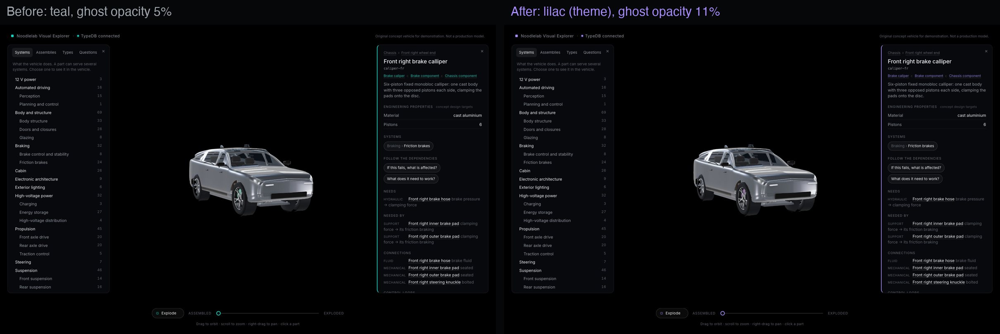
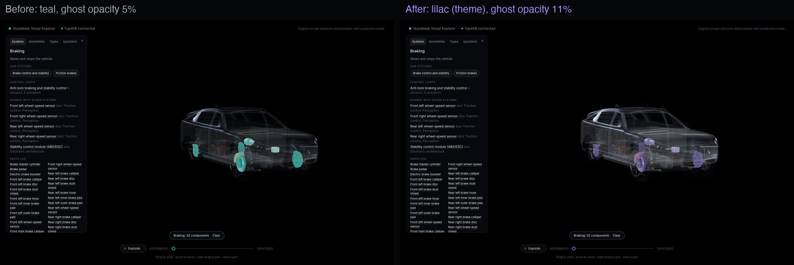
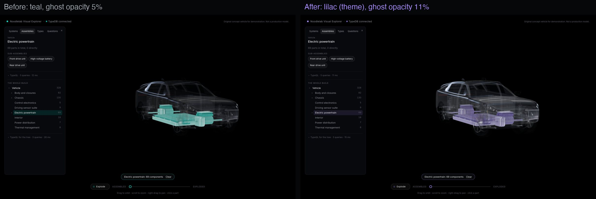
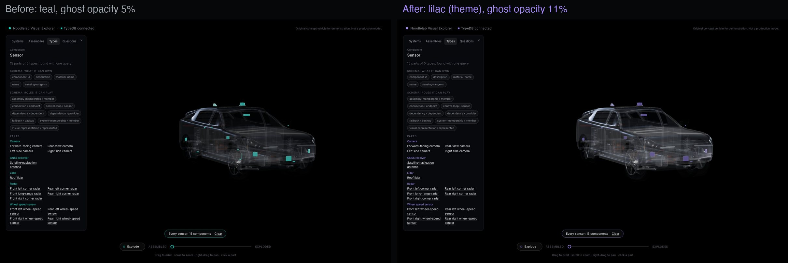
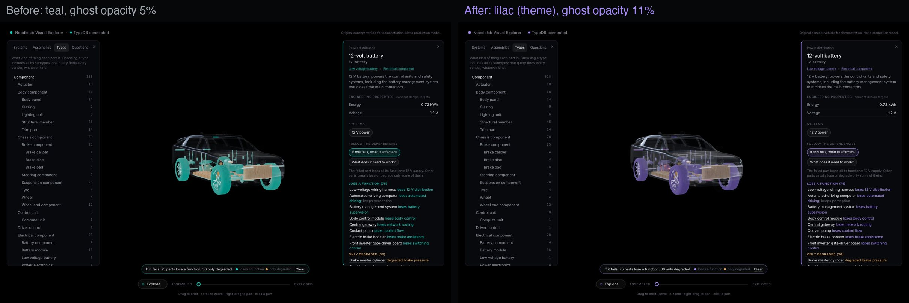

## 2. Rendering: high tier fixed

The high tier's pixel ratio is capped at 1.5x, and ambient occlusion runs at half resolution above 3 million
pixels. GPU time per frame (Chrome, 1600 x 1000 at 2x): **34-79 ms before, 15-19 ms after** (medium: 12-17
ms). High keeps better occlusion quality, 4x antialiasing and longer full-detail distances. Close-ups show no
meaningful loss (before left, after right):

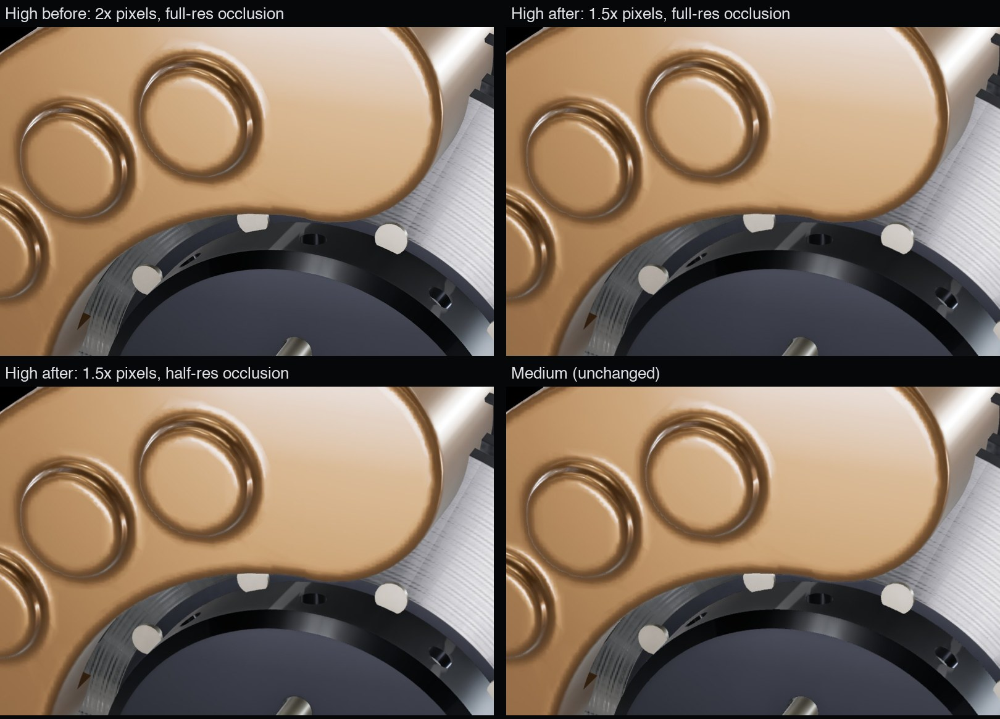
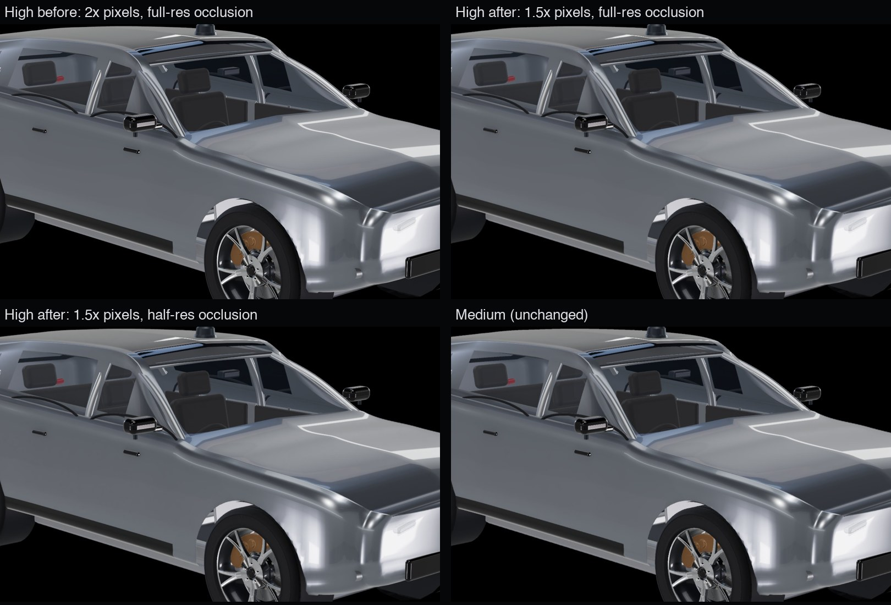

The slow question ("single failures that stop all propulsion") shows **Asking TypeDB… Cancel**, stays
responsive, and a cancelled or superseded answer is ignored; it is recorded in `docs/optimisation-backlog.md`.

## 3. The drive units

Both units are Blender models (`blender/drive_unit.py`, the same pipeline as the corner: Meshopt
compression, a light copy for distance, a mapping file from node to component id). They follow the
three-shaft layout used by most single-motor axles (sources and simplifications in
`docs/engineering-references.md`):

- **Motor:** 8-pole interior permanent-magnet machine. Water-jacketed cast housing with coolant ports and a
  terminal box. 48-slot laminated stator with hairpin windings (bent crowns at one end, welded pin pairs at
  the other). Rotor with V-shaped magnet pockets and balance plates. Hollow splined shaft, two ball bearings,
  and a resolver in the end cover.
- **Gearbox:** a two-stage helical reduction in a split cast case.
  - Input pinion 21 to intermediate gear 61; intermediate pinion 17 to final-drive gear 53: **9.06:1**.
  - Open differential: cast-iron case, two side gears, two spider gears on a cross pin.
  - Oil pump and oil cooler.
  - Front: a **disconnect clutch** on the intermediate shaft. Rear: a **park lock**.
- **Silicon-carbide inverter** on top of the motor: six-pack module on a pin-fin cold plate, film DC-link
  capacitor, DC busbars, gate-driver board, motor-control board, three-phase current sensor, phase busbars
  down to the motor, and an orange HV connector.
- **Mounts:** one under the motor end, one under the gearbox, and a torque rod. **Drive shafts** have a
  tripod joint, boots, a fixed ball joint and a splined stub into the hub.

**Packaging within the 3.03 m wheelbase.**
- Each motor axis sits 190 mm above the wheel axis (front 30 mm behind it, rear 100 mm behind), so the left
  drive shaft passes under the motor.
- The front unit fits between the steering rack and the front-end cooling parts; the rear unit fits between
  the subframe and the rear compartment.
- A new automatic check (`web/src/scene/packaging.test.ts`) samples every drive-unit surface every 2 mm and
  compares it with every part around it. It found five real problems, now fixed:
  1. The Phase A damper stood exactly where the front-right drive shaft must pass. It now has a **fork**
     whose legs straddle the shaft, as real double-wishbone corners with driven wheels do (the corner model
     was rebuilt).
  2. The torque rods hit the anti-roll bars. They now sit outboard, on the cover side.
  3. The coolant line crossed the front-left drive shaft. It now runs above the shaft.
  4. The rear torque rod also crossed the rear HV harness. Moving the rod cleared it.
  5. Both HV harnesses now end at the inverters' new connectors.

**Assembled:**
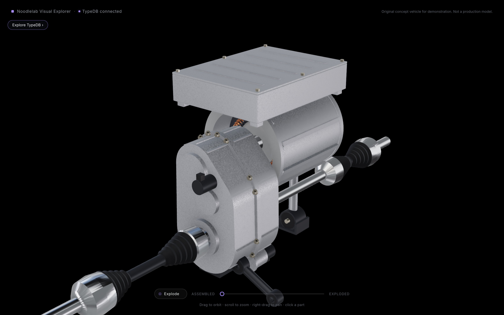
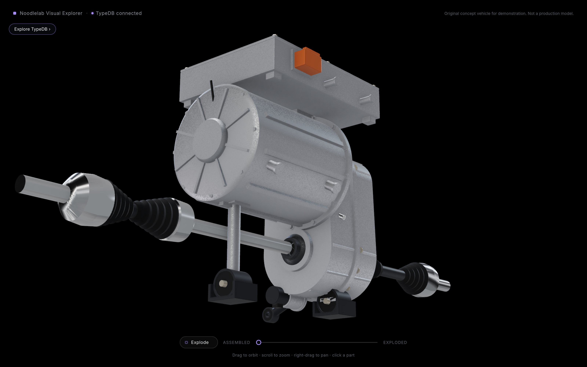
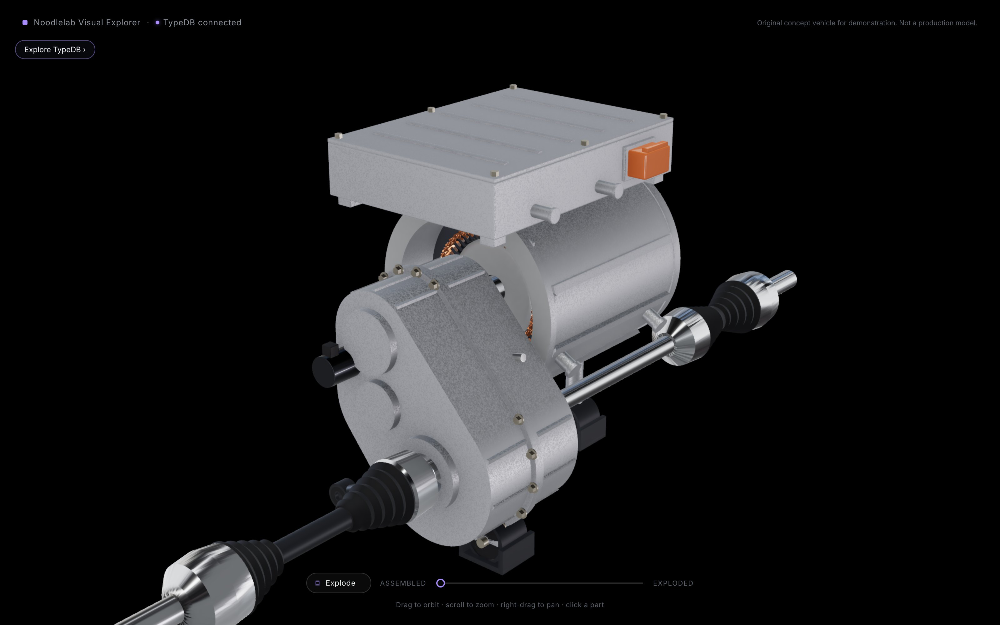
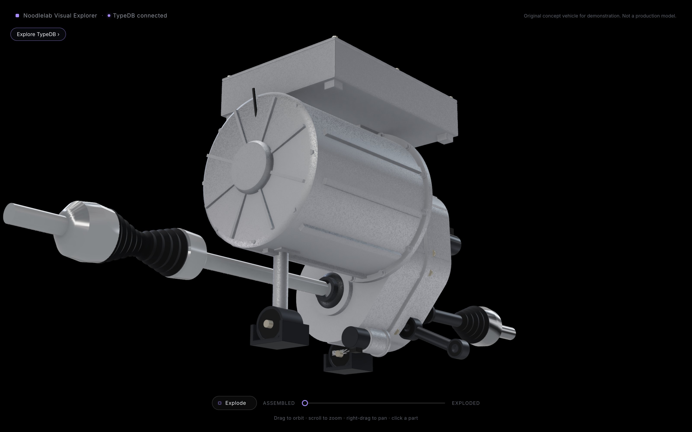

**Inside the gearbox** (case halves, inverter and right drive shaft hidden): input pinion, intermediate gear,
final-drive gear on the differential, oil pump, and the hairpin crowns and bearing through the motor's open
end.
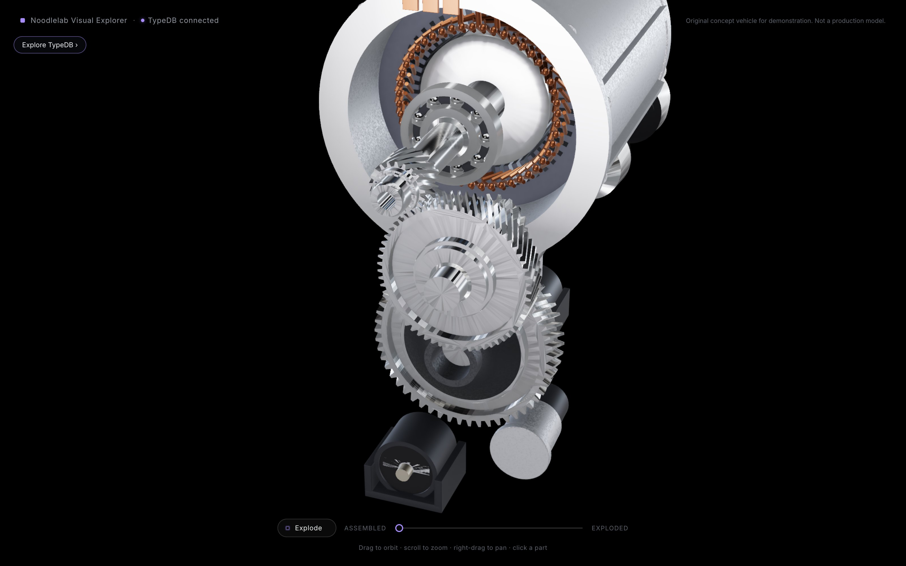
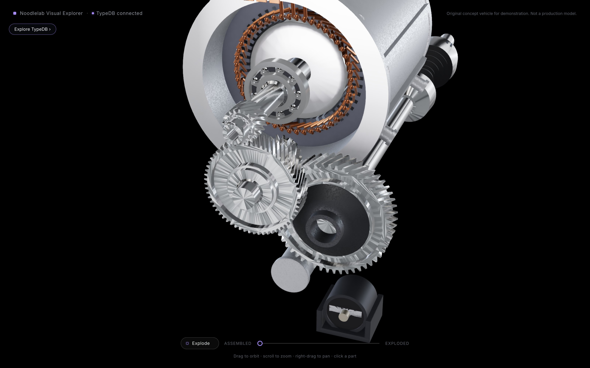

**Exploded:** the motor slides apart along its axis (housing, stator, rotor, shaft, bearing, resolver, end
cover). The gear train opens the other way (case, differential, side and spider gears, final-drive gear,
intermediate shaft and gear, pinion, cover, then the disconnect or park lock). The inverter rises as a stack
(tray, busbars, capacitor, module, sensor, boards, lid). The mounts drop.
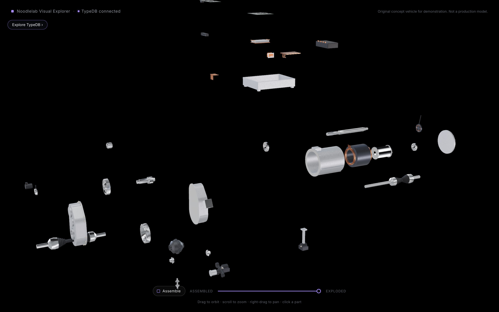
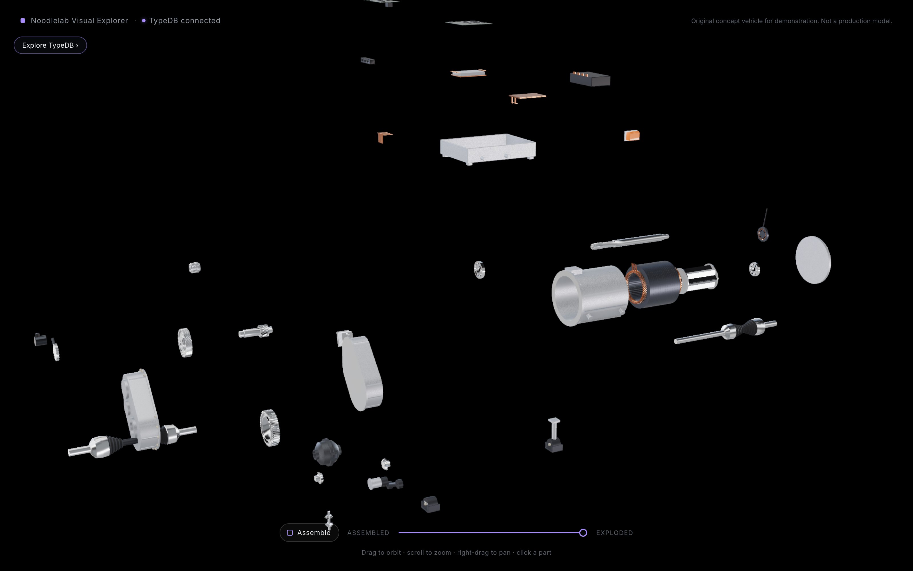

**In place** (body hidden):
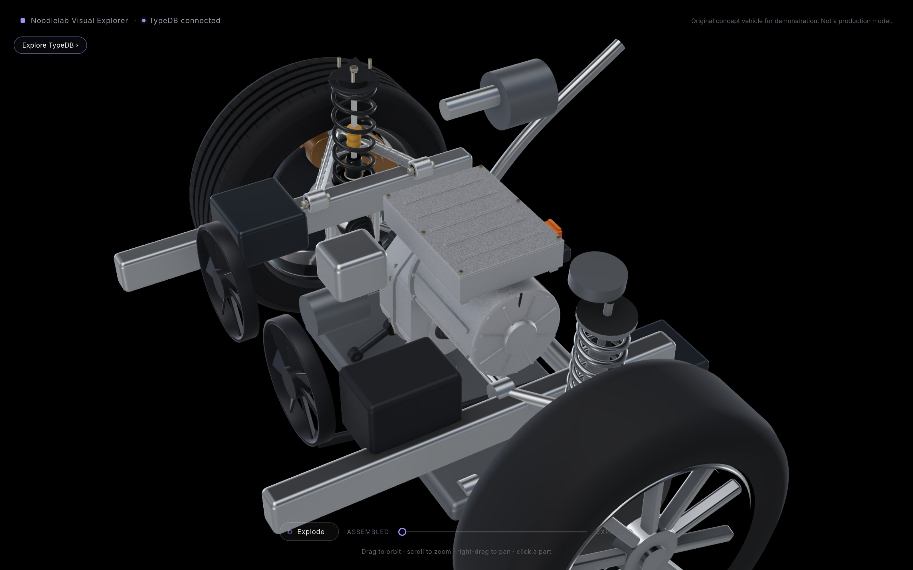
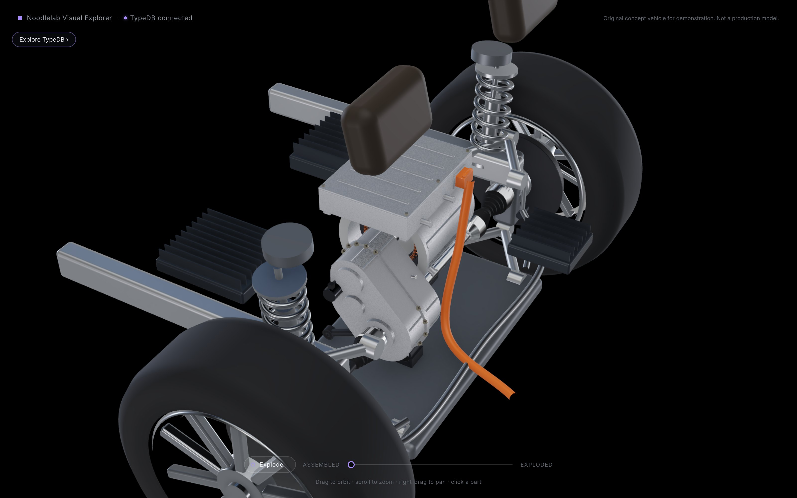

## 4. TypeDB

**All 40 existing drive-unit ids are kept.** 32 new ids are listed in `docs/component-ids.md`.

**Schema:**
- New types: `gear` (owns `tooth-count`), `park-lock` and `axle-disconnect` (both actuators in control
  loops), `mount`, `connector`, `position-sensor`, `current-sensor`.
- Oil is now a fluid, and `lubrication` is a new dependency kind.

**Behaviour, function by function** (`docs/dependency-semantics.md`, written before the data was loaded):
- HV harness → **HV connector** → DC busbars → capacitor → power module → **phase busbars** → stator.
- The VCU's torque request goes to a **motor-control board**, which also needs the **resolver** and the
  **current sensor**, and commands the gate driver.
- Torque runs pinion → **intermediate gear** → (front: **disconnect**) → **intermediate shaft** → final-drive
  gear → differential → **spider gears** → **side gear** → drive shaft.
- Losing oil flow or oil cooling *degrades* torque; it does not stop it.

**Four new control loops:** front and rear motor current control, front axle disconnect, park lock. The new
system **drive-unit oil cooling** sits under thermal management.

| Count | C2 | C3a |
|---|---|---|
| Components | 328 | **360** |
| Component types in the hierarchy | 44 | 51 |
| Connections | 374 | **448** |
| Dependencies (function to function) | 179 | **218** |
| Vehicle functions | 48 | 55 |
| Systems / system memberships | 32 / 351 | 33 / 388 |
| Control loops | 4 | 8 |
| Sensors (polymorphic "sensor") | 15 | 19 |

### TypeQL examples (live answers)

The rear gear train with tooth counts, from the `gear` type (9 ms):
```
match $g isa gear, has tooth-count $t, has component-id $id; $id like "^rear-";
fetch { "id": $id, "teeth": $t };
```
→ pinion 21, intermediate gear 61, intermediate shaft 17, final-drive gear 53, side gears 16, spider gears 10.

Which parts mesh, from the connections (7 ms):
```
match $c isa mechanical-connection, has joint-type "meshed", links (endpoint: $a, endpoint: $b);
  $a has component-id $x; $b has component-id $y; $x like "^front-"; $x < $y;
fetch { "a": $x, "b": $y, "what": $c.description };
```
→ pinion / intermediate gear (first stage), intermediate shaft / final-drive gear (second stage), spider gears
/ each side gear (bevel).

The four-role control loop, with each sensor's most specific type (2 ms):
```
match $l isa control-loop, has name "Rear motor current control",
  links (controller: $c, sensor: $s, actuator: $a); $s isa! $t;
fetch { "controller": $c.component-id, "sensor": $s.component-id, "sensor-type": $t, "actuator": $a.component-id };
```
→ rear control board reads the resolver (position-sensor) and current sensor (current-sensor); actuator the
rear motor.

Recursive assembly count (9 ms): `match $u isa assembly, has assembly-id $aid; $aid like "-drive-unit$"; let $c
in assembly_components($u); reduce $n = count groupby $aid;` → 36 parts in each unit.

Failure reasoning: a front resolver failure, which tyres lose drive torque (158 ms):
```
match $s isa component, has component-id "front-resolver";
  let $p, $g, $c, $f in lost_steps($s); $c isa tyre;
fetch { "tyre": $c.component-id, "function": $f.function-name };
```
→ tyre-fl and tyre-fr: drive torque. The rear axle is untouched. A rear oil-pump failure (`degraded_steps`)
instead *degrades* the rear stator and the whole rear torque path to both rear tyres, and loses nothing but
the oil cooler's function.

### Expected outcomes, as tested

| # | Failure | Result |
|---|---|---|
| 4 (revised) | Coolant pump | Now also loses both oil coolers' oil cooling; both stators degraded; no tyre loses drive |
| 11 | Front resolver | Front control, switching, phase current and front drive torque lost; rear untouched |
| 12 | Rear oil pump | Only the oil cooler lost; rear stator and rear torque path degraded |
| 13 | Front disconnect | Front drive torque lost from the intermediate shaft onwards; the front motor itself unaffected |
| 14 | Rear left side gear | Rear-left drive shaft, hub, wheel and tyre lose drive torque only |
| 15 | Rear park lock | Nothing (it carries no drive torque) |
| 16 | Front HV connector | Front DC supply and front drive torque lost; rear untouched |

**For your decision (not implemented):** with an *open* differential, a broken side gear or drive shaft
actually leaves the *other* wheel of that axle with almost no torque as well. The model keeps the C1 rule
(per side). Correcting it would change scenario 14 and the existing drive-shaft cases to "both wheels of that
axle lose drive".

As before, agreement between TypeDB and the Python oracle shows the rules are computed consistently, not
that the engineering assumptions are right. The new assumptions are listed in
`docs/dependency-semantics.md`:
- a failed resolver stops its motor (no sensorless fallback);
- the oil pumps are electric;
- drive torque is lost per side downstream of the differential.

## 5. Performance and asset sizes

| Model file | Full detail | Light copy | Triangles (full) |
|---|---|---|---|
| Front drive unit | 857 KB | 442 KB | 91,300 |
| Rear drive unit | 890 KB | 464 KB | 93,500 |
| Front-right corner (with the new damper fork) | 1,976 KB | 790 KB | 304,500 |

All 97 modelled parts (5.4 MB) download and decode in **0.21-0.27 s** from the local server (three cold
loads).

**Rendering in Chrome** (`scripts/browser/perf.py`, 1600 x 1000 at 2x, median per frame; every case at 60
fps):

| Tier | State | CPU before → with drive units | GPU before → with drive units |
|---|---|---|---|
| High | assembled | 2.3 → 2.7 ms | 16.4 → 17.3 ms |
| High | explorer open, Braking highlighted | 3.9 → 5.0 ms | 19.3 → 20.4 ms |
| High | exploded / exploding | 2.4-4.0 → 3.5-5.9 ms | 15.3-16.0 → 16.4-17.2 ms |
| Medium | all states | 3.6-5.4 ms | 12.0-15.8 ms |

The drive units add about 1 ms of GPU and up to 2 ms of CPU per frame (more draw calls: each part has several
materials).

**API** (median of five, total including HTTP):

| Answer | C2 | C3a |
|---|---|---|
| System, assembly or type views of the drive units | 2-11 ms | 4-8 ms |
| Failure impact (function-level) | 240-360 ms | 380-400 ms |
| Single failures stopping all propulsion | 3.4 s | **5.1 s** (more parts, longer chains; cancellable; in the backlog) |

## 6. Tests

| Suite | Result |
|---|---|
| API and TypeDB (pytest, real server, disposable database) | **64 passed** (58 at C2): six new drive-unit failure scenarios; the revised coolant-pump scenario; the independent failure oracle for all 360 parts; sensor counts and types now include resolvers and current sensors |
| Web unit tests | **36 passed** (29 at C2). New: both drive-unit model files against the manifest (nodes, light copies, positions, materials, size), and the packaging check |
| Web against the live API | **7 passed**: every model file's nodes match TypeDB's visual references; every system, assembly and question part is drawn |
| Type check and production build | pass |

## 7. Limitations

- **Geometry is representative:** gear teeth are trapezoidal, not involute. Hidden bearings, seals and oil
  passages are omitted. See the simplifications log.
- **The open-differential rule** (above) is a known simplification awaiting your decision.
- **The sills** (simple procedural boxes from Phase A) run on into the wheel arches since the wheelbase change,
  so they pass through the tyres and drive shafts. The packaging check excludes them for now; they belong to
  the body-structure work.
- **Exploded views are wide:** the drive units open into many parts. A close-up of one unit needs the camera
  well back; isolating a unit (as in these renders) reads best.
- **Small inverter parts** (current sensor, boards) are hard to see when highlighted in the assembled car,
  as noted at C2.
- **The single-failure question** now takes 5.1 s and will grow with C3b. Options are in the backlog.
- **The procedural fallback** (`?corner=procedural`) shows simple stand-ins in the right places, not the
  detail.
