# C3b review: battery, high-voltage distribution, open differential (30 October 2026)

Status: **for review.** Branch `feature/m2.2-mechanical`; nothing merged into `main`. Work stops here for
review.

Screenshots: a separate headless Google Chrome (real engine, M2 Pro GPU), 1600 x 1000 at 2x, from
`scripts/browser/battery.py` and `scripts/browser/c3b_explorer.py`, so they can be regenerated.

## 1. Open-differential failure model (approved correction)

**Assumption** (`docs/dependency-semantics.md`): conventional open differentials, no locking or limited-slip
device, one motor per axle. An open differential passes equal torque to both sides, so if one side gear or
drive shaft breaks, **neither wheel on that axle gets useful drive torque**.

**How it is modelled.** Each side gear and drive shaft provides a *reaction path*; the differential's drive
torque needs the reaction path of both drive shafts. Hubs gain an explicit *wheel rotation* function from
their bearings. The reasoning functions are unchanged and the graph has no loops.

**Axle versus vehicle.** Every failure answer now opens with drive per axle and one sentence for the whole
vehicle. Which tyres belong to which axle comes from TypeDB (the drive-torque chain from each axle system's
drive shafts), not from part names.

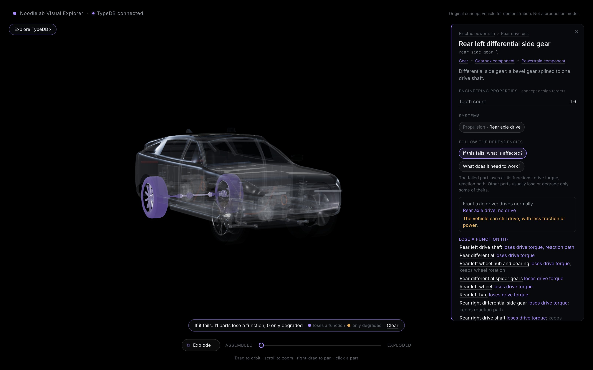

Tested:
- **Rear side gear:** both rear wheels lose drive; the wheels still turn; no braking or steering function is
  touched; the front axle drives normally, so the vehicle can still drive.
- **Front drive shaft:** the same at the front.
- **Wheel bearing:** loses only that hub's wheel rotation.
- **12 V battery:** both axles lose drive, so the vehicle cannot drive.
- **Coolant pump:** both axles reduced.

## 2. The battery pack and high-voltage distribution

Blender models `hv-battery` and `power-electronics` (`blender/battery.py`), in the same pipeline as the drive
units. Sources, concept numbers and simplifications: `docs/engineering-references.md`.

- **Structure.** Cast tray with a narrower front bay, extruded three-chamber side rails (bolted to the sills),
  hat-section crossmembers in the row gaps, a ribbed steel protection plate, and a lid with a hatch over the
  service disconnect. The pack fits between the 190 mm ground clearance and the cabin floor at 380 mm.
- **Cells and modules.** 16 modules of 14 prismatic cells (224 in series, 806 V nominal, 100 kWh concept
  target): end plates, straps, terminals and laser-welded series links. The module-to-module busbars and
  their leads run to the junction box and to the service disconnect.
- **Cooling.** One cooling plate with pressed channels and a thermal pad, supply and return rails along the
  centre, and ports in the bay's front wall.
- **Supervision.** Eight module monitors (one per two modules) on their daisy chain to the BMS master in the
  front bay.
- **Junction box** (its own sub-assembly). Positive and negative main contactors, the pre-charge relay and
  resistor, the pack fuse and the current shunt. Outlets feed the front inverter and, over the front drive
  unit, the front PDU.
- **Service disconnect** in the middle of the series string, at the rear of the pack under the rear seat. It
  is reachable through the floor.
- **Internal rear feed** along the centre channel to two rear outlets: one for the rear inverter's cable, one
  for the DC charging cable.
- **Front compartment.** PDU, DC-DC converter (moved next to the 12 V battery), 12 V battery and a new 12 V fuse
  box. **Rear quarter:** the on-board charger and a combined AC and DC charge inlet.

**The pack, lid off:** 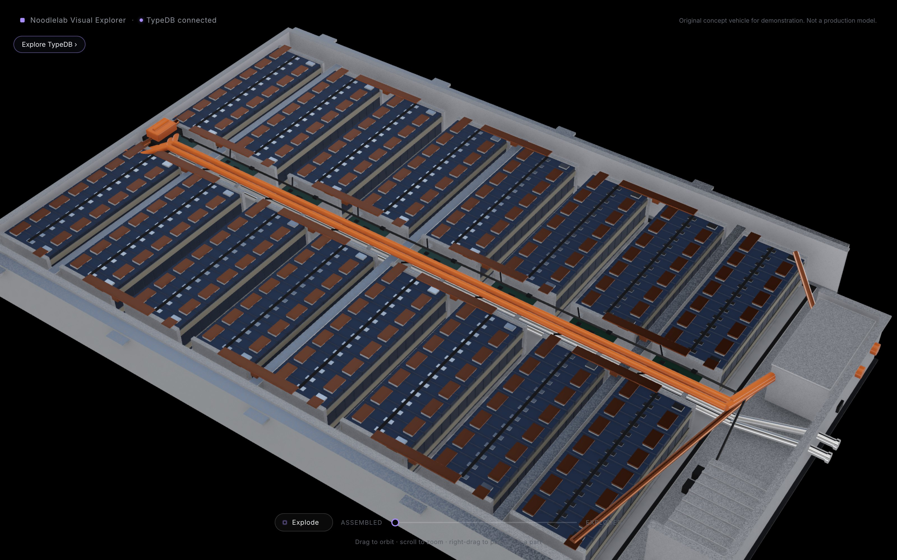
**Modules and a monitor:** 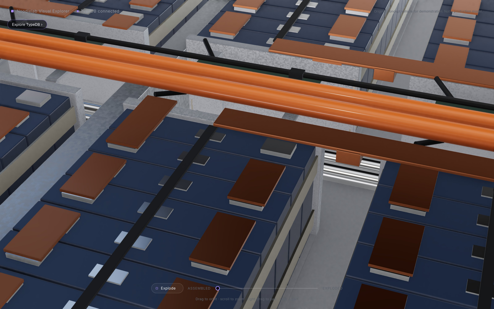
**Front bay, junction box housing hidden:** contactors, pre-charge, fuse, shunt, coolant ports, cable outlets.
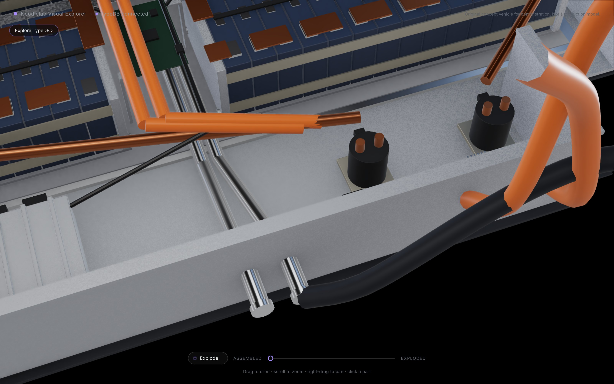
**Exploded** (lid up, protection plate down, modules lifted into a grid, monitors and chain above, junction box
opened into its parts): 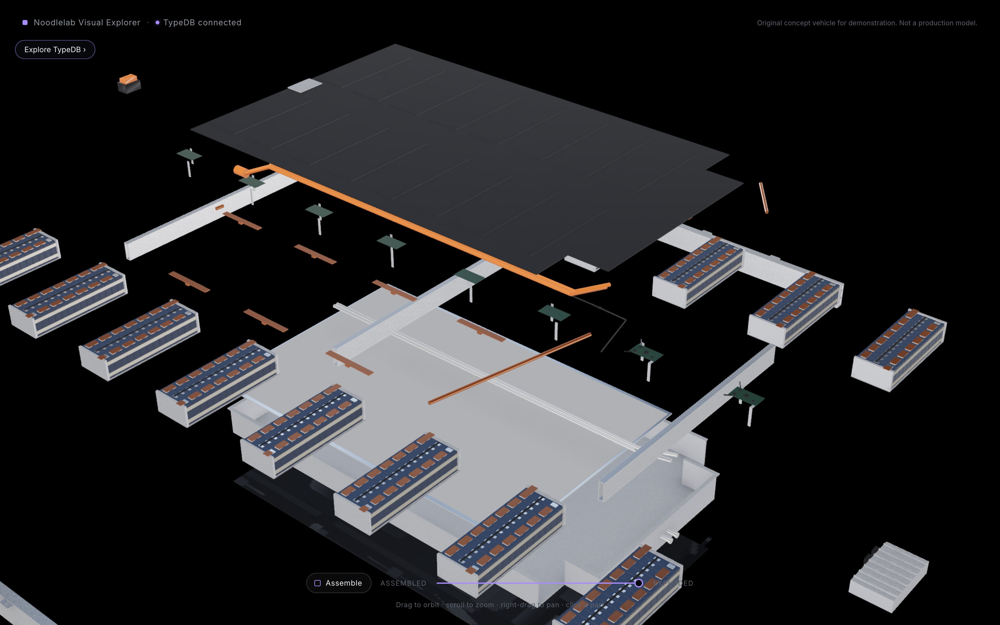
**In place**, with the drive units and cables: 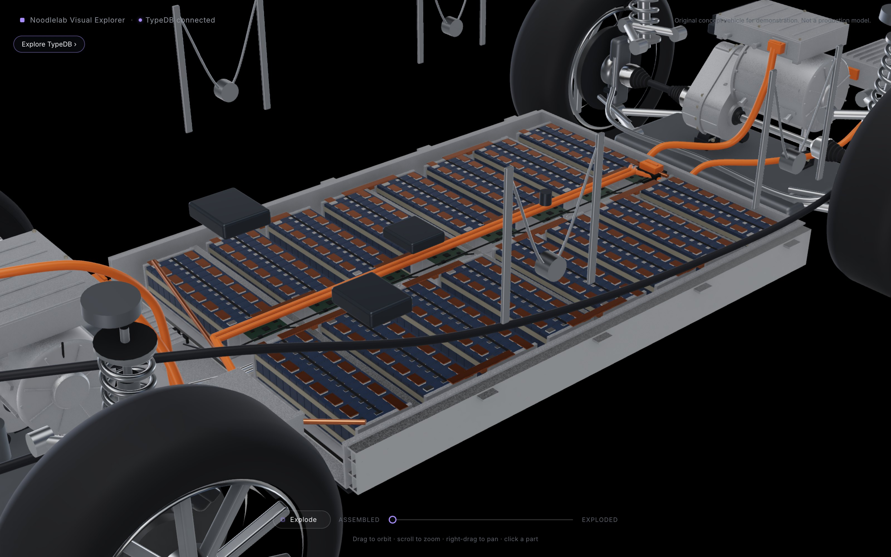
**Front compartment:** 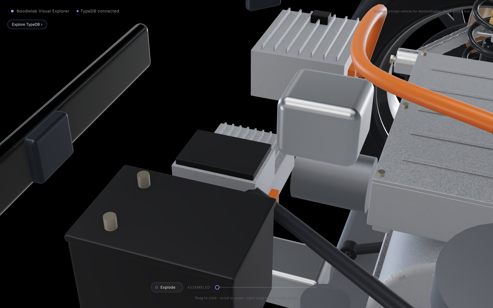
**Charging at the rear:** 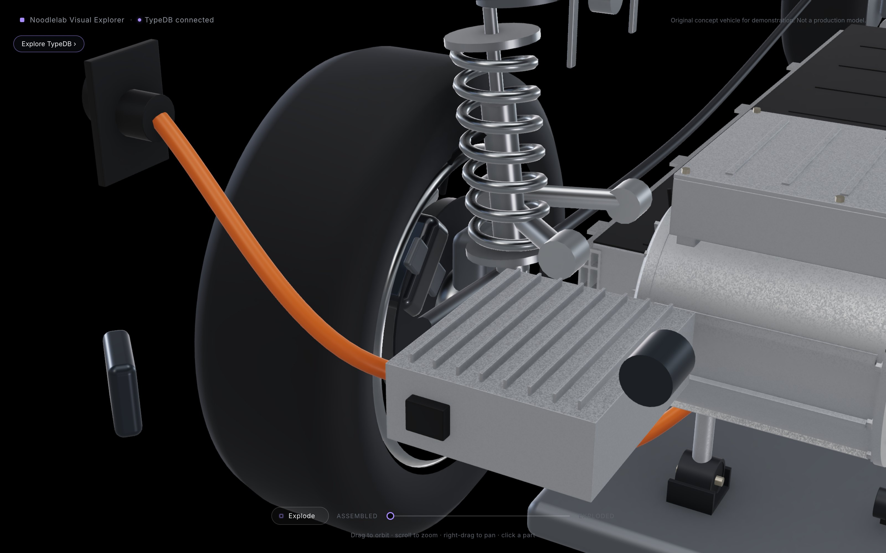

**Packaging.** The clash check (`web/src/scene/packaging.test.ts`) now covers the pack and the power
electronics too. It found six problems, all fixed:
- My first DC-charging route (inside the pack) crossed the side rail and a crossmember. The cable now joins
  the pack at a dedicated rear outlet, as real packs do.
- The side rails touched the rear wheel-arch liners: shortened by 2.5 cm.
- The 12 V battery and the PDU overlapped the front chassis rails. This was already true of their simple
  shapes since Phase A; both moved inboard.

The only remaining clashes are the two on the body-structure backlog (B1, the sills): the check reports them on
every run and fails if they change, rather than skipping them.

## 3. TypeDB

**New types.**
- `cell-monitor`: a kind of sensor.
- `contactor`: an actuator in control loops.
- `fuse`.
- A sub-assembly `battery-junction-box`.

**22 new components:**
- protection plate
- 8 module monitors and their chain
- vent valve
- service disconnect
- internal rear feed
- 2 main contactors, pre-charge, pack fuse, pack current sensor
- 12 V fuse box
- auxiliary HV cable, DC charging cable, charge port

All existing ids are kept.

**Behaviour, written as expected outcomes before the data:**
- **The series string.** It runs through the service disconnect and the fuse to the contactors; the positive
  contactor closes through pre-charge.
- **Monitoring.** The BMS needs every module monitor and the chain; without cell data it opens the contactors.
  Without current measurement it only limits power.
- **Feeds.** The junction box feeds the front inverter directly, the rear inverter through the pack's internal
  feed, and the front PDU over the auxiliary cable.
- **DC charging.** It falls back to the on-board charger, and charging current passes the contactors.
- **12 V supply.** It goes through the fuse box. Losing the DC-DC converter only lets the 12 V battery run down.
- **Control loop.** New system **Battery management** (under Energy storage), with a four-role control loop:
  the BMS reads 8 monitors and the current sensor, and commands 2 contactors and the pre-charge.

| Count | C3a | C3b |
|---|---|---|
| Components | 360 | **382** |
| Assemblies | 29 | 30 |
| Systems | 33 | 34 |
| Connections | 448 | **497** |
| Dependencies (function to function) | 218 (230 with the open-differential change) | **279** |
| Vehicle functions | 55 (58) | 66 |
| Fallbacks | 6 | 7 |
| Control loops | 8 | 9 |
| Sensors (polymorphic "sensor") | 19 | 28 |

**Browsable in the existing interface:**
- **Systems › Battery management:** the loop, shared parts and all 14 parts highlighted.
  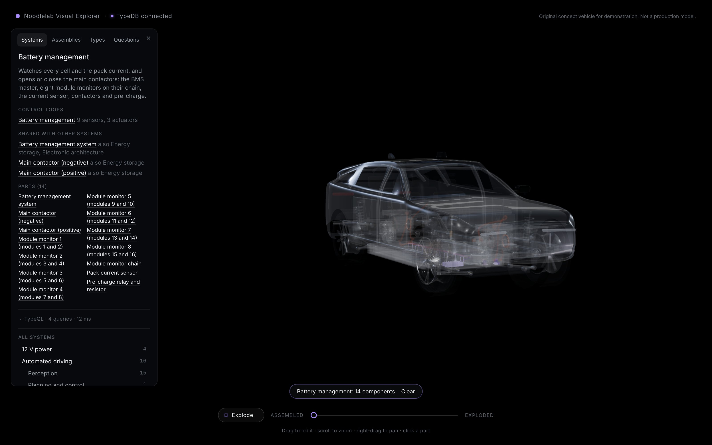
- **Assemblies › Battery junction box:** 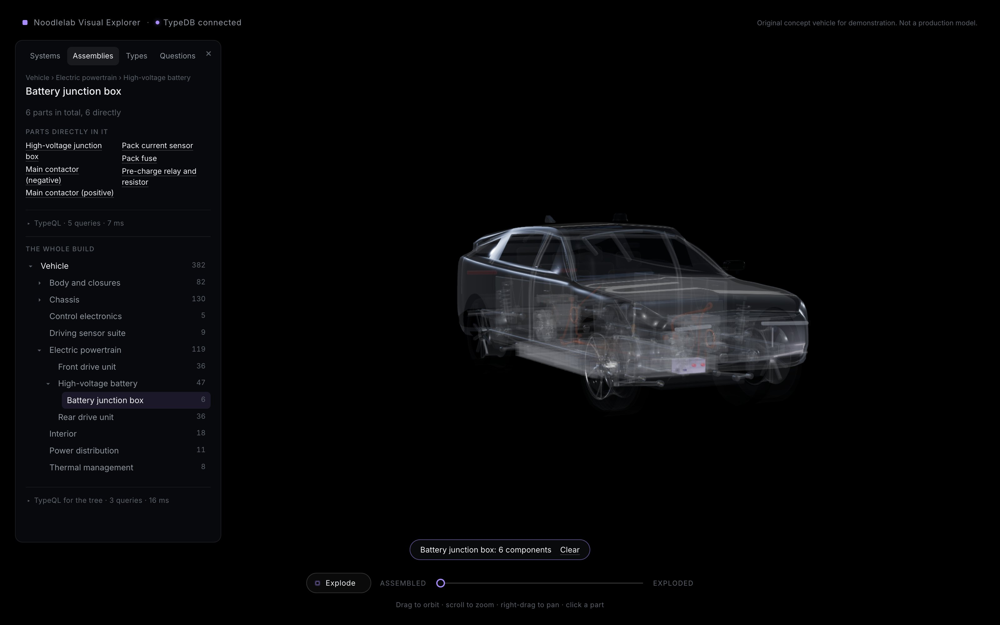
- **Types › Cell monitor:** 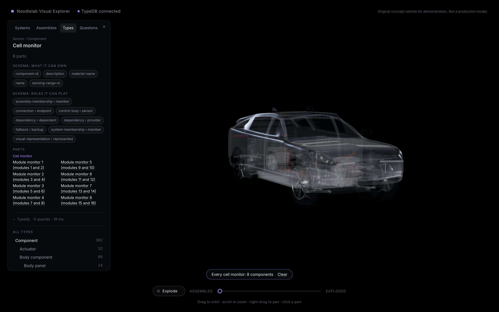
- **Questions › single failures:** 38 parts. 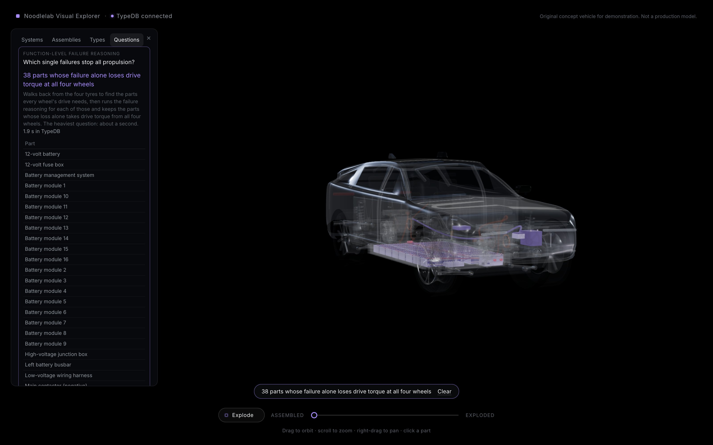
- **Failure of the pack fuse:** both axles have no drive, so the vehicle cannot drive.
  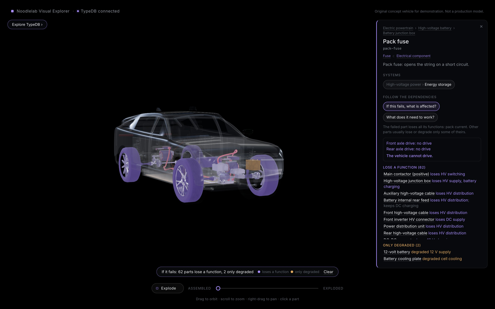

### TypeQL examples (live answers)

The battery-management loop with each sensor's most specific type (15 ms):
```
match $l isa control-loop, has name "Battery management",
  links (controller: $c, sensor: $s, actuator: $a); $s isa! $st; $a isa! $at;
fetch { "controller": $c.component-id, "sensor": $s.component-id, "sensor-type": $st, "actuator": $a.component-id };
```
→ the BMS reads 8 `cell-monitor`s and 1 `current-sensor`; actuators: both main contactors and the pre-charge
circuit (all `contactor`).

The pack's contents by type, recursively through the junction-box sub-assembly (4 ms):
`match $u isa assembly, has assembly-id "hv-battery"; let $c in assembly_components($u); $c isa! $t; reduce $n
= count groupby $t;` → 16 battery modules, 8 cell monitors, 6 structural members, 5 battery components, 3
contactors, 2 fuses, 2 wiring harnesses, 2 thermal components, 1 current sensor, 1 power electronics, 1
control unit.

Why a failed module opens the contactors (204 ms):
```
match $s isa component, has component-id "battery-module-7";
  let $p, $g, $c, $f in lost_steps($s); $c isa contactor;
fetch { "contactor": $c.component-id, "function": $f.function-name, "because": $p.component-id };
```
→ both contactors lose HV switching: through the string (pack fuse, service disconnect) *and* because the BMS
loses supervision (module 7's monitor is powered by module 7).

The fallback, read from the data (5 ms): the junction box's *battery charging* needs DC charging through the
rear feed, with the on-board charger as backup ("AC charging through the on-board charger, much slower").

Single failures that stop all propulsion: **38 parts** (24 at C2). New: 8 module monitors and their chain,
both contactors, pre-charge, pack fuse, service disconnect, 12 V fuse box. No longer: the PDU, because the
inverters are now fed straight from the junction box.

### Expected outcomes, as tested

| # | Failure | Result |
|---|---|---|
| 19 | Pack fuse | HV supply, both inverter feeds, PDU, charging and all drive lost; vehicle cannot drive |
| 20 | Module monitor 3 | BMS supervision lost, contactors open, all drive lost; its modules keep their cell power |
| 21 | Pack current sensor | Nothing lost; supervision, HV supply and all drive degraded; vehicle reduced |
| 22 | DC charging cable | Only charging degraded (on-board charger in use); drive unaffected |
| 22b | Charge port | DC and AC charging both lost: the charger cannot stand in when its own supply fails |
| 23 | Pre-charge | Contactors cannot close: vehicle cannot drive |
| 24 | Internal rear feed | Rear axle no drive, front normal; DC charging falls back to AC |
| 25 | 12 V fuse box | As the 12 V battery: vehicle cannot drive |
| 26 | DC-DC converter | Only the 12 V battery degraded |
| 27 | Auxiliary HV cable | PDU, DC-DC, compressor, charger lost; cooling and 12 V degraded; drive unaffected |

**What the tests caught**:
- **The reasoning (shared cause).** The charge port feeds both DC charging and its backup, the on-board
  charger. TypeDB's functions accepted the backup anyway and reported charging as degraded; the independent
  oracle said lost. The functions now reject a backup that directly depends on the failed part.
- **The data (scenario 19).** Charging did not pass the contactors and fuse; it now does.
- **My expectation (scenario 27).** I wrote "drive reduced" through lost battery chilling. The rule approved at
  C1 says degraded chilling does not reach the modules. I corrected the expectation, not the data, and the
  document says so.

As before, agreement with the Python oracle shows the rules are computed consistently, not that the
engineering assumptions are right. The new assumptions are listed in `docs/dependency-semantics.md`:
- one series string;
- loss of cell data opens the contactors;
- pre-charge is needed at every start;
- the oracle-checked limit of the shared-cause rule.

## 4. Performance

**The single-failures question.**

| | Time |
|---|---|
| C3a, before the fix | 5.1 s |
| The same old method on today's model | 11.2 s |
| After the fix, at C3b | 2.1–2.4 s |

The cause, measured piece by piece: each call of the failure reasoning has a fixed cost, mostly independent of
how far the failure reaches. The old query paid it for every part.
- The fix asks TypeDB first which parts every wheel's drive depends on (48 candidates), then reasons only
  from those.
- It is still 2 s because there are now 38 real single points and the fixed cost per call has risen to 36 ms.
- Half of that 36 ms comes from today's shared-cause check.
- A tested restructuring removes the fixed cost for small failures, but is about 4x slower for large ones.
- Options are in `docs/optimisation-backlog.md`. Recommended next: hoist the shared-cause check out of the
  recursion.

No second database or frontend index was introduced.

**Failure answers for one part:** 0.8–1.1 s (0.4 s at C3a). Same cause, plus longer chains.

**Rendering** (Chrome, 1600 x 1000 at 2x; GPU per frame, median):

| Tier | C3a | C3b |
|---|---|---|
| High | 16.4–20.4 ms | 16.3–21.8 ms, 60 fps median |
| Medium | 12.0–15.8 ms | 12.6–18.9 ms, 60 fps |

A first run taken straight after other GPU work measured up to 31 ms, a reminder that these numbers vary
between runs. The pack adds 166 draw calls and 66,000 triangles (651 calls and 674,000 triangles in all).

**Model files and loading:**

| File | Full | Light copy |
|---|---|---|
| Battery pack | 235 KB | 131 KB |
| Power electronics | 60 KB | 34 KB |

The 16 modules share one mesh. All 150 modelled parts (5.9 MB) download and decode in 0.28–0.29 s from the
local server.

## 5. Tests

| Suite | Result |
|---|---|
| API and TypeDB | **78 passed** (64 at C3a): open-differential scenarios 14, 17, 18 and propulsion levels; battery scenarios 19-27 and 22b; the oracle over all 382 parts |
| Web unit tests | **42 passed** (36 at C3a): both new model files; packaging over drive units, pack and power electronics, with backlog clashes reported |
| Web against the live API | **7 passed**, now checking all five model files against TypeDB |
| Type check and production build | pass |

## 6. Limitations and backlog

- **Single-failure question and impact answers:** slower as the model grows (section 4; proposal in the backlog).
- **Shared causes deeper than one step** are not recognised by the fallback rule. The oracle confirms none
  exists in this data.
- **B1, the sills:** they still run into the wheel arches. This is tracked, not hidden.
- **Geometry is representative:** one cooling plate, no pyrotechnic fuse or isolation monitor, procedural
  cable shapes. The charge port sits behind the quarter panel without a cut door opening.
- **Rate effects are not modelled:** for example, a pack warming slowly without chilling.

## Commits in C3b

| Commit | Step |
|---|---|
| `3cc9697` | docs(semantics): open-differential failure model and expected outcomes |
| `229da68` | feat(typedb): open differential needs both sides; propulsion per axle |
| `5d2c3e3` | feat(web): axle and vehicle propulsion in the failure answer |
| `3ff1611` | test(impact): open-differential scenarios and propulsion levels |
| `aafb4e4` | docs: body-structure backlog (B1) |
| `c7ecdad` | test(packaging): report backlog clashes instead of skipping the sills |
| `fe77b54` | perf(questions): find single-failure candidates first |
| `2c69c07` | docs(backlog): single-failure query investigation |
| `0a6bf5e` | docs: C3b battery and HV architecture, expected outcomes and sources |
| `c8ee546` | feat(blender): model the battery pack and power electronics |
| `c46906f` | fix(blender): battery packaging corrections from the clash check |
| `5ee741f` | fix(typedb): a backup that shares the failed cause is no fallback |
| `7caf0ff` | feat(typedb): battery pack, HV distribution, charging and 12 V supply |
| `9925eb2` | test: battery failure scenarios, model files and packaging |
| (this report) | docs: C3b review |
