# C3c: mechanical completion (in progress)

Scope and order: `docs/c3c/audit.md` (approved). This file collects the results step by step; the full review
package is added at the end of C3c.

## Step 1: all four wheel corners (30 October 2026)

- **What changed.** The front-left, rear-right and rear-left corners are now Blender models (`blender/corner.py`
  builds all four). They replace simple placeholder shapes; every id is unchanged.
- **Front-left:** the front-right corner mirrored. The tyre is turned round instead, so its sidewall marking
  reads correctly.
- **Rear corners:** the front corner flipped front to back. The calliper now sits ahead of the axle, and the
  steering arm becomes the arm for the **toe link** (an adjustable link without the tie rod's rubber gaiter).
  Each rear calliper carries a new **electric parking-brake actuator** (`epb-actuator-rl`, `-rr`): a motor and
  gear unit on its inboard half. Its parking semantics follow in step 4.
- **Fallback shapes** (`?corner=procedural`) were realigned to where the real parts are. The asset test now
  checks every part's stand-in within 15 cm.

**Simplifications.**
- The rear corners reuse the front's disc, calliper, knuckle and arm sizes. Real rear brakes are usually
  smaller, and a multi-link rear knuckle has a different shape. Concept simplification.
- The toe link uses the tie rod's geometry without its gaiter.

**Packaging.** All four corners are now checked against their neighbours, and models against each other.
That exposed clashes the front-right corner had always had but which were never checked:
- B1 (sills): extended to every corner.
- New body-structure items B2 (chassis rails through the suspension), B3 (cabin floor into the rear arches)
  and B4 (rear doors into the rear tyres): `docs/body-structure-backlog.md`.
- Two placeholder-suspension items, marked "C3c-2", are fixed in step 2 (anti-roll-bar ends inside the damper
  forks; the subframe box through the lower arms' bushes).
- The 12 V harness, which ran through the rear-left damper, drop link and tyre, has been rerouted inboard and
  over the drive shaft.

Every known group is listed in the test and printed on every run. Anything new fails the check, and so does a
group that disappears without the list being updated.

**Sizes.** Each corner model is 1.98 MB, with a 0.79 MB light copy. The four corners now total 11.1 MB of the
download. The corners share their geometry, so loading one model and mirroring it in the browser could save
about 8 MB. Recorded for the final optimisation phase.

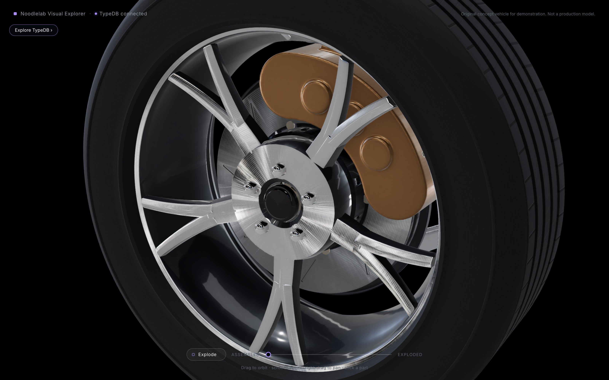
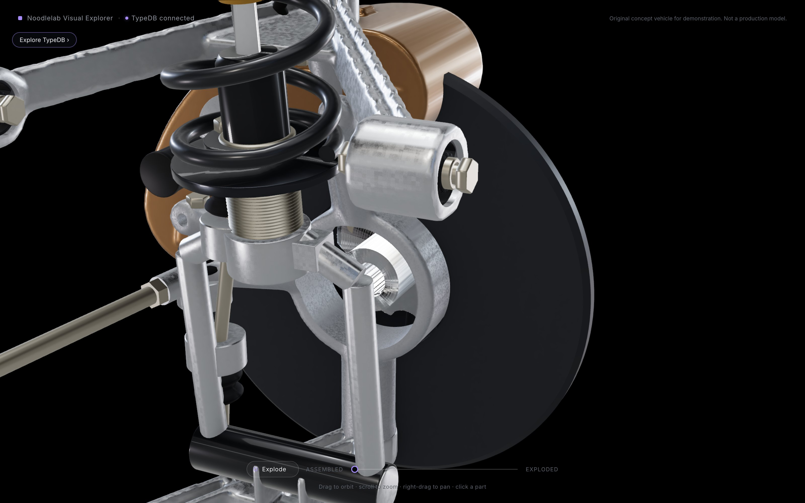

## Step 2: suspension (30 October 2026)

Expected outcomes were written first (`docs/dependency-semantics.md`, "Suspension: expected outcomes", commit
`8c572f8`); the TypeDB tests check against them.

### What changed

- **Subframes, mounts, anti-roll bars** (new `blender/chassis.py` → `chassis.glb`, 218 KB, 12 parts):
  - Front and rear cast subframes. They have clevises for the lower-arm bushes and, at the rear, for the toe
    links.
  - Each subframe sits on **four rubber body mounts**, eight new parts
    (`front-subframe-mount-1..4`, `rear-subframe-mount-1..4`). Each mount is a cast boss with a rubber
    isolator, a spacer to the rail, and a bolt with its washer.
  - Front and rear **anti-roll bars**, each with two rubber bushes and clamps. Their bent ends meet the drop
    links clear of the damper forks.
- **Corners** (`blender/corner.py`, all four rebuilt). The ride-height model had parts passing through each
  other; once checked at 1.5 mm, these were fixed:
  - **Upper arm against the rim:** the ball joints moved and the arm's pivots widened.
  - **Calliper against the upper arm and tie rod:** the calliper was trimmed and its outboard bleed nipple
    removed.
  - **Disc shield against the lower arm:** the shield is notched at the ball joints and the steering arm.
  - **Spring against the upper arm:** the spring is slimmer.
  - **Brake hose:** rerouted.
  - The tie rod's inner joint was re-optimised for low bump steer.
- **Rear axle checked on its own.** It has its own toe links on the rear subframe and its own drop links to
  the rear bar.
- **Elsewhere:**
  - The 12 V battery moved.
  - The front HV cable and the 12 V harness were rerouted around the new mounts and the inverter.
  - Stand-in shapes were realigned. Rack: y 0.40, 0.88 m long.
- **Counts:** 392 components (+8 mounts), 511 connections, 337 dependencies, 78 vehicle functions.
- **New connections:**
  - every subframe mount ↔ its subframe and its rail (or the cabin floor);
  - upper arm ↔ rail;
  - drop link ↔ damper.

### Suspension semantics in TypeDB

The new functions are data in `data/seed/dependencies.yaml`, read by the existing reasoning; nothing in
`schema/functions.tql` changed.

| Function | Provided by | If lost |
|---|---|---|
| subframe location | each of the four mounts | **degraded** (the other three still hold it) |
| knuckle location | the subframe, for each lower arm | lost |
| wheel location | lower arm, upper arm | lost |
| wheel alignment | tie rod (front), toe link (rear, itself located by the rear subframe) | lost |
| load support | spring, via its top mount | **degraded** road holding: the corner rests on its bump stop |
| damping | damper, via its top mount | **degraded**: ride comfort and grip on rough roads |
| roll control | anti-roll bar, via both drop links | **degraded**: body roll and balance in corners |
| road holding (tyre) | knuckle (location, alignment), spring, damper, bar | lost or degraded, as above |

So the three levels the brief asked for come out of TypeDB:
- **Essential loss:** an arm, a tie rod or a toe link. The wheel loses road holding, and with it steering and
  braking at that wheel, through the existing dependencies.
- **Degraded handling:** a drop link, a bar or a subframe mount.
- **Ride comfort:** a damper or a spring degrades only. Nothing is lost.

New scenarios 28–35 (`api/tests/test_impact.py`, against a real TypeDB), with scenario 10 revised:

| # | Failure | Lost | Degraded | Must not appear |
|---|---|---|---|---|
| 28 | Front left lower arm | knuckle-fl wheel location; tyre-fl road holding | | other wheels; drive torque, braking, steering motion |
| 29 | Rear right spring | | tyre-rr road holding | anything lost |
| 30 | Front left damper | | tyre-fl road holding | anything lost |
| 31 | Rear left drop link | rear bar roll control | both rear tyres' road holding | front tyres |
| 32 | Front subframe mount 2 | | subframe location; both front arms, knuckles and tyres | anything lost; rear wheels |
| 33 | Front right tie rod | knuckle-fr alignment; tyre-fr road holding | | front left wheel |
| 34 | Rear right toe link | knuckle-rr alignment; tyre-rr road holding | | other wheels |
| 35 | Front left top mount | spring load support; damper damping | tyre-fl road holding | anything else lost |

### Kinematics and clearance through the envelope

`web/src/scene/kinematics.ts` solves each corner as a double wishbone with a tie rod (front) or toe link
(rear), using the models' own pickup points. `web/src/scene/travel.test.ts` places every moving part at each
pose:
- **Poses:** every corner at −80, 0 and +80 mm of wheel travel. The front corners also at −35°, 0° and +35° of
  steer in each position, which includes full lock at full bump and at full rebound. That is 24 poses.
- **What is checked:** the moving parts against everything around them, at 5 mm voxels. Any pair closer than
  about 5–9 mm is flagged.

| Front right | Camber | Toe | Rack |
|---|---|---|---|
| +80 mm (bump) | −1.7° | 0.13° out | |
| −80 mm (rebound) | −0.3° | 0.27° in | |
| ±35° at ride height | | | −70 / +85 mm |
| ±35° at +80 mm | | | −74 / +91 mm |

- **Steering axis:** about 9.3° of kingpin inclination and 4.3° of caster.
- **Bump steer:** no more than 0.27° through the full travel.
- **Steering range:** about −40° to +49° is reachable, so the ±35° target is met at every travel position.
- **Rear corners:** toe-in in bump, same magnitudes (see the simplifications below).
- **For step 3:** full lock needs up to 91 mm of rack travel per side. Typical racks give about ±75 mm.

**Result.**
- **Clean poses:** ride height straight ahead, and full bump straight ahead, at all four corners.
- **Open conflicts:** 43 pairs at 73 poses, all reported in `web/src/scene/travel-open.json`. The test fails if
  that list changes in either direction, so nothing is silently excluded.

| Where | Pairs per pose (both corners of the axle) | Typical pairs |
|---|---|---|
| Front, full rebound (−80 mm), any steer | 12–13 | drop link vs spring and tie rod; calliper vs tie rod; damper vs drive shaft |
| Front, full lock at ride height | 2–3 | tyre vs upper arm; drop link vs tie rod |
| Front, full lock at full bump | 9 | tyre vs upper arm and bar; drop link vs tyre, wheel and drive shaft; spring vs upper arm |
| Rear, full rebound only | 12 | tyre vs upper arm; calliper vs toe link; drop link vs spring and toe link |

**Root cause:** the upper arm sits inside the tyre's height. At lock the tyre swings into it, and at rebound
the knuckle drops the tie rod and drop link into the spring.

**Proposal (not done; needs your decision):**
- Move to a **high upper arm with a goose-neck knuckle**, so the upper joint sits above the tyre.
- Mount the drop link on the knuckle side of the damper.
- This changes the corner model and its kinematics, so I did not do it inside step 2.
- The alternative is a smaller envelope (for example ±30° or −60 mm), which you asked me not to adopt
  silently.

### Packaging and C3c-2

- **C3c-2 is resolved.** The group is gone from the packaging test.
  - The anti-roll-bar ends no longer sit inside the damper forks.
  - The real subframe takes the lower-arm bushes in its clevises, instead of a box through them.
- **Static check:** every model against its neighbours, at 6 mm. No unlisted clash. Known body-structure
  groups:
  - B1 sills: 36
  - B2 rails: 16
  - B3 cabin floor: 7
  - B4 rear doors: 4
  - B6 rear seat over the rear upper arms: 4 (new)
- **Body-structure clashes in motion:**
  - B1 157, B2 112, B3 22, B4 18
  - B5 arch liners: 18 (new)
  - B6: 12
  - B5 and B6 are new **tracked** body items in `docs/body-structure-backlog.md`, because the body is rebuilt
    in the next milestone. B1–B4 are kept and extended.
- **Designed contacts listed in the tests:** ball joints, bushes, the damper's eye, the drive shaft at the
  hub, lower arm and toe link to the subframe, drop link to bar, mount to rail.

### Simplifications (concept, documented)

- **Rear geometry:** the rear pickups are the front's, flipped front to back, with a toe link instead of a tie
  rod. Real rear multi-links differ. The rear poses are still solved and checked on their own.
- **No compliance:** no bush compliance and no tyre deflection. The spring is stretched along its axis, and the
  damper turns rigidly about its top mount.
- **Drive shaft:** it turns as a whole about its inner joint. Its pairs with its own drive unit are therefore
  listed as contacts here, and checked statically instead.
- **Brake hose:** left out of the motion check, because it is designed to bend.

### Performance and size

- **Benchmark (`__perf`, high tier, standard view):**
  - Assembled: 1.28 M triangles, 799 draw calls, 2.6 ms median frame.
  - Exploded: 0.81 M triangles, 781 calls, 9.1 ms.
  - At C3b: 674,000 triangles and 651 calls. Most of the increase is the
    detailed corners (three new ones in step 1); step 2 adds the 12 chassis parts.
- **Frame time (`perf.py`):**
  - High tier: GPU 15.8–21.9 ms, at a steady 60 fps except the explorer-open view (p90 33 ms).
  - Medium tier: 12.5–16.7 ms GPU, 60 fps.
- **Download and loading:**
  - 13.9 MB of models in all; the chassis adds 218 KB (103 KB light copy).
  - The 18 models load in 0.42 s from the local server.
  - The corner-sharing optimisation (~8 MB) stays in the backlog.

### Tests

- **Web:** 52 passed, 7 skipped (live-only). Includes the travel check (about 10 minutes) and static packaging.
- **API and TypeDB:** 86 passed.
- **Web against live TypeDB:** 7 passed.

### Renders

- `scripts/browser/suspension.py` renders the views below in a separate headless Chrome.
- Wheels are hidden in the axle views.

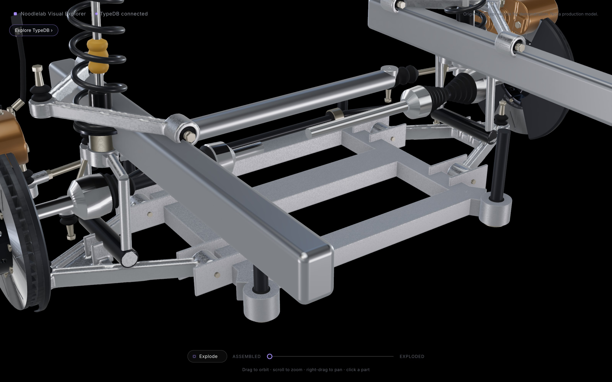
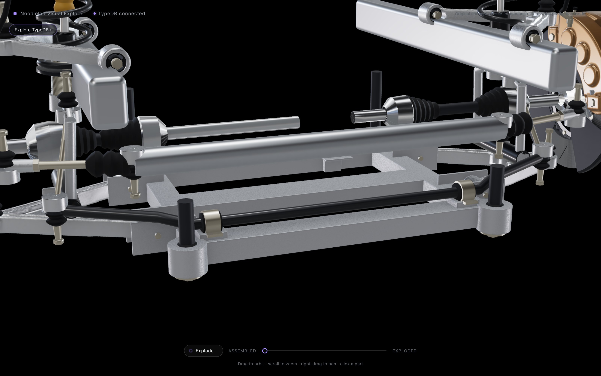
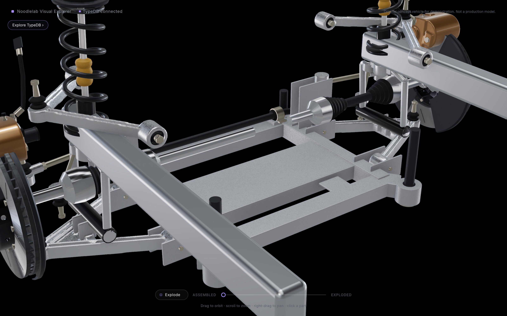
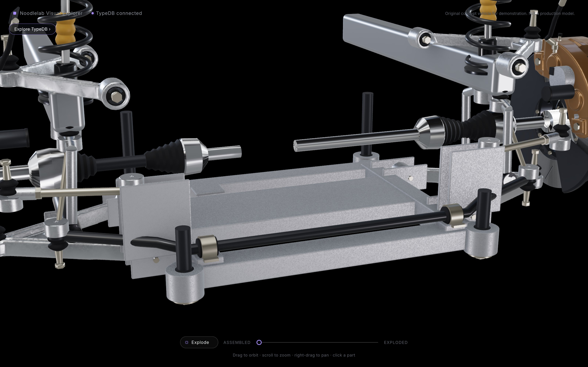
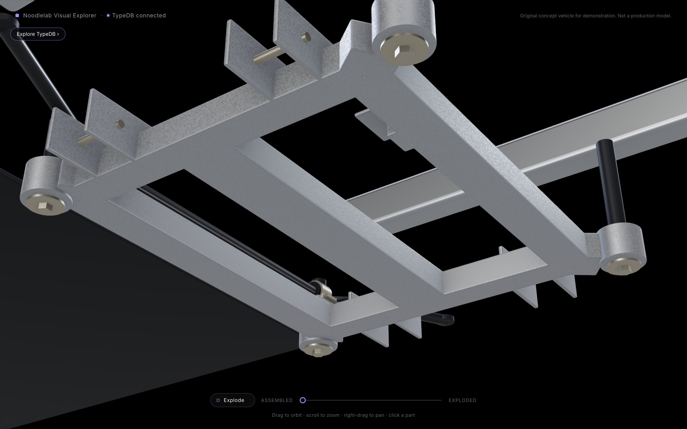
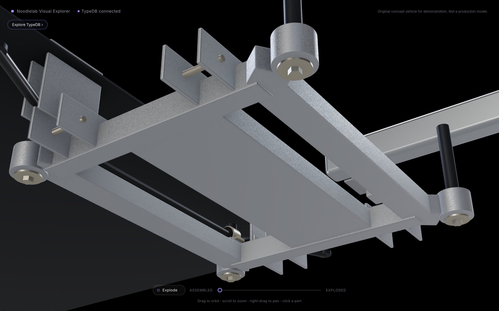
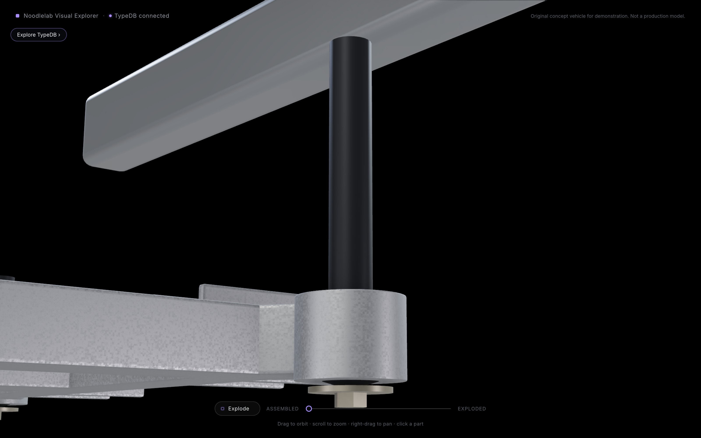
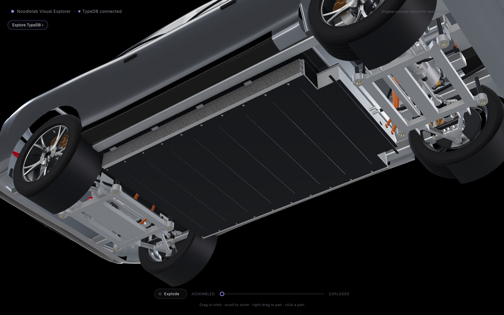

## Step 2b: suspension geometry correction (31 October 2026)

Step 2 left 43 clearance conflicts at full rebound and full lock. Step 2b reworked the suspension architecture
to remove them without relaxing the targets: ±80 mm of travel, and ±35° for each front wheel. The full write-up,
written before the corners were rebuilt, is
[suspension-architecture.md](suspension-architecture.md).

### What the 43 conflicts were

Every conflicting pose was re-measured as a true surface-to-surface distance:
- **65 real intersections** (under 1 mm);
- **8 near-clearance warnings** (1–5 mm).

They group into six causes:

| Cause | Poses |
|---|---|
| Upper arm inside the tyre's height | 30 |
| Drop link across the tie rod's / toe link's path | 24 |
| Steering arm and calliper on the same side | 10 |
| Anti-roll bar's ends in the tyre's sweep | 6 |
| Damper fork vs drive shaft | 2 |
| Tyre vs PDU | 1 |

### Selected architecture

**Front: high upper arm with a goose-neck knuckle.**
- **Knuckle and upper arm:** the knuckle reaches up past the tyre to a ball joint above it, and the upper arm
  works entirely above the tyre.
- **Calliper:** moved ahead of the axle, opposite the steering arm.
- **Anti-roll bar:** moved ahead of the axle, on the subframe's front cross member.
- **Drop links:** rise to brackets on the damper fork's front leg.

**Rear: double wishbone with a separate toe link, on its own hard points.** The front flipped is no longer
used.
- **Upper arm:** inside the wheel.
- **Toe link:** ahead of the axle.
- **Calliper:** behind the axle, with the parking-brake actuator.
- **Anti-roll bar:** behind the axle.

**One source of geometry.** The hard points live in `web/src/vehicle/suspension.json`, read by
`blender/corner.py`, `blender/chassis.py`, the manifest's fallback shapes and the motion solver. The models and
the checks can no longer disagree.

**Steering axis and rack.**
- Kingpin inclination 9.8°, caster 4.9°, scrub radius 50 mm, trail 20 mm.
- Bump steer at most 0.13° (front) and 0.15° (rear).
- **Rack travel: 81 mm each way**, not the 91 mm reported in step 2. That figure came from the step-2 steering
  arm and tie-rod layout, not from the requirement.

### Before and after

| | |
|---|---|
| Front corner from inboard: the knuckle's goose neck and the upper arm above the tyre | 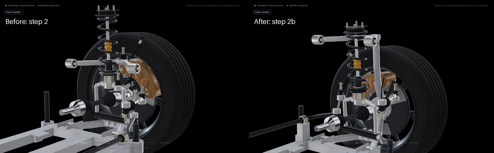 |
| Rear corner from inboard: own geometry, toe link ahead, calliper and parking brake behind | 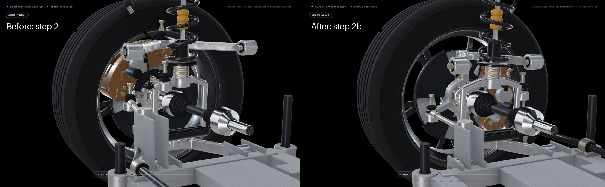 |
| Front axle (wheels hidden) | 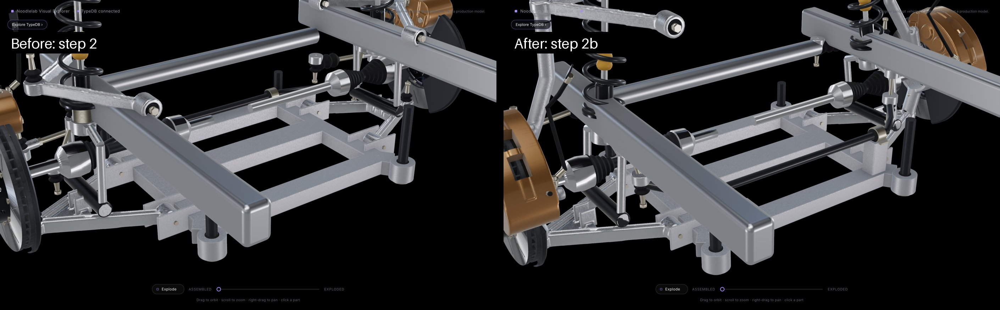 |
| Rear axle (wheels hidden) | 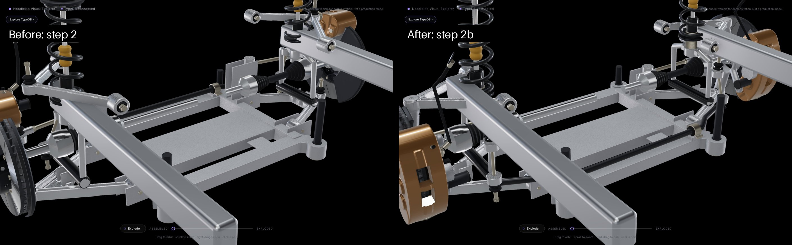 |
| Rear axle from ahead | 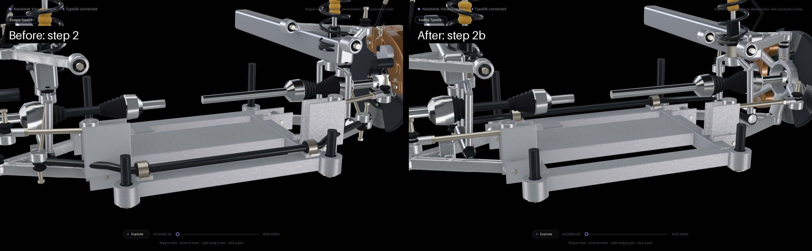 |

Also in `step2b/`:
- the subframes and their mounts from below;
- a mount close-up;
- the underside.

"Before" is the step-2 models in the same app and camera.

### Clearance across the operating envelope

**What the motion check (`web/src/scene/travel.test.ts`) covers:**
- **Travel:** every corner at nine positions from −80 to +80 mm.
- **Steering:** the front corners at eleven rack positions across the whole ±81 mm stroke at each travel
  position. That is 99 poses per front corner; the rear corners get 9 each.
- **Combined extremes and intermediate positions:** full lock at full bump and at full rebound are included, as
  are all the positions in between.
- **Left / right articulation:** each half of the anti-roll bar twists with its own drop link (between −21° and
  +25° at the rear). One wheel in bump with the other in rebound is therefore checked side by side.

**How it measures:**
- **True minimum distance:** between surfaces sampled every 2.5 mm, accurate to about 2 mm. Not a voxel overlap
  count.
- **Rule:** every pair must keep **10 mm**, except:
  - **designed contacts**, which are listed in `travel-setup.ts`: ball joints, bushes, the damper's eye, the drive
    shaft in the hub, the bar in its clamps, the links in their brackets;
  - **body-structure items B1–B5**, which are counted and printed.
- **Runtime:** about 3 minutes.

**Result: no pair under 10 mm.** All 43 step-2 conflicts are gone. `travel-open.json` is deleted, so no
exceptions remain. The closest pairs:

| Gap | Pair | Where |
|---|---|---|
| 11.3 mm | front upper arm / top mount | full bump, 38.6° |
| 11.4 mm | rear upper arm / drop link | full bump |
| 12.4 mm | front tyre / subframe (lower-arm bush bracket) | full rebound, 44.9° |
| 13.0 mm | front tie rod / drive shaft | full rebound, 44.9° |
| 13.1 mm | front upper arm / master cylinder | full rebound, 23° |
| 13.2 mm | front tyre / lower arm | full bump, 38.6° |
| 13.9 mm | rear tyre / rear seat back | full bump |

**Rear validation.** The rear corners are solved and checked on their own geometry:
- toe change ±0.15° over ±80 mm;
- camber 1.15° more negative at full bump;
- closest pair 11.4 mm (upper arm to drop link at full bump).

### Static packaging and the body backlog

**Static check:** every model against its neighbours at 6 mm. No unlisted clash.

**Body backlog B1–B6 kept:**
- **B2 rails:** now also crossed by the front tie rods (the rack sits at 0.505 m to clear the drive shafts). The
  rebuilt rails must pass above or inboard of the tie rods.
- **B5 arch liners:** the goose-neck knuckle's top reaches the placeholder liners, statically too.
- **B6 rear seat:** no longer occurs. The status is recorded in the backlog, with 13.9 mm measured to the seat
  back.

**Other parts moved to make room:**

| Part | Change |
|---|---|
| PDU (power distribution unit) | 30 mm inboard: it was within 2 mm of the tyre at full bump and lock |
| Front coolant line | rerouted under the rack's left end |
| 12 V harness | rerouted round the front upper arm's pivots, the inverter and the rear upper arm's pivots |
| Steering-column, EPS-motor and master-cylinder stand-ins | moved clear of the rack and the upper arm; steps 3 and 4 replace them |

### TypeDB

- **No new parts, connections or dependencies.**
- **Unchanged:** the drop link still joins the damper, and the upper arm still attaches to the body.
- **Counts unchanged:** 392 components, 511 connections, 337 dependencies, 78 vehicle functions.
- **Only change:** the front and rear knuckles now have separate descriptions. The front one mentions the goose
  neck, the rear one the parking brake.
- **Explosion grouping** is unchanged and re-checked against TypeDB.

### Simplifications (concept, documented)

- **Rear parts:** the rear uses the front's disc, calliper and arm sections.
- **No compliance:** no bush compliance and no tyre deflection.
- **Anti-roll bar:** each half turns rigidly; the bar's centre is not modelled as it twists.
- **Brake hose:** left out of the motion check, because it is designed to bend.
- **Drive shaft:** it turns as a whole about its inner joint.
- **Rear bump steer:** slightly toe-out in bump (0.15°). Toe-in would be preferred; this toe-link height cannot
  give it.
- **Scrub radius:** 50 mm is on the high side, because the large brake limits how far outboard the lower ball
  joint can go.

### Performance and size

| | Step 2b models | Step 2 models, measured today |
|---|---|---|
| Triangles (assembled) | 1.34 M | 1.28 M |
| Draw calls | 799 | 799 |
| GPU frame time, high tier | 19–24 ms | 19–24 ms |
| GPU frame time, medium tier | 15–23 ms | 16–21 ms |

- **No measurable cost:** both sets of models were measured back to back, and the new ones cost no frame time.
  Both are slower today than the step-2 report's figures, so the change is in the machine, not the models.
- **Download:**
  - corners 1.93–1.96 MB each (light copies 0.78 MB);
  - chassis 218 KB;
  - all models 14.3 MB, loaded in 0.44 s locally.

### Tests

- **Web:** 52 passed, 11 skipped (live-only and the on-demand analysis tools). That includes the new motion check
  and the static packaging check; the build passes.
- **API and TypeDB:** 86 passed.
- **Web against live TypeDB:** 7 passed.

**Analysis tools, run on demand** (`ANALYSE=1`):
- `layout.analysis.test.ts`: fast capsule layout study;
- `steering.analysis.test.ts`: steering, tie-rod and toe-link searches.

## Step 3: steering (31 October 2026)

Proportionate scope, following the owner's direction: credible, recognisable parts and a complete steering chain
in TypeDB. No further geometric optimisation.

**Model** (`blender/steering.py` → `steering.glb`, 8 parts):
- **Rack:** cast housing, rubber bellows to the tie rods, and the pinion housing on the driver's side.
- **Power-steering motor:** rack-parallel, with a belt cover to the ball-nut housing. The steering control module
  sits on its inner end.
- **Torque sensor:** on the pinion, with its harness to the module.
- **Rack mounts:** two, on the subframe's rear cross member. The left one sits outboard of the front motor; the
  right one between the ball nut and the pinion.
- **Intermediate shaft:** two universal joints and a rubber seal at the bulkhead.
- **Column:** jacket, adjustment housing and bracket to the cross-car beam.
- **Steering wheel:** still a simple shape.

**TypeDB.**
- **Four new parts:**
  - `steering-intermediate-shaft`;
  - `steering-torque-sensor`, of a new type `torque-sensor` under `sensor`;
  - `steering-rack-mount-l` and `steering-rack-mount-r`.
- **New joint type:** `universal-joint`.
- **The chain is now complete:** steering wheel → column → intermediate shaft → rack → tie rods. Before, nothing
  depended on the steering wheel.
- **Control loop:** the power-steering loop gets its sensor. The module needs the torque sensor to assist, so a
  dead sensor switches assistance off but leaves steering.
- **Rack mounts:** each provides rack location. Losing one only degrades the steering, the same rule as the
  subframe's mounts.
- **Expected outcomes** were written first (scenarios 36–39 in `docs/dependency-semantics.md`), and the tests
  match them.
- **Counts:** 396 components, 517 connections, 345 dependencies, 80 vehicle functions.

**Packaging.**
- **Designed contacts listed:**
  - the rack mounts bolted to the subframe;
  - the intermediate shaft passing through the bulkhead in its seal.
- **Moved to clear the new parts:** the rack mounts (clear of the front motor and the subframe's rear-left mount)
  and the coolant line (behind the left mount).
- **Motion check:** unchanged, closest pair 11.3 mm. The tie rods' travel stays clear of the new parts.

**Simplifications.**
- The rack's internal bar and its movement are not drawn: the housing stays still while the tie rods move.
- The column adjustment is a simple housing.
- The steering wheel stays the app's simple shape.

**Tests:** web 55 passed (11 skipped), API and TypeDB 91 passed, web against live TypeDB 7 passed.

**Size:** `steering.glb` is about 0.5 MB.

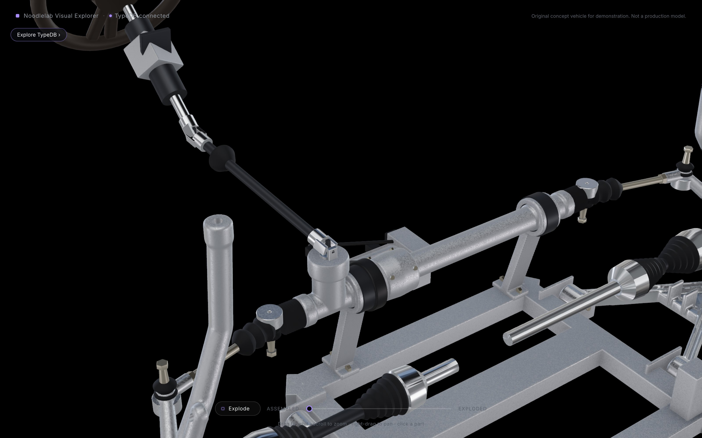
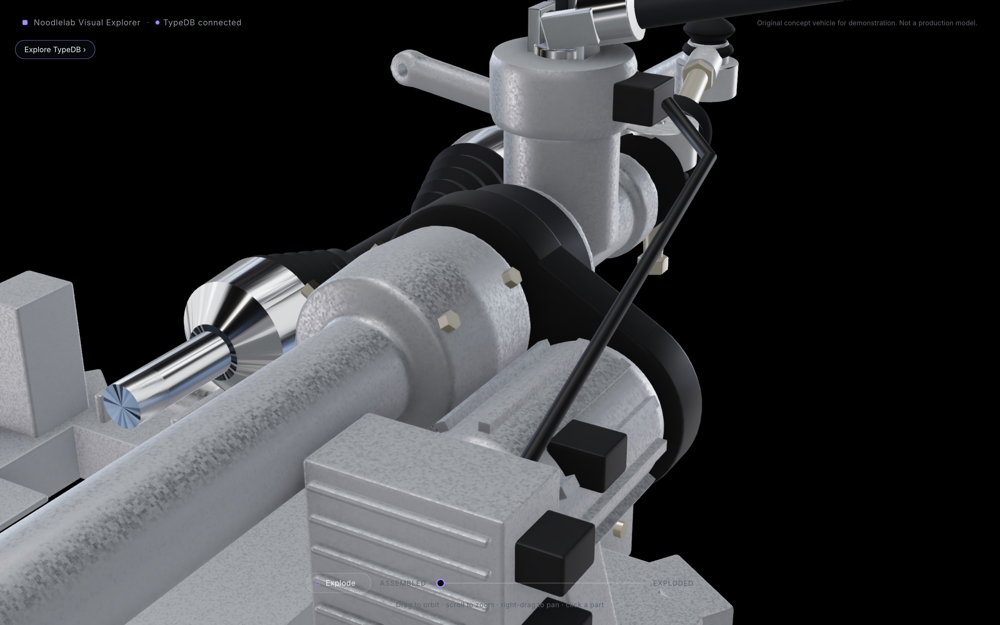

## Step 4: braking supply and parking (1 November 2026)

**Model** (`blender/brakes.py` → `brakes.glb`, 9 parts):
- **Pedal and booster:** the pedal box sits under the steering column, and its pushrod passes through the
  bulkhead to the ribbed electric booster.
- **Master cylinder:** with its fluid reservoir, and two circuit pipes over the upper arm's pivots to the ESC
  module.
- **ESC module:** a valve block with its pump motor and control unit.
- **Four rigid brake lines:**
  - front: over the power distribution unit;
  - rear: under the cabin floor between the battery pack and the sill, then up inside the rear wheelhouses.
- **Hose brackets:** moved 14 cm inboard, out of the front tyre's sweep at lock and bump.

**TypeDB.**
- **New parts:** the brake-fluid reservoir and four brake lines.
- **New system:** *Parking* (under Braking), with an *Electric parking brake* control loop. The ESC module drives
  the rear actuators.
- **Brake chain:** reservoir → master cylinder → ESC → line → hose → calliper. The ESC's fail-open fallback now
  sits on the lines.
- **Parking:** the park lock and the electric parking brake each back the other up for *vehicle holding* at the
  rear tyres. Neither can stand in for service braking, and a test checks that over every dependency and
  several failures.
- **Expected outcomes:** scenarios 40–44 and revised 8, 15 and 12 V, all written before the data.
- **Counts:** 401 components, 524 connections, 359 dependencies, 84 vehicle functions, 11 fallbacks.

**One reasoning change, found by the oracle test.**
- **The problem:** a 12 V failure takes out both parking mechanisms through different chains (VCU and ESC).
  TypeDB's fallback rule only noticed a backup failing when it depended *directly* on the failed part, so it
  still counted each mechanism as the other's backup.
- **The fix:** a new function, `hard_losses`, finds what a failure removes through dependencies that have no
  fallback. A backup no longer counts if it is among them.
- **Result:** the oracle now agrees for every one of the 401 components.
- **Cost:** the API suite takes about 140 s instead of 110 s. Query timing is re-measured in the performance step.

**Packaging.**
- **Designed contacts listed:**
  - lines into their hoses;
  - the booster bolted to the bulkhead;
  - the pedal pushrod through the bulkhead.
- **Moved:** the auxiliary HV harness, raised over the ESC module.
- **Body items:**
  - the rear lines graze the placeholder rear arch liners (B5);
  - inside the rear wheelhouses they meet the placeholder floor and rear seat, which reach into the arches
    (B3, B6).
- **Motion check:** passes. It caught the front lines and hose brackets in the tyre's sweep, and the rear lines
  too close to the front tyre at full lock; both were rerouted.

**Simplification:** lines are drawn as smooth tubes with a few clips, with no bends to exact production radii.

**Tests:** web 58 passed (11 skipped), API and TypeDB 101 passed, web against live TypeDB 7 passed.

**Size:** `brakes.glb` is about 0.3 MB.

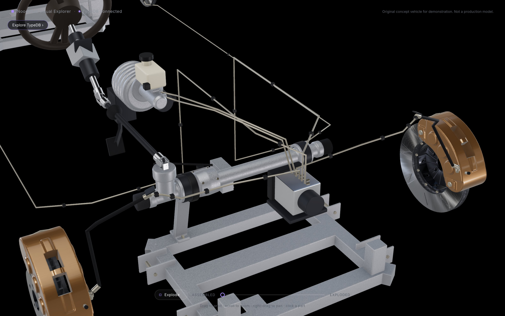
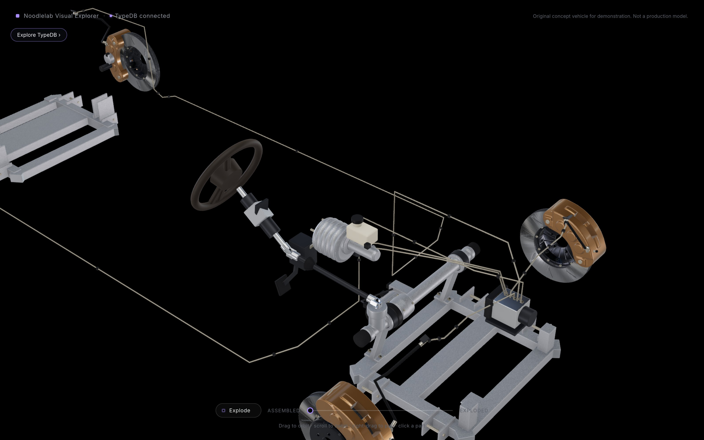

## Step 5: thermal circuits (1 November 2026)

**Model** (`blender/thermal.py` → `thermal.glb`, 13 parts):
- **Front cooling module:** condenser, radiator with end tanks, fan shroud and two fans. It is narrowed to fit
  between the front rails.
- **Coolant parts:** pump, expansion reservoir, thermal-mode valve and HV coolant heater.
- **Heat pump:** battery chiller and compressor.
- **Refrigerant lines:** round the front loop, and over the front drive unit and through the bulkhead to the cabin
  climate module.
- **Drive-unit coolant lines:** the front pair goes to the inverter and to the oil cooler from below. The rear
  pair runs under the battery pack to the rear drive unit.

**TypeDB.**
- **Seven new parts:** reservoir, valve, heater, condenser, refrigerant lines, front and rear coolant lines.
- **`coolant-lines`** keeps its id and is now the battery's circuit.
- **Radiator:** its heat rejection now matters. It feeds the valve's *coolant temperature*, which the battery
  manifold, both inverters and both oil coolers need.
- **Refrigerant:** the lines need the compressor and the condenser; the condenser needs the fans' airflow.
- **Heater:** serves the battery circuit and the cabin.
- **Expected outcomes:** scenarios 45–49 and revised 4. One rule changed while implementing: letting the chiller
  and heater degrade coolant temperature derated all four motors whenever the heat pump stopped (scenario 27).
  That was too strong, so it was dropped and the change is recorded in `docs/dependency-semantics.md`.
- **Counts:** 408 components, 534 connections, 376 dependencies, 89 vehicle functions.

**Packaging.**
- **Designed contacts listed:**
  - the radiator outlet in the battery line;
  - the refrigerant line through the bulkhead;
  - the coolant hoses on the inverter and oil-cooler ports. The rear cooler's ports pass through the gearbox wall.
- **Fixed:** the chiller moved clear of the DC-DC converter.
- **Motion check:** passes.

**Simplification:** one valve stands for the circuit's thermal modes, and the hoses are drawn as smooth tubes.

**Tests:** web 61 passed (11 skipped), API and TypeDB 106 passed, web against live TypeDB 7 passed.

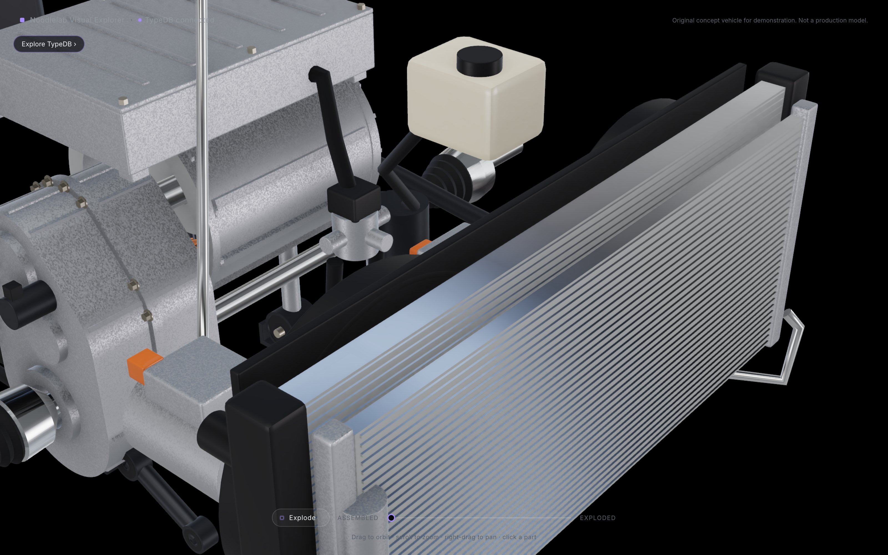
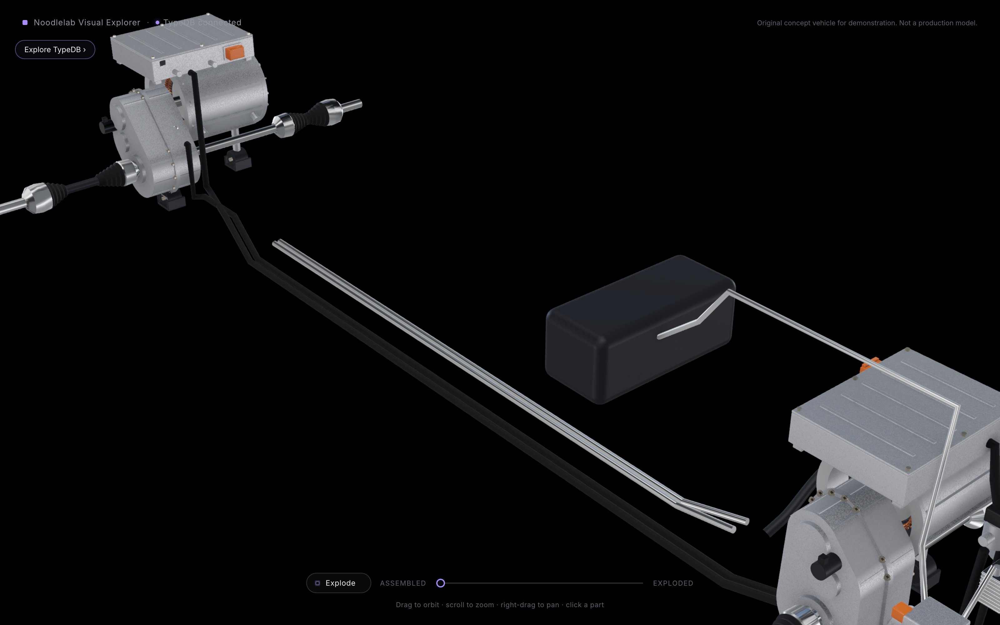

## Checkpoint: steps 3–5 (1 November 2026)

Steering, brake supply and thermal circuits are now Blender models joined into complete chains in TypeDB.

| | Step 2b | Now |
|---|---|---|
| Components / connections / dependencies / vehicle functions | 392 / 511 / 337 / 78 | **408 / 534 / 376 / 89** |
| Systems / control loops / fallbacks | 34 / 9 / 7 | **35 / 10 / 11** (new *Parking* system and parking-brake loop) |
| Blender-modelled models / download | 18 files / 14.3 MB | **24 files / 15.7 MB**, loaded in 0.44 s locally |
| Triangles / draw calls (assembled) | 1.34 M / 799 | **1.41 M / 855** |
| Impact query (typical / 12 V battery) | 0.8–1.1 s (C3b) | **1.0 s / 1.4 s**, with the deeper shared-cause rule |

**Frame time (high tier).**
- **Unchanged:** 60 fps median in every state, and the same GPU time as before (16–24 ms).
- **Open item:** CPU time per frame while a system is highlighted reads 16–19 ms, up from about 7 ms. Draw calls
  in that state are about 3,150. The CPU appears to be waiting on the GPU, which is over budget there, and the
  profiler charges the wait to WebGL calls. The ghosted, transparent parts are the cost.
- **Medium tier:** unaffected (7–8 ms).

Proposed for the C3c performance step: make ghosting cheaper, for example by merging ghosted meshes per material
or dropping their ambient-occlusion pass.

**Remaining C3c work (proportionate):**
- **Step 6:** a light interface check. Fluid and power connections between modelled parts should touch.
- **Step 7:** the ghosting cost above and the impact queries.
- **Step 8:** the body-interfaces document for the body rebuild.
- **Step 9:** the final review package.

## Step 6: connection check (1 November 2026)

**The check.**
- **What it compares:** every mechanical, power and fluid connection in TypeDB (451) against the drawn vehicle.
- **How:** it measures the gap between the two parts' surfaces in the assembled vehicle.
- **Tool:** `web/src/semantic/connections.analysis.test.ts`, run on demand with `TYPEDB_INTEGRATION=1 ANALYSE=1`.
- **Scope:** a light, review-by-eye check, not a geometric validation framework. Data connections are left out,
  since a signal needs no contact.

**Fixed, because they were visible or wrong:**

| Problem | Fix |
|---|---|
| The steering wheel floated 42 mm off the column | Column extended to the wheel's hub |
| The battery's coolant line ran from the radiator straight to the pack, never reaching the pump, valve or chiller it is connected to | It is now a modelled part with branches: radiator → pump → valve → chiller → pack |
| No hose between the coolant heater and the valve | Hose added |
| The motor bearings' connections were swapped relative to the drawing | Data corrected: bearing 1 sits in the end cover, bearing 2 in the gearbox casing |
| The drive-unit coolant lines were recorded as joining the pump | Corrected to the valve, where they leave |

**Remaining (102 of 451, more than 15 mm apart), by kind:**
- **12 V harness (24):** drawn as one representative cable. Its links to every 12 V unit are logical, not drawn
  one by one.
- **Power cables between modules (7):** OBC to PDU, OBC to charge port, PDU to heater, compressor and DC-DC,
  DC-DC to the 12 V battery, 12 V battery to the fuse box. These are not drawn and stay abstracted.
- **Body placeholders (30):** the body milestone's job, and listed in its requirements
  (`docs/c3c/body-interfaces.md`):
  - top mounts, upper-arm pivots and subframe mounts that should reach the body;
  - the pack's tabs to the sills;
  - glass and window regulators, mirrors, roof, bonnet and tailgate.
- **Inside housings (41):** not visible. Busbars, bearings, gate drivers, side gears, monitors, the drive shafts'
  splines in the hubs, and the coolant ports that pass through the gearbox and pack walls.

## Step 7: performance (1 November 2026)

**The highlighted-state slowdown.**
- **Cause, found from a CPU profile and a draw-call count:** the ambient-occlusion effect (N8AO) detects any
  transparent material. A semantic focus ghosts about 1,300 meshes, and N8AO then rendered every one of them in two
  extra passes per frame, walking the whole scene four times to switch visibility. That added about 1,450 draw
  calls.
- **Fix:** ambient occlusion now ignores transparent parts. `web/src/scene/Stage.tsx` turns N8AO's transparency
  detection off. A ghost at 11% opacity gains nothing visible from occlusion.

Measured in the same session (the machine was capping the browser at 30 fps throughout, so frame intervals are not
comparable; frame costs are):

| Braking highlighted | Before | After |
|---|---|---|
| Draw calls | 3,154 | **1,686** (the same as with no focus) |
| CPU per frame, high / medium tier | 8.3 / 9.3 ms | **4.6 / 4.9 ms** |
| GPU per frame, high / medium tier | 24.7 / 19.5 ms | **21.7 / 17.8 ms** |

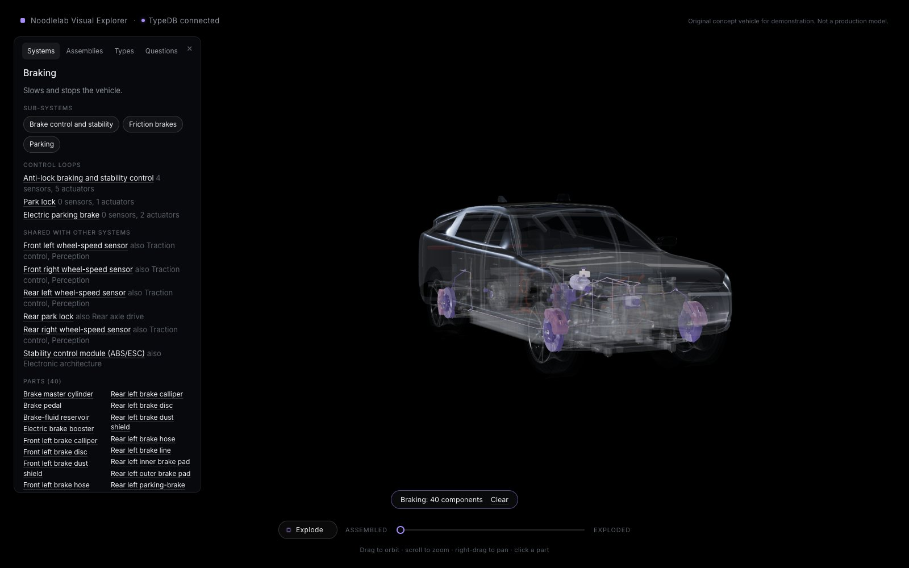

**Left for the final optimisation phase:**
- **GPU time, high tier with a focus:** still about 22 ms. The rest is transparency overdraw from ghosted parts,
  at 4× antialiasing. A cheaper ghost style (merged ghost meshes, or ghosts at lower resolution) is architectural
  work.
- **Shared geometry:** the four corner models still carry their own copies of the same geometry (about 8 MB, in the
  backlog since step 1).

**Impact queries:** about 1 s, accepted as they are. No query changes were made, so the reasoning semantics are
untouched.
