# D1.2 Body structure: review (1 November 2026)

**Status: for review. D1.3 not started; nothing merged.** Branch `feature/d1-body-exterior`.

**What D1.2 delivers:**
- **The body-in-white:** the welded and bolted load-carrying structure under the panels, modelled in Blender
  round the existing mechanical vehicle.
- **TypeDB:** the structure as components, connections and load paths.
- **Mechanical parts:** none moved. No Blender mechanical model, suspension hard point or component id changed.

**The provisional D1.1 exterior:**
- It is kept as a reference only. It is not the approved design and is not in the app yet.
- The structure has been checked to sit entirely inside it.
- The app still shows the milestone 2.1 exterior. The structure also sits inside that.

## 1. What was built

`blender/structure.py` builds the model `body-structure` (42 parts, about 20,500 triangles, 0.19 MB plus a 0.10 MB
light copy). Every part is named by its component id.

| Area | Parts | Notes |
|---|---|---|
| **Front** | front rails, front towers (new), front floor rails (new), front crash boxes (new), front crash beam, front-end carrier (new), bulkhead | The rails run from the crash boxes inboard of the steered tyres, over subframe mounts 1/2, and end in the cast towers ahead of the steering rack. The rack, tie rods and steering shaft occupy the space behind (R2). The towers carry the damper top mounts in a turret and the upper arms in two brackets each, and brace back to the cowl. The floor rails carry subframe mounts 3/4 under the toe board. The cooling module sits in its carrier behind the beam. The beam moved back from x 2.34 to 2.315 and is straight across the condenser. |
| **Middle** | sills, A/B/C/D pillars, roof rails, front and rear headers, two roof bows, cross-car beam | Sills from x −0.97 to 1.06, clear of both wheels (R1). Their inner faces meet the pack's mounting tabs. The A-pillar includes the hinge pillar. The pillars and roof follow the provisional D1.1 greenhouse, inside it. |
| **Floor** | cabin floor (with heel kick-up), floor crossmembers 1, 2 and 3 (new) | The floor sits on the pack and kicks up over the rear subframe (R3). Crossmember 3, under the kick-up, carries rear subframe mounts 1/2. |
| **Rear** | rear rails, rear towers (new), rear wheelhouse inners (new), rear floor (new), rear crash boxes (new), rear crash beam | The rails rise over the rear suspension between the drive unit and the springs, and come down to subframe mounts 3/4 under the on-board charger. The towers' turrets rise through the boot floor (which clears the rear inverter). The wheelhouse walls stand inboard of the tyres. The back panel ties the rails' ends together. |

Openings and grommets (R7): steering shaft, brake pushrod, refrigerant line and 12 V harness through the bulkhead,
and the 12 V harness through the boot floor.

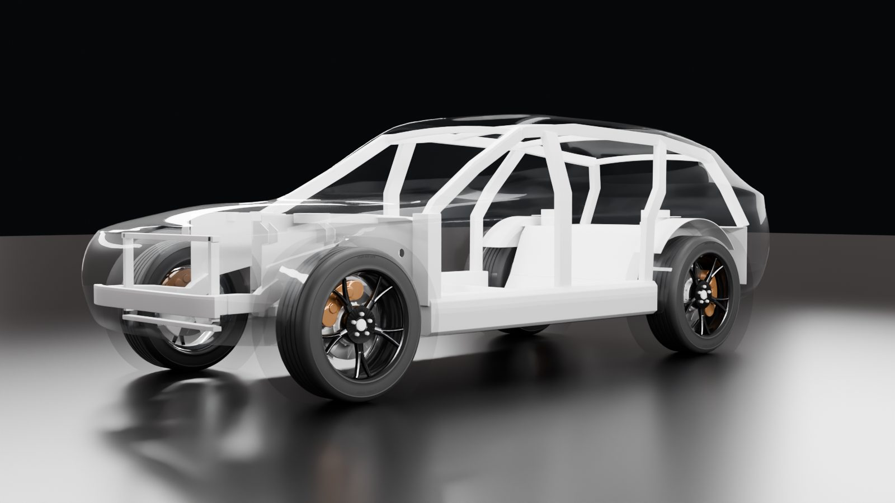
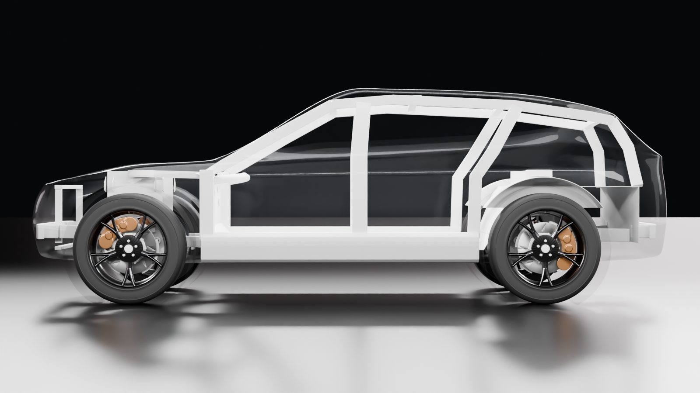
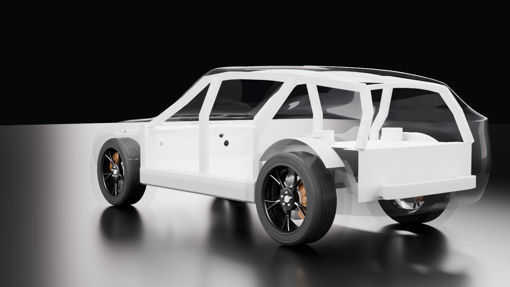

*Blender renders: the structure in grey, inside the D1.1 skin drawn almost transparent, on the real wheels.*

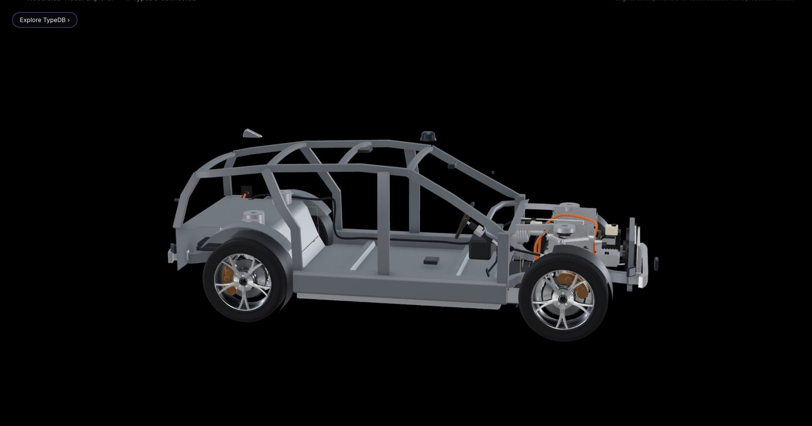
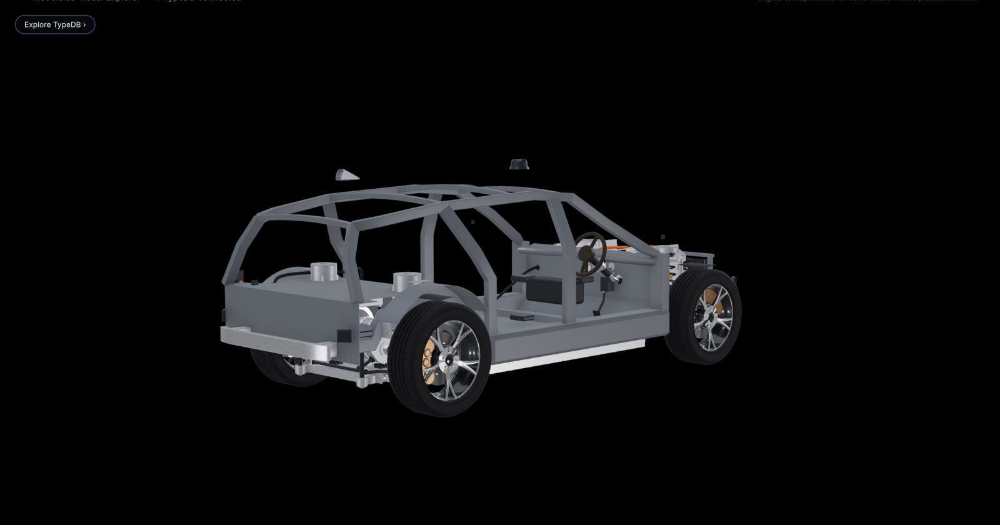
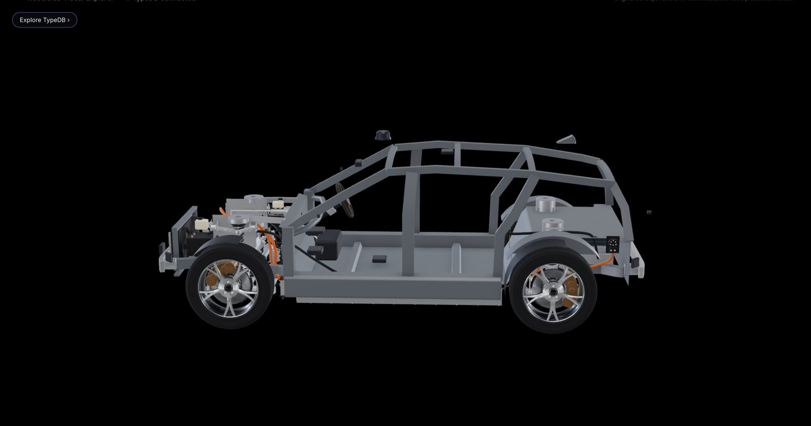
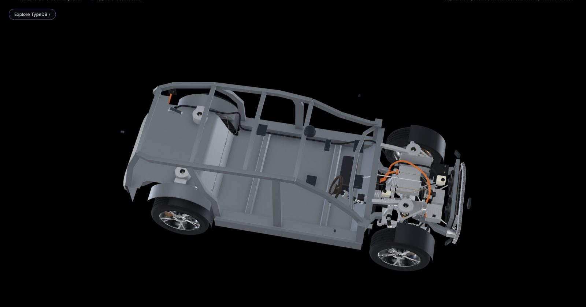

Close-ups in the app (body hidden): the right front tower, the right rear tower and wheelhouse, and the bulkhead
behind the brake booster.

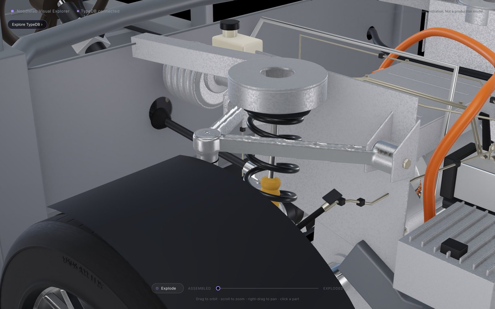 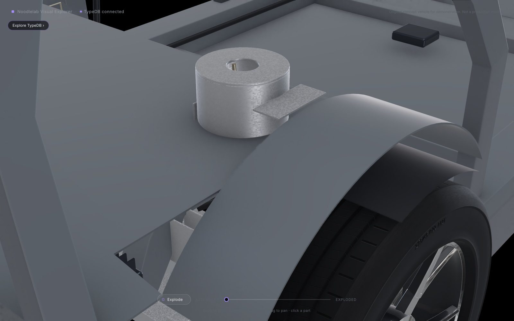 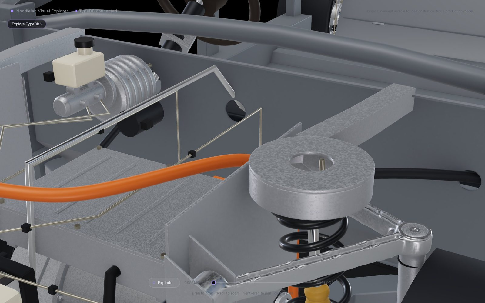

## 2. Keeping the exterior separate (modularity)

- **The structure is the fixed layer.** Each exterior panel is a separate skin over it with its own id.
  `structure.py` does not read the exterior: the pillar and roof positions are its own data.
- **Replacing a panel** means:
  - building a new skin;
  - checking it with `blender/structure_review.py`, which reports any structure poking through it and renders the
    ghost views;
  - mapping its nodes to the existing panel ids.

  The structure, its connections and the load paths stay as they are.
- **Load paths do not involve exterior panels.** Only the hinge and bond connections (doors, bonnet, windscreen,
  roof, tailgate) touch them, and those ids do not change.

## 3. TypeDB

| | Before D1.2 | After |
|---|---|---|
| Components | 408 | **423** (15 new structural members) |
| Connections | 534 | **606** |
| Dependencies | 376 | **396** (20 new, all physical "support") |
| Vehicle functions | 89 | **91** (*suspension mounting*, *structural support*) |
| Named questions | 8 | **9** |

**Connections now follow the real structure:**
- **Moved to the parts that now carry them:**
  - top mounts and upper arms: from the rails to the towers;
  - front subframe mounts 3/4: to the floor rails;
  - rear subframe mounts 1/2: to the rear seat crossmember;
  - crash beams: to their crash boxes.
- **New welded and bolted joints** trace the load paths. For example:
  - rail → tower → cowl;
  - sill → A/B/C pillar → roof rail;
  - floor → crossmember 3 → rear rail → rear tower → wheelhouse and boot floor → D-pillar.
- **New clipped connections** where lines pass through grommets: front brake lines in the towers, rear brake hoses
  in the wheelhouses, the 12 V harness in the bulkhead and boot floor.

**Load paths** (`docs/dependency-semantics.md`, "Body structure: load paths"):
- top mounts and upper arms need their tower's *suspension mounting*;
- each tower needs its rail's *structural support* (degraded only, because the tower is also tied to the cowl or
  the wheelhouse);
- each subframe mount needs the rail, floor rail or crossmember it is bolted to.

The expected outcomes were written before the data:

| # | Failure | Result |
|---|---|---|
| 50 | Right front tower | That corner's road holding **lost** (spring, damper and upper arm lose their mounting) |
| 51 | Right front rail | Subframe mount 2 lost; the front axle's road holding **degraded** |
| 52 | Left rear tower | That corner's road holding **lost** |
| 53 | Rear seat crossmember | Rear subframe mounts 1/2 lost; the rear axle **degraded** |
| 54 | Right front floor rail | Subframe mount 4 lost; the front axle **degraded** |

The independent oracle agrees with TypeDB for all 423 components.

**New question: "What carries the front-right wheel's load into the body?"**
- **How it works:** a recursive walk back from the tyre, keeping only the physical support steps.
- **The answer:**
  - 29 steps, in about 0.17 s;
  - from the tyre, through the knuckle, the arms, spring, damper and anti-roll bar, the top mount and tower, the
    subframe and its four mounts and the rack;
  - ending at the four front rails and floor rails.
- In the app, the path lights up on the vehicle.

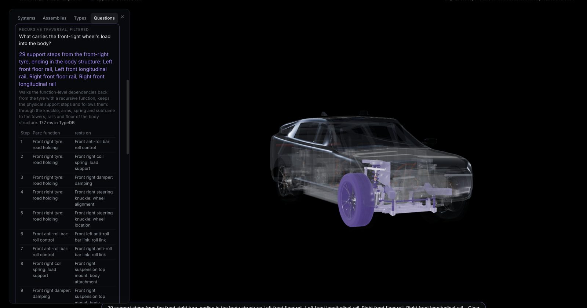

## 4. Packaging results

**Static packaging check:**
- **Resolved and removed:** body groups B1 (sills), B2 (rails through the suspension), B3 (floor in the rear arches)
  and B6 (rear seat over the suspension).
- **Still open:** B4 (4 pairs) and B5 (4 pairs).
- **New group B7 (22 pairs):** the placeholder doors and rear arch liners overlap the new sills, pillars and
  wheelhouses. They are rebuilt in D1.3. All are listed in `docs/body-structure-backlog.md`.

**Motion check** (every moving suspension and steering part, ±80 mm travel, full lock, 10 mm required):
- **Passes**, and now covers the whole new structure. The old exemptions for sills, rails and floor are gone.
- **Closest structure pairs:** see the final table in section 8.
- **Known placeholder records:** B4 54 and B5 411 pose records, the same as before.

**Fit inside the provisional exterior** (`structure_review.py`): nothing reaches outside, including at the wheel
openings.

**Connection check:** does each physical connection join parts that actually meet?
- **Result:** 92 of 523 have their parts more than 15 mm apart. At the end of C3c it was 102 of 451.
- **Every new structure joint meets.**
- **The rest:**
  - wiring abstractions (power connections drawn as one harness);
  - the old exterior panels' hinges and bonds (doors, windscreen, roof, bonnet, tailgate), for D1.3;
  - the pack bolted to the sills, which meets through its side rail (45 mm from the enclosure, as before).

**Designed contacts added to the checks:**
- subframe mounts on their body brackets;
- top mounts and upper arms in the towers;
- the radiator in its carrier;
- the steering column's bracket on the cross-car beam;
- lines and the 12 V harness through grommets.

**Routes changed to make room for the body** (simple shapes in the app, not mechanical models):
- **Front HV harness:** it ran over the front-left subframe mount, where the body bracket must go. It now rises
  inboard of the mount, between the battery coolant line and the auxiliary harness.
- **Charge harness:** moved off the rear-left subframe mount.
- **12 V harness:** now runs along the sill over the floor crossmembers, up in front of the rear wheelhouse and over
  the boot floor. It passes through grommets in the bulkhead and boot floor.
- **Rear seat (R6):** moved forward to x −0.80 and narrowed to 1.18 m, clear of the kick-up, the wheelhouses and
  the brake lines.

## 5. Requirements R1–R10

| Req. | Status |
|---|---|
| R1 Sills | **Done**: x −0.97 to 1.06; inner faces meet the pack's tabs; the brake lines run beside them |
| R2 Rails and towers | **Done**: front rails stop at the towers, ahead of the rack and tie rods; towers carry the top mounts and upper-arm pivots; floor rails and rear rails take the subframe mounts |
| R3 Floor kick-up and wheelhouses | **Done**: kick-up over the rear subframe; wheelhouse walls 15 mm inside the tyres' sweep; crossmember 3 carries rear mounts 1/2 |
| R4 Rear door shut line | **D1.3**: the C-pillar's foot is at x −0.935, ahead of the tyre, but the placeholder doors still reach the tyres (B4) |
| R5 Arch liners | **D1.3**: the rear wheelhouse inners are built; the liners are still placeholders (B5) |
| R6 Rear seat | **Position done** (D1.2); redrawing the seat is D1.5 |
| R7 Bulkhead openings | **Done**, plus a grommet for the 12 V harness |
| R8 Bonnet and front structure | **Front structure done**: cooling module in its carrier behind the beam; tower tops at y 0.98 under the provisional bonnet (about 1.03). Bonnet panel and air path: D1.3 and D1.4 |
| R9 Underbody channel | **Deferred to D1.3**: the coolant pair's cover belongs to the underbody panel, which is part of the exterior skin. Ground clearance is unchanged |
| R10 Sensor housings | D1.4 |

## 6. Performance

- **Benchmark (`__perf`, high tier):**
  - assembled: 1.43 M triangles, 858 draw calls, 3.3 ms median frame;
  - exploded: 0.91 M triangles, 840 calls, 14.2 ms;
  - 16.0 MB downloaded, loaded in 0.58 s.
- **Same-session comparison** with the structure shown, hidden, then shown again:
  - no measurable difference in CPU or GPU time per frame (GPU 52.5, 54.2 and 53.2 ms median);
  - the structure adds about 20,500 triangles and 42 draw calls.
- **Caveat:** the absolute GPU figures in this session are not comparable with C3c's. Other checks were running at
  the same time, and the GPU timer disagreed with the 60 fps frame rate.

## 7. Outstanding issues

1. **Exterior design.** The front and rear need substantially better surface design (your review of D1.1). Planned:
   revisit them at the start of D1.3, against this structure, before any lights, trim or sensors. The D1.1 skin is
   provisional.
2. **The app still shows the milestone 2.1 exterior.** The structure fits inside both it and the D1.1 skin. The new
   panels replace it in D1.3.
3. **Placeholder doors and arch liners** (B4, B5, B7): rebuilt as closures and liners in D1.3.
4. **Roof sensors.** With the body hidden, the lidar and shark fin float above the new roof frame: they sit on the
   old roof. Their housings come in D1.4 (R10).
5. **Exploded view.** The structure's parts fly out one by one. Clear layers (structure, closures, glazing, trim)
   are D1.5.
6. **Simplifications, stated honestly:**
   - **Front rails** end at the towers. A continuous rail would have to pass through the steering rack, tie rods
     and shaft. The front's lower load path is the floor rails, through the subframe.
   - **Crash load paths** are not modelled in TypeDB, by choice.
   - **Floor rail bracket.** The battery coolant line runs over the rear half of front subframe mount 3 (and the
     right-hand bracket is made to match), so each front floor rail's bracket sits on the front half of its mount.
     A cleaner fix is to reroute that coolant pipe in `blender/thermal.py`, a small mechanical change I did not make
     without asking.
   - **Rear legroom is tight.** The rear cushion starts about 15 cm behind the front seat backs, because the kick-up
     must clear the rear subframe. To revisit with the interior in D1.5.
7. **R9** (the underbody coolant channel) moves to D1.3 with the underbody panel.

## 8. Final motion clearances (closest structure pairs)

The closest structure pairs from the last motion run:

| Clearance | Pair | Pose |
|---|---|---|
| 11.3 mm | rear drop link to rear tower bracket | rear wheel at full bump (+80 mm) |
| 12.9 mm | rear damper to rear tower bracket | rear wheel at full bump |
| 13.5 mm | rear spring to rear tower | rear wheel at full bump |
| 14.2 mm | rear tyre to wheelhouse | rear wheel at full bump |

All are above the 10 mm required.
