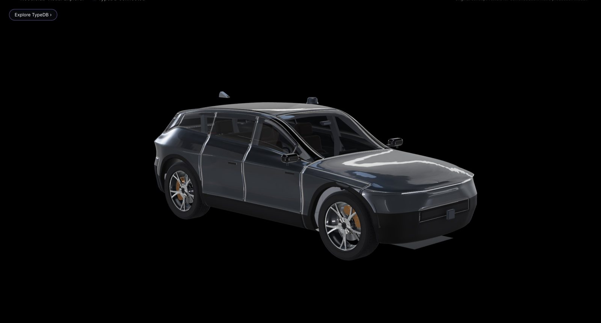
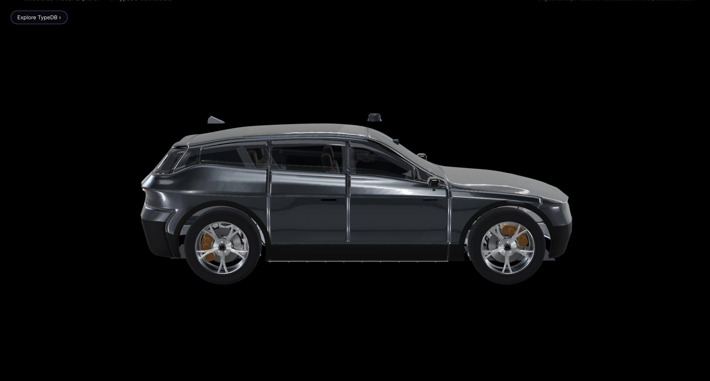
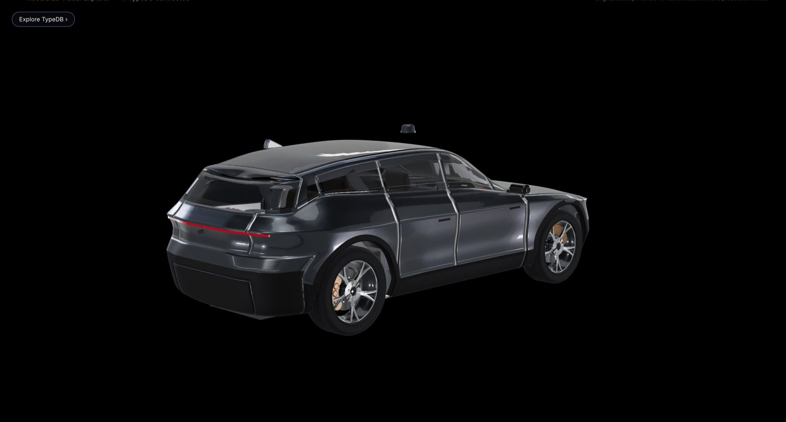
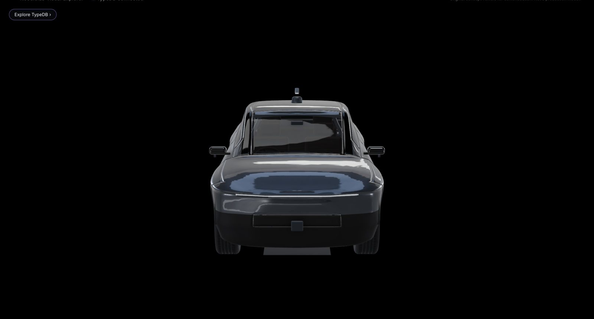
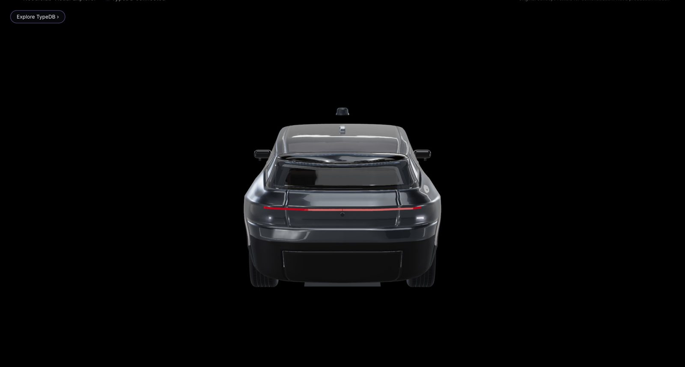
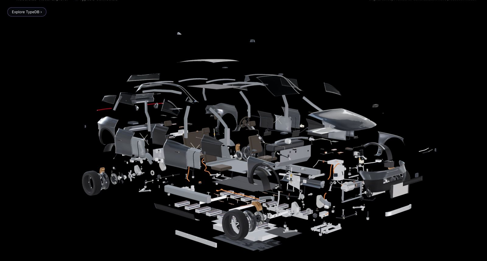
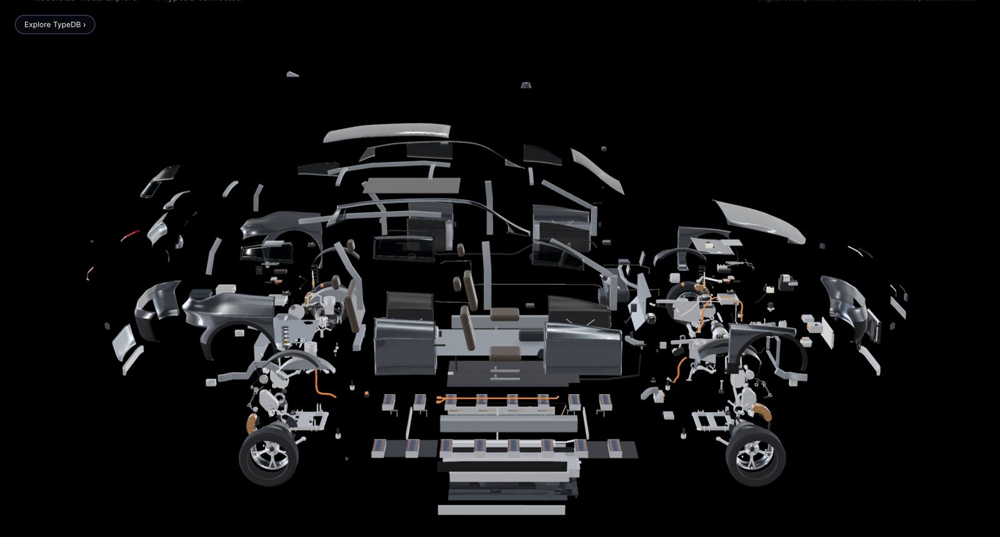
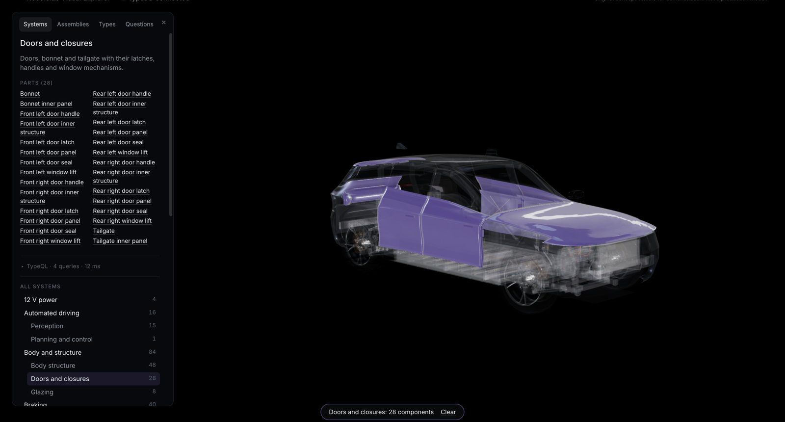
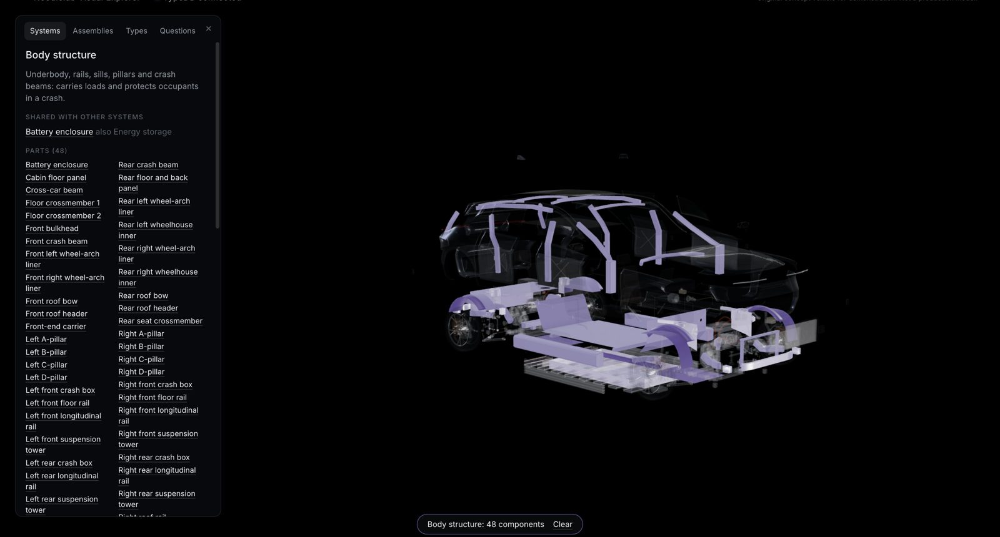
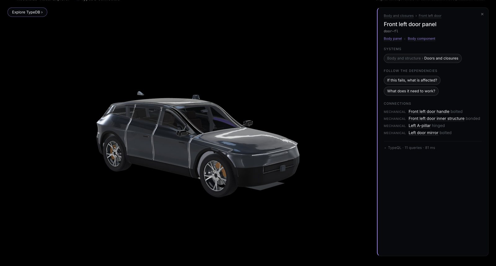

# D1.3 exterior redesign: visual checkpoint (1 November 2026)

**Status: for your approval of the main exterior shape.**
- Not started: the opening panels (doors, bonnet, tailgate), the arch liners, B4/B5/B7, R9 and TypeDB changes.
- Nothing is in the app yet, and nothing is merged.

Full-size D1.3 views: `d13-front34.jpg`, `d13-rear34.jpg`, `d13-front.jpg`, `d13-rear.jpg`, `d13-side.jpg`.

## How it is modelled now

`blender/exterior_d13.py`. D1.1's `blender/exterior.py` is kept unchanged so the two can be compared.

**Design lines, not a loose cage.** There are 14 design lines, for example:
- the rocker;
- the bumper lines;
- the concave lower door;
- the shoulder crease;
- the beltline;
- the window line;
- the roof.

Each line has a side-view height curve and a plan-view width curve. The curves are interpolated without overshoot,
so the control net, and the smooth surface over it, stays taut.

**Front and rear are shaped per line.** Each line has its own face position, corner radius and flat centre:
- **Front:** the bonnet edge stands out over a set-back upper fascia, the bumper stands forward, and the lip tucks
  under.
- **Rear:** the shoulder crease wraps the tail as a ledge, the tailgate tucks in below it, and the diffuser tucks
  under.

**Wheel arches** have controlled flares: front wings, and wider rear haunches.

**Unchanged from D1.1:** the same studio, cameras, wheel openings and lips, and the real wheel corners.

**Satin black.** The satin-black lower body (bumpers, sills, arch lips) is now properly matte. In D1.1 it reflected
the bright studio floor and looked grey.

**Placeholder light lines.** The same thin lines as in D1.1 mark the light positions. Lights themselves are D1.4.

## What changed, view by view

- **Front:**
  - lower and more purposeful;
  - a level, crisp bonnet edge;
  - a bonnet that drops to the nose;
  - a set-back fascia band;
  - a black lower bumper, so the painted face reads shorter.
- **Side:**
  - the concave lower door and the sill read clearly;
  - a continuous shoulder crease;
  - stronger rear haunches.
- **Rear:**
  - a defined tail ledge (where the light bar goes);
  - a lower, larger rear window;
  - the tailgate tucks in under the ledge;
  - a black lower bumper.

## Fit (proportionate check)

`uv run --project blender python -I blender/exterior_d13.py fit` reports:
- **Body structure:** nothing outside the new shell.
- **Mechanical assemblies:** nothing outside above the underbody. The wheels and drive shafts pass through the
  openings by design.
- **Changes to make it fit:**
  - The bumpers stay flat across the crash beams and boxes (to 0.56 m from the centre) before wrapping.
  - The bonnet sits about 15 mm over the front towers' front edge.

## Honest assessment

- **Clearly better than D1.1 from every angle,** especially at the front and in the side's sculpting.
- **Not yet at the concept image's level.** The upper fascia and tailgate are still plain surfaces. The character
  that the concept image gets from its light graphics, intake and corner details is not there yet.
- **Next refinements, for this phase or after your approval:**
  - The front corners' transition from the bumper to the wing.
  - A small kink where the bonnet's nose meets the fascia band in side view.

## Refinement pass after your review (1 November 2026)

- **Bonnet nose kink removed.**
  - The bonnet's lines now follow one smooth, steadily curving profile from the cowl round the nose. Before, they
    held a constant height round the corner while the centre kept falling.
  - The creases of the beltline and the window line stop at the front corners, so there's no ridge across the
    nose.
  - The bonnet edge overhangs the fascia by 2.5 cm (was 5.5 cm).
  - The bonnet still clears the front towers and the front-end carrier.
- **Front corners:** a defined vertical edge where the wing turns into the bumper.
- **Tailgate:**
  - a deeper ledge;
  - the face under it set back and wrapped further round the corners;
  - corner edges where the body sides turn into the tail.
- **Fit:** still nothing from the structure or the mechanical assemblies outside the shell. The comparison sheet
  and the D1.3 views above are updated.

---

# D1.3 complete: review (1 November 2026)

**Status: for review. D1.4 not started; nothing merged.**

## The vehicle in the app

 

**Exploded:**

**TypeDB highlighting:**
- the "Doors and closures" system (28 parts);
- the "Body structure" system, with the body ghosted;
- the front-left door selected, with its connections from TypeDB:
  - handle, bolted;
  - inner structure, bonded;
  - A-pillar, hinged;
  - mirror, bolted.

The Blender review renders of the final shell, against D1.1 at identical cameras, are in `compare-d11-d13.jpg`.

## What was built

`blender/exterior_panels.py` builds the model `body-exterior`: 68 parts, about 94,000 triangles, 0.69 MB plus a 0.32 MB
light copy.

**Panels cut from the one shell.** Each part keeps its existing component id:
- bonnet, front bumper, grille (lower intake), wings;
- front and rear doors, door glass;
- body sides (roof side rails and black A-pillars);
- quarter panels, quarter glass, sill trims;
- roof (body-colour skin and panoramic glass), windscreen;
- tailgate, rear window, rear bumper, diffuser.

**How the panels follow the surface:**
- Every control face of the shell is tagged with its panel, and the subdivision passes the tag on, so panels separate
  exactly along the shell's edge loops.
- The side stations sit on the shut lines: the door edges, the windscreen's base and top, the roof glass, the rear
  side window's tip.
- Shut lines are 3 mm.
- Painted panels have 2 mm thickness, satin-black edges and painted insides.
- The arch lips are part of the wings and quarter panels.

**Built from each panel's own surface:**
- the bonnet and tailgate inner panels;
- each door's:
  - inner structure;
  - trim;
  - seal;
  - flush handle;
  - latch;
  - speaker;
  - window regulator.

**Also:**
- **Arch liners:**
  - Front: a sheet following the front tyres' swept envelope plus 25 mm, with a raised inner crown over the
    goose-neck knuckle.
  - Rear: a crown inside the structure's wheelhouses.
- **Underbody (R9):** aero trays under both subframes, and the U-section channel covering the rear drive unit's coolant
  pair under the pack. Ground clearance is 0.14 m at the channel and the front tray.
- **Placeholder lamps:** on the new surface, until D1.4.
- **Moved to fit the new body:** the mirrors, the side cameras and the headliner.

**Materials:** graphite metallic paint, dark tinted glass, satin-black lower body and lamps (new studio materials).

**Fallback:** the browser-built body (`body.ts`) is kept as the fallback when the models are switched off.

## Packaging and fit

- **B4, B5 and B7 are resolved.** The static packaging check and the motion check now have no known groups. Every part
  is checked in full.
- **Static check:** no clashes. Newly registered designed contacts:
  - bumper fascias on the crash beams;
  - the body side's outer panel on the pillars and roof rails;
  - the rear liners in the wheelhouses;
  - the rear window against the D-pillars;
  - the tailgate at its hinge header;
  - the charge port in its flap.
- **Motion** (±80 mm travel, full lock, 10 mm required): passes. The closest exterior pair is the front liner and the
  upper arm, 15.7 mm at full bump and full lock.
- **Fit checks:**
  - nothing from the structure or the mechanical assemblies reaches outside the shell
    (`exterior_d13.py fit`);
  - no inner part reaches outside the skin (built into `exterior_panels.py`).

## TypeDB

**Unchanged:** the components (423) and every id.

**Connections: 669 (was 606).** The new ones say how each panel is held and how each closure is built:
- **Doors:**
  - the skin hemmed and bonded to the inner panel;
  - trim, seal, regulator, speaker and handle;
  - latches seated on strikers in the B- and C-pillars.
- **Bonnet and tailgate:**
  - skins bonded to their inner panels;
  - the bonnet latch on the front-end carrier;
  - the rear window on the tailgate;
  - the light bar on the tailgate.
- **Front end:**
  - bumper fascias on the crash beams;
  - the grille and diffuser clipped to the bumpers;
  - headlamps on the carrier;
  - wings on the hinge pillars.
- **Body side:**
  - the body side's outer panel welded to the A-pillar and roof rail;
  - quarters on the wheelhouses and C-pillars;
  - sill trims and liners clipped.
- **Underbody:** fixed to the pack and the subframes. This replaces "underbody welded to the sills".

**Not added:** no new components or dependencies. The panels carry no failure functions, by design.

## Performance

- **Benchmark (`__perf`, high tier):**
  - assembled: 1.43 M triangles, 887 draw calls, 2.6 ms median frame;
  - exploded: 0.92 M triangles, 869 calls, 10 ms;
  - 17.0 MB downloaded, loaded in 0.41 s.
- **Compared with D1.2:** 858 calls and 16.0 MB. The new exterior replaces the browser-built body, so the triangle
  count barely changes.

## Outstanding issues (for D1.4 and later)

1. **Lights, trim and sensors are D1.4:**
   - real headlamps and the light blade, and the tail-light bar;
   - the intake detail;
   - sensor housings (R10).
   The lidar and shark fin still sit where the old roof was. They now rest close to the new roof, but they're not yet
   integrated.
2. **Shut lines read as fine light lines** in the app's lighting rather than dark gaps. That's acceptable at normal
   viewing distance; could be tuned in D1.5.
3. **The exploded view** still sends every part out on its own. Clear layers (structure, closures, glazing, trim) are
   D1.5.
4. **The interior** is still the simple placeholder (seats, dashboard), as agreed. The headliner was moved under the new
   roof.
5. **Wheels:** the app's wheels are still bright machined alloy. The darker wheel finish in the Blender renders is D1.4.
