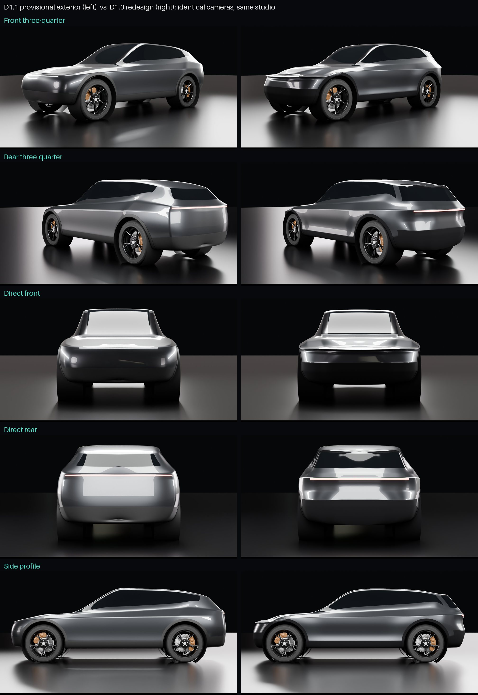

# D1.3 exterior redesign: visual checkpoint (1 November 2026)

**Status: for your approval of the main exterior shape.**
- Not started: the opening panels (doors, bonnet, tailgate), the arch liners, B4/B5/B7, R9 and TypeDB changes.
- Nothing is in the app yet, and nothing is merged.

Full-size D1.3 views: `d13-front34.jpg`, `d13-rear34.jpg`, `d13-front.jpg`, `d13-rear.jpg`, `d13-side.jpg`.

## How it is modelled now

`blender/exterior_d13.py`. D1.1's `blender/exterior.py` is kept unchanged so the two can be compared.

**Design lines, not a loose cage.** There are 14 design lines, for example:
- the rocker;
- the bumper lines;
- the concave lower door;
- the shoulder crease;
- the beltline;
- the window line;
- the roof.

Each line has a side-view height curve and a plan-view width curve. The curves are interpolated without overshoot,
so the control net, and the smooth surface over it, stays taut.

**Front and rear are shaped per line.** Each line has its own face position, corner radius and flat centre:
- **Front:** the bonnet edge stands out over a set-back upper fascia, the bumper stands forward, and the lip tucks
  under.
- **Rear:** the shoulder crease wraps the tail as a ledge, the tailgate tucks in below it, and the diffuser tucks
  under.

**Wheel arches** have controlled flares: front wings, and wider rear haunches.

**Unchanged from D1.1:** the same studio, cameras, wheel openings and lips, and the real wheel corners.

**Satin black.** The satin-black lower body (bumpers, sills, arch lips) is now properly matte. In D1.1 it reflected
the bright studio floor and looked grey.

**Placeholder light lines.** The same thin lines as in D1.1 mark the light positions. Lights themselves are D1.4.

## What changed, view by view

- **Front:**
  - lower and more purposeful;
  - a level, crisp bonnet edge;
  - a bonnet that drops to the nose;
  - a set-back fascia band;
  - a black lower bumper, so the painted face reads shorter.
- **Side:**
  - the concave lower door and the sill read clearly;
  - a continuous shoulder crease;
  - stronger rear haunches.
- **Rear:**
  - a defined tail ledge (where the light bar goes);
  - a lower, larger rear window;
  - the tailgate tucks in under the ledge;
  - a black lower bumper.

## Fit (proportionate check)

`uv run --project blender python -I blender/exterior_d13.py fit` reports:
- **Body structure:** nothing outside the new shell.
- **Mechanical assemblies:** nothing outside above the underbody. The wheels and drive shafts pass through the
  openings by design.
- **Changes to make it fit:**
  - The bumpers stay flat across the crash beams and boxes (to 0.56 m from the centre) before wrapping.
  - The bonnet sits about 15 mm over the front towers' front edge.

## Honest assessment

- **Clearly better than D1.1 from every angle,** especially at the front and in the side's sculpting.
- **Not yet at the concept image's level.** The upper fascia and tailgate are still plain surfaces. The character
  that the concept image gets from its light graphics, intake and corner details is not there yet.
- **Next refinements, for this phase or after your approval:**
  - The front corners' transition from the bumper to the wing.
  - A small kink where the bonnet's nose meets the fascia band in side view.
