# D1.4 exterior finishing, lighting, sensors and visual integration: review (1 November 2026)

**Status: for review. D1.5 not started; nothing merged.**

Every picture below is an app screenshot (high quality tier, headless Chrome, `scripts/browser/d14.py`). Each sheet
shows D1.3 on the left and D1.4 on the right, from identical cameras. Full-size D1.4 shots are in `after/`.

## Before and after

1. Front three-quarter: 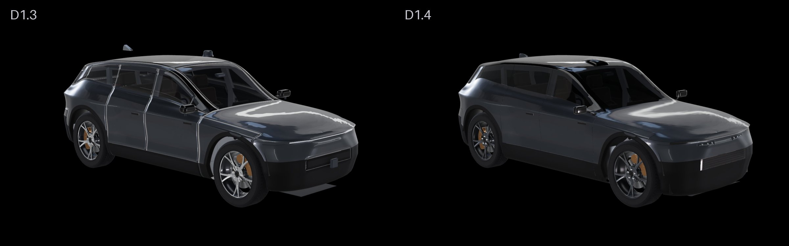
2. Rear three-quarter: 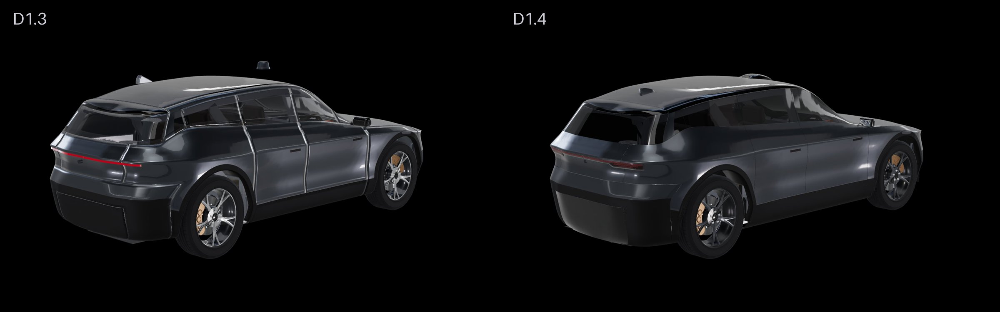
3. Direct front: 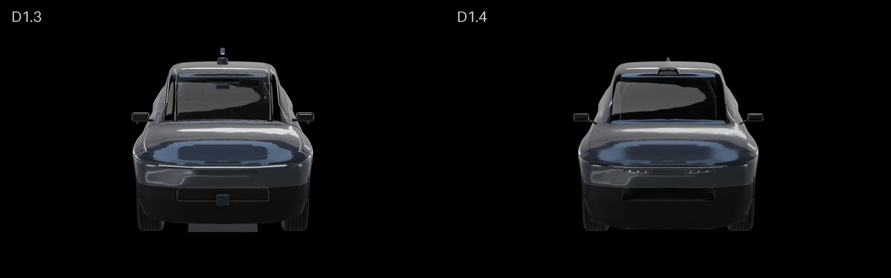
4. Direct rear: 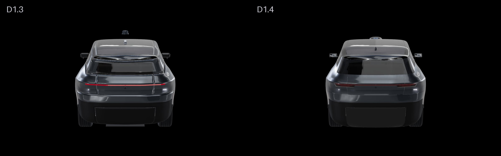
5. Side profile: 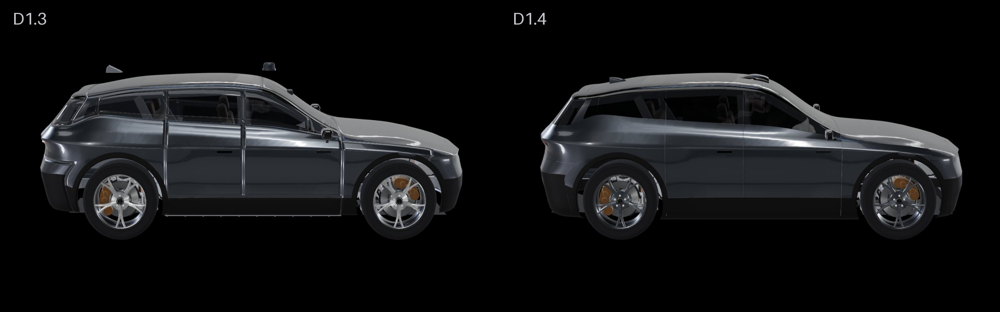
6. Elevated three-quarter (roof sensors): 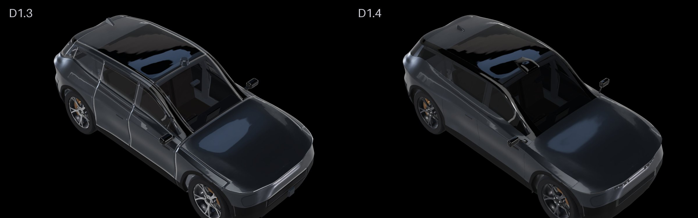
7. Low side angle (underbody): 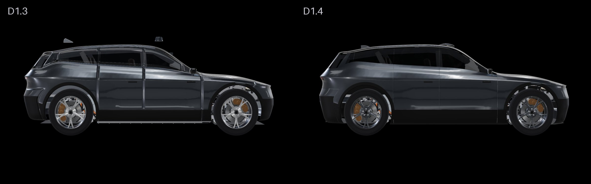
8. Exploded: 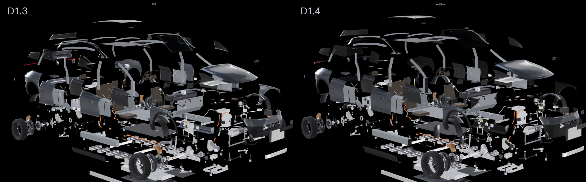
9. "Body and structure" highlighted: 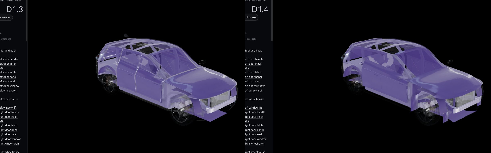
10. "Perception" (the driver-assistance sensors) highlighted: 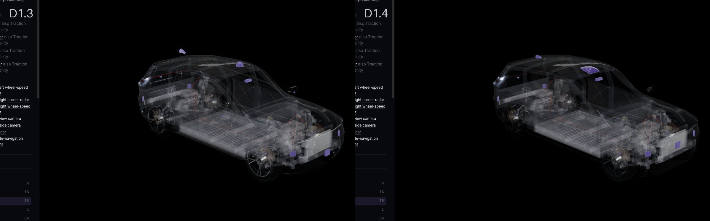
11. "Exterior lighting" highlighted: 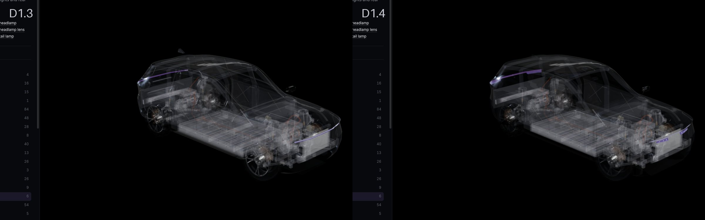

**Lights off and on** (left: off, right: on), from the front three-quarter, rear three-quarter, front, rear and side:

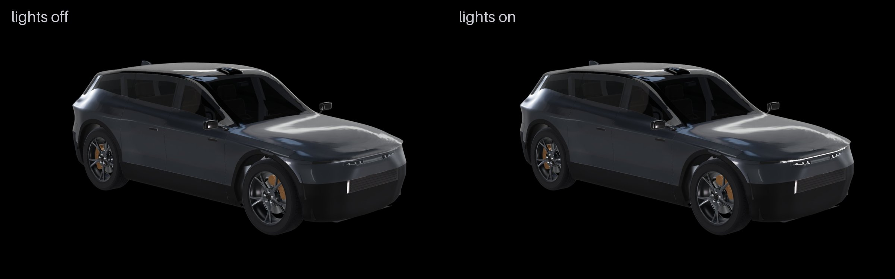
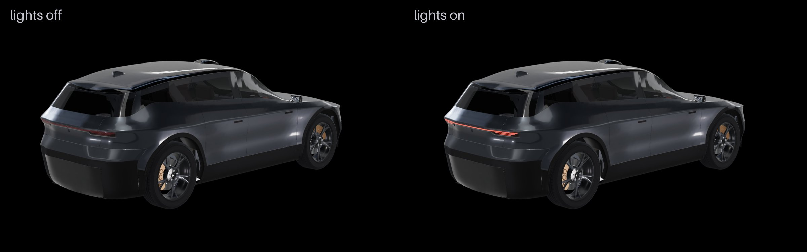
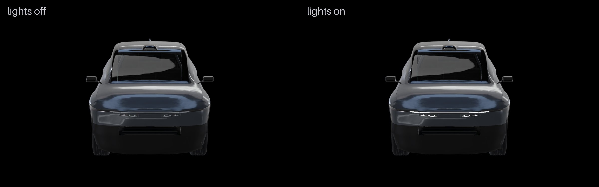 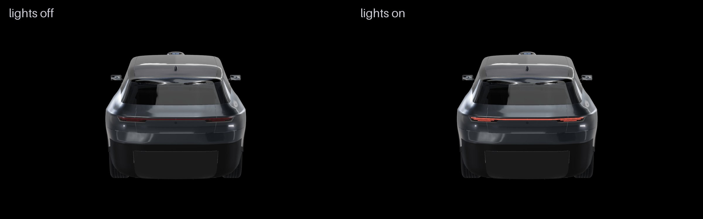 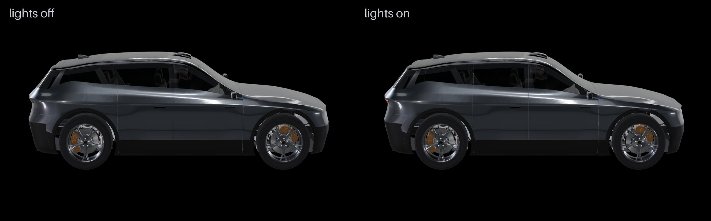

The app has a new **Lights** button next to the explode slider (or open it with `?lights=on`).

## What changed

### Floating sensors (all fixed)

Five sensors had been placed against the old body outline, so they floated above or outside the new body:

| Sensor | Was | Now |
|---|---|---|
| `lidar` | a dome 8 cm above the roof | in a low gloss-black pod on the roof's front edge, its dark window looking forward over the windscreen; the pod's base is shaped to the roof |
| `gnss-antenna` | a fin 11 cm above the roof | a body-colour fin on the painted rear part of the roof, its base shaped to the roof |
| `front-camera` | poking 2 cm through the windscreen | behind the top of the windscreen, under the lidar pod |
| `rear-camera` | 8 cm behind the tailgate | in the tailgate under the light bar |
| `front-radar` | 6 cm in front of the intake | behind the fascia above the intake, on the bumper beam |

Mirrors (`mirror-l/r`) are now gloss-black heads on slim arms from each front door's upper corner. The side cameras
(`side-camera-l/r`) sit in the heads' undersides, looking down and outwards. All ids are unchanged.

### Underbody (the long thin pieces under the car)

Identified as:
- **`underbody`:** the aero trays, which stood 5-10 cm below the bumpers' lower edges, front and rear.
- **`battery-underbody-shield`:** the pack's protection plate and its bolt heads, whose edge showed under the sills.

They were not hidden. Instead:
- **Sills and bumpers:** their lower edge comes down from 0.23 m to about 0.18 m. That is just below the pack's
  plate, as a real sill skirt covers it.
- **Trays:** they now ramp up into the bumpers. Ahead of the front wheels the front tray rises and widens into the
  bumper's lower edge. Behind the rear subframe the rear tray rises into the rear bumper as a shallow diffuser with
  three low strakes.
- **Clearance:** unchanged. 0.14 m at the front tray and the coolant channel, 0.16 m at the rear tray, 0.18 m at the
  sills.

### Wheel arches

- **Liners:** they now continue down the front and rear ends of each arch. The front one is clipped to the A pillar's
  foot.
- **Structure faces:** the faces of the body structure that look into a wheelhouse carry black underbody protection,
  as on a production body. These are the rails, towers, bulkhead, A-pillar foot and rear wheelhouses. Only those
  faces change. Every part is still whole, selectable and visible in the engineering views.
- **Clearances:** the front liner keeps 15.7 mm from the upper arm (unchanged). The new ends are 15 mm and 25 mm clear
  of the steered tyre's sweep.

### Lighting

- **Front:** a slim light blade runs across the nose under the bonnet edge, on a gloss-black band. It splits into two
  short parallel lines where it wraps each corner. Below it, at each corner, a dark lens holds three projector
  modules in a row, with a thin lit line beneath. All of it is laid onto the body surface.
- **Rear:** a continuous light bar runs under the tail ledge, across the tailgate and round onto the quarters. At each
  corner two shorter lines sit below the bar, under a deeper smoked lens.
- **Off and on:** off, the elements are grey (front) and dark red (rear). On, they glow white and red. The glow is
  restrained: the app has no bloom, so there is no flare.

### Front and rear

- **Front:**
  - a gloss-black lower intake with four slim dark-metal slats;
  - the radar behind the fascia;
  - the intake fits tight into its bumper (no open shut line).
- **Rear:**
  - a gloss-black diffuser face over the strakes;
  - the bumper and quarters keep their satin-black lower body.

### Materials

- **Wheels:** satin graphite with a smoked machined face, instead of bright silver. The geometry is unchanged.
- **Paint:** a deeper graphite with a slightly softer clear coat, for fewer mirror-like streaks.
- **Glass:** darker (86% opaque), so the cabin still shows but the windows read as dark glass.
- **Roof:** the roof side rails and A pillars are gloss black, so the window band and the dark panoramic roof read as
  one.
- **Shut lines:** near black. The panels' cut edges are flat-shaded and their insides near-black, so the gaps read as
  dark lines, not light ones.

## TypeDB

**Components: 423, unchanged.** Every id is the same. The new visual details belong to existing components: the
lamp elements to their lamp, the pod to the lidar, the fin to the antenna, the slats to the intake.

**Connections: 676 (was 669).** The 7 new ones are mounting points:
- lidar bolted to the front header;
- antenna bolted through the roof;
- front camera bonded to the windscreen;
- rear camera clipped into the tailgate;
- front radar bolted to the bumper beam;
- each tail lamp bolted to its quarter panel, as well as to the tailgate.

**Not changed:** dependencies (396) and the failure-impact semantics. The systems still separate body, closures,
lighting and driver assistance (see the highlight views).

## Checks

- **Web:** 67 tests pass, plus the build.
- **Live TypeDB:** 7 pass.
- **API:** 112 pass.
- **Static packaging:** no clashes. One new designed contact: the front liners on the A pillars.
- **Motion clearance** (±80 mm, full lock, 10 mm required): passes. The closest exterior pair is still the front liner
  and upper arm, at 15.7 mm.
- **Fit:** nothing from the structure or the mechanical assemblies reaches outside the lowered shell
  (`exterior_d13.py fit`). No inner part reaches outside the skin.

## Performance

| | D1.3 | D1.4 |
|---|---|---|
| Download | 17.0 MB | 17.2 MB (body-exterior 0.76 MB + 0.39 MB light copy) |
| Triangles, assembled | 1.43 M | 1.44 M |
| Draw calls, assembled | 887 | 935 |
| Frame time, assembled (median) | 2.6 ms | 3.7-10.6 ms over three runs |

- **Frame times:** very noisy in this headless browser. The best D1.4 run (3.7 ms) is close to D1.3.
- **Draw calls:** the extra 48 come from the new parts' several materials and the coated structure faces.
- **Verdict:** nothing here needs optimising yet. It should be re-measured at the D1.5 checkpoint.

## Outstanding

1. **Straight side view into the arches:** you still see the suspension (arms, knuckle, subframe) through the gap
   between tyre and arch, as on a real car. A liner can't block a straight side view: it would have to sit inside the
   steered tyre's sweep. The structure there is now dark; the bright parts are the suspension's aluminium.
2. **Tail lamp across the tailgate shut line:** each tail lamp is drawn as one piece, from the tailgate's centre round
   onto the quarter. A production car splits it at the shut line into a tailgate lamp and a quarter lamp. Splitting
   it would need two new components, which this phase avoided.
3. **Rear bumper:** the satin-black lower body below the tail is still a large plain area. A reflector line or a finer
   split could come in D1.5.
4. **Mirror heads:** simple rounded boxes. They are credible at normal distance, but not sculpted.
5. **Glass:** the side windows have no visible B-pillar trim between them. The glass reads as one dark band (a
   deliberate "floating" look); a black applique can be added if you prefer.
6. **Exploded view:** the D1.5 layering is still to do.
