# D1.5 engineering presentation and TypeDB visibility: review (2 November 2026)

**Status: for review. Phase E not started; nothing merged.**

Every picture is an app screenshot (high quality tier, headless Chrome, `scripts/browser/d15.py`; 1600x1000 unless
noted). The exterior is the approved D1.4 baseline, with two small finishing items (below).

## 1. The contextual TypeQL overlay

Choosing a system, an assembly, a type, a question, a failure or a single part puts the TypeQL behind it in the dark
space above and left of the vehicle. The camera moves the vehicle beside or below the overlay, whichever leaves it
larger. The overlay can be collapsed (the "TypeQL" label); a new selection fades in.

What it shows, top to bottom:

| Line | What it is | Where it comes from |
|---|---|---|
| Kind and name | "System · Propulsion" | the answer |
| Summary | components highlighted, number of queries, total time in TypeDB | the answer's own record of the queries that ran, each timed in the API to its last answer |
| Types / relations / functions | the types, relation types with the roles used, and functions the highlighting query uses | read from that query's text, so it cannot drift from the query |
| **SCHEMA** block | the definition of the type (with "what it inherits"), or of the function the query calls | the database's schema as TypeDB returns it (`database.schema()`, a driver call, not a query); timed separately |
| **QUERY** block | every query the answer ran, numbered, the one that returned the highlighted parts first and marked; each with its purpose and time | the API (each query labels itself) |
| **APP** block, "not TypeDB" | what the API did in Python afterwards (removing duplicates, walking parent links, counting steps), and what the 3D view does with the ids | the API (each step labels itself) |

The three tags keep schema definitions, data queries and application-side work visibly apart, so the interface never
credits TypeDB with work done in Python.

**System** (Propulsion): `system-membership (system, member)` and the recursive function `system_components`, whose
definition is shown.

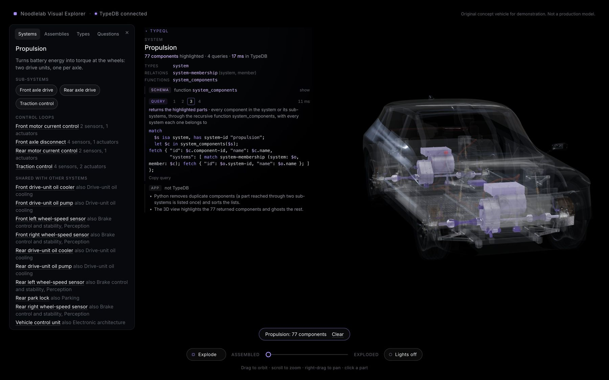
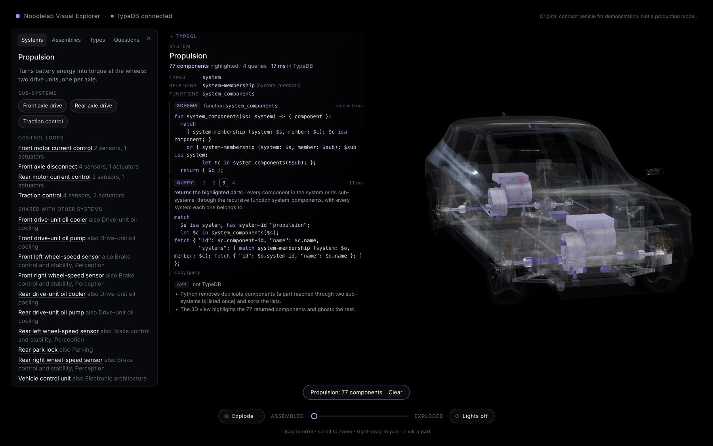

**Assembly** (Electric powertrain): the component-membership query, `assembly_components`.

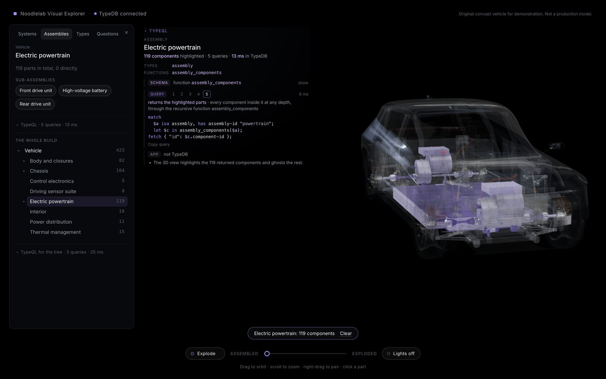

**Type** (Sensor, abstract): its schema definition, and the one polymorphic query that returns all 29 sensors of 9
types.

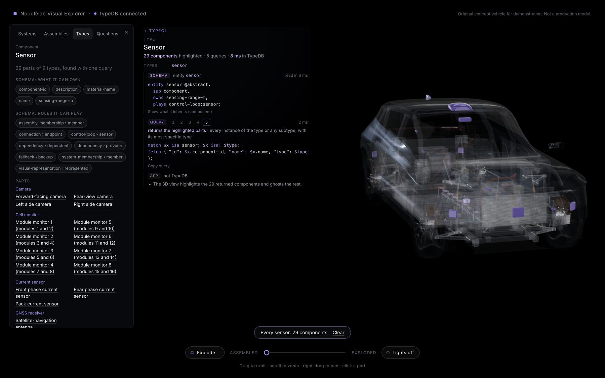

**Single part** (front-right brake calliper): its type chain, the relations its queries explore (connections of any
subtype, dependencies, fallbacks, control loops), its schema definition, and the seven queries behind the panel
(query 4 shown: its connections).

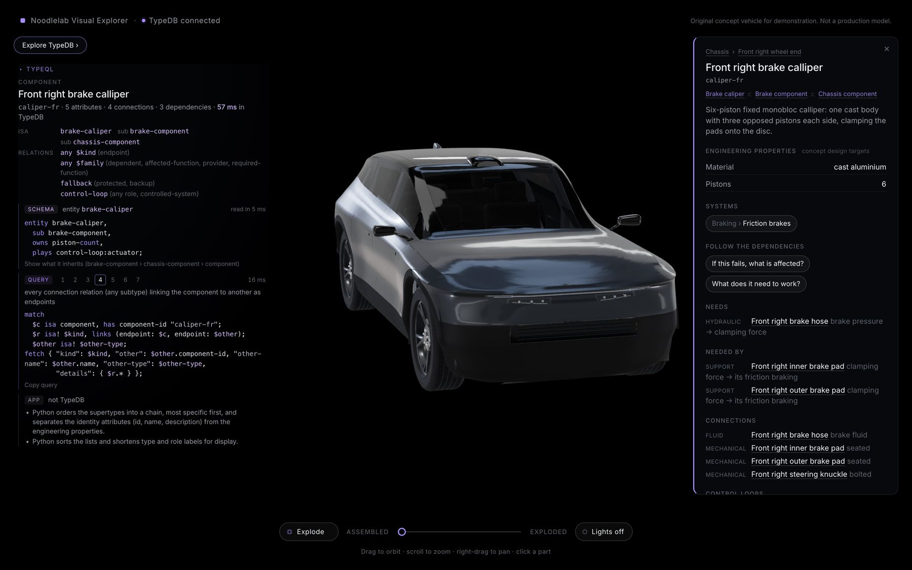

**Failure impact** (the 12 V battery): `lost_steps` and `degraded_steps`, 159 parts reached, 1.6 s in TypeDB; the
Python steps (counting steps, grouping functions, the axle verdict) listed apart.

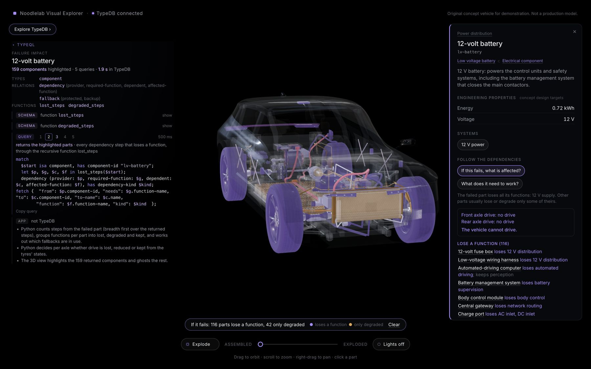

## 2. The exploded view in layers

The vehicle now separates vertically into engineering layers, each kept in its plan position:
1. exterior panels and closures, with the driving sensors stepping out from their mounts;
2. the body structure, with the cabin fitted to it;
3. cooling and brake control (over the front bay);
4. the chassis: suspension, steering and the wheel ends, moved outboard;
5. the drivetrain with its power electronics (drive units slid fore and aft), and the 12 V and charging electrics;
6. the battery at the bottom.

Within a layer, sub-assemblies and parts open as before but less (doors, wheel ends, motors, the battery's modules),
so layers don't run into each other. Layers move first, then sub-assemblies, then parts, then fine detail. Which
layer an assembly belongs to is choreography in `web/src/vehicle/explode.ts`; the assembly tree still comes from
TypeDB. Selection, highlighting and every TypeDB relationship are unchanged.

D1.4 (left) and D1.5 (right), identical cameras:

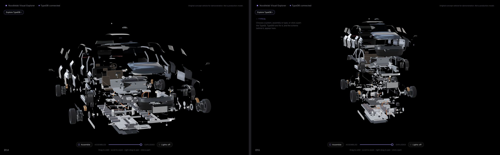
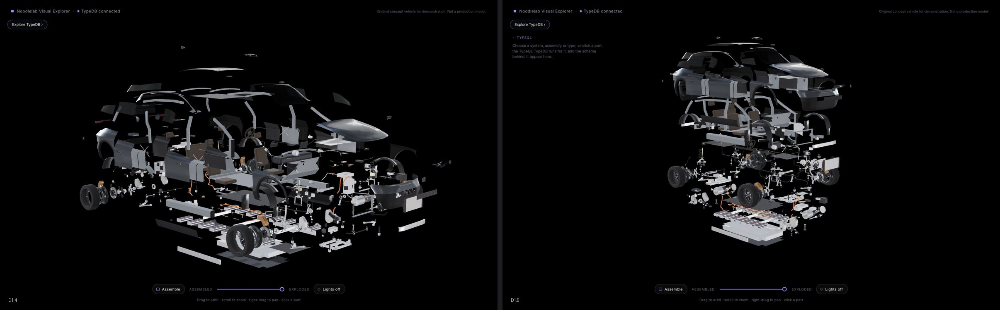
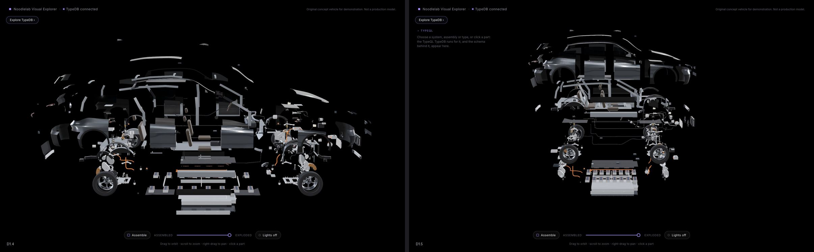
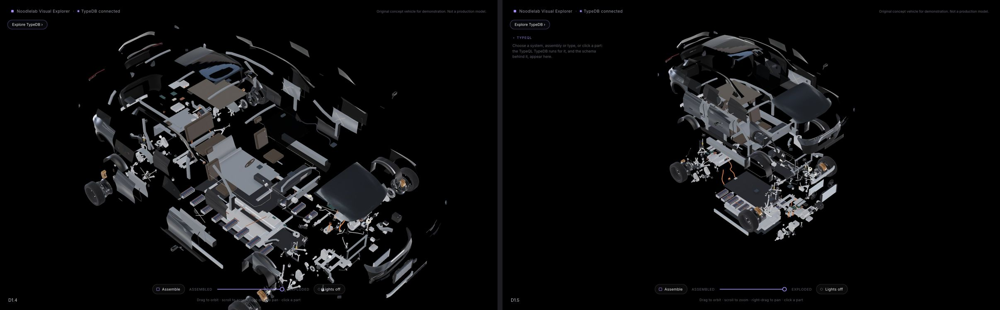

Exploded with a system highlighted and its TypeQL:

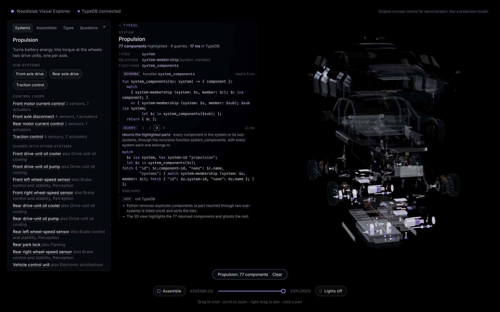

Assembled and exploded, no selection: 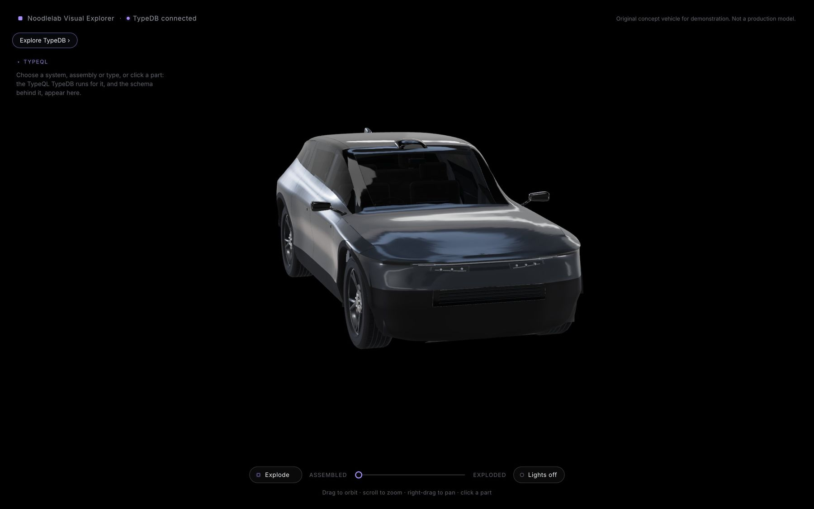 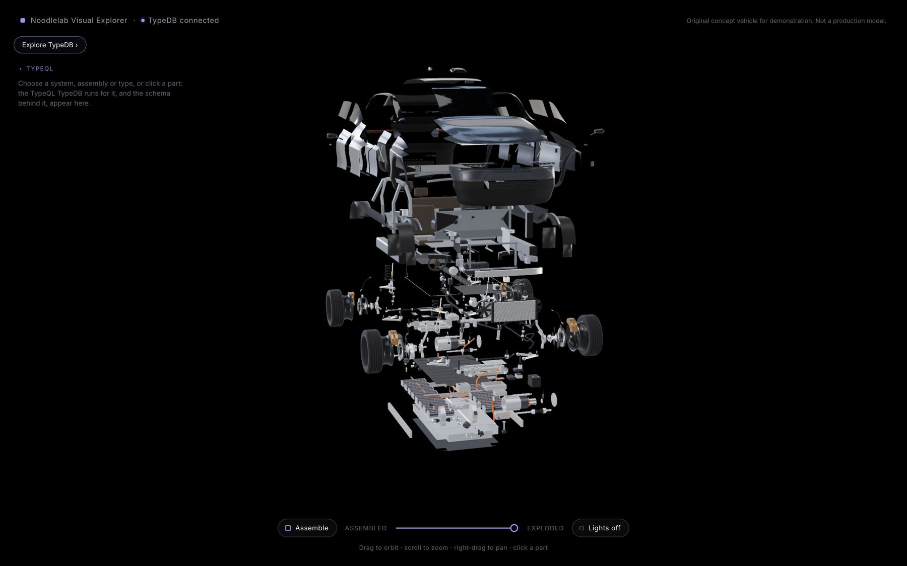

## 3. Interface and smaller screens

- **Framing:** the camera keeps the vehicle in the free space between the side panels, the brand line, the controls
  and the overlay. At rest, with no panels, the vehicle is a little larger than before.
- **Hover:** pointing at a part shows its name from TypeDB and "click for its TypeDB details".
- **Before anything is chosen:** the overlay says what will appear there.
- **Colours:** query highlighting uses the selection lilac (keywords), the soft lilac (variables) and grey-lilac
  (strings), in the overlay and in the panels' TypeQL viewers.
- **Laptop (1280x800) with both panels open:** the overlay narrows and shortens.

  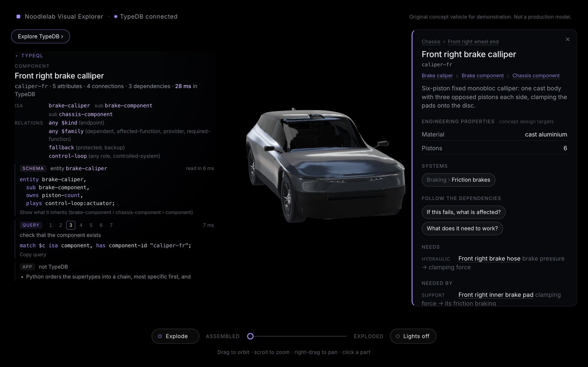
- **Phone (390x844):**
  - the overlay starts collapsed;
  - opened, it sits at the top and the vehicle moves below it;
  - the explorer is a full-screen sheet;
  - the focus bar sits above the controls.

  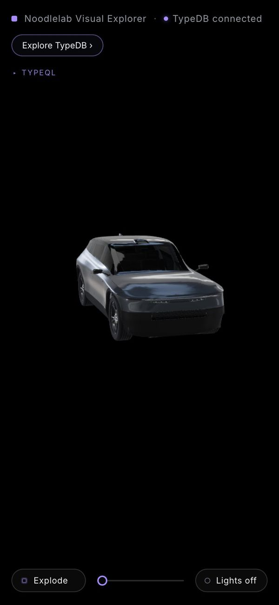 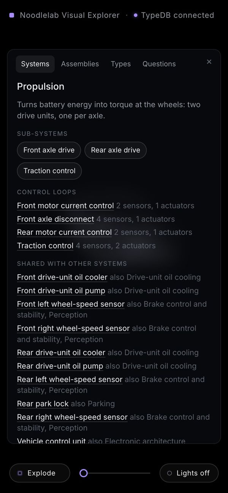 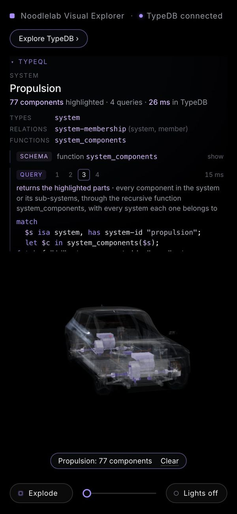 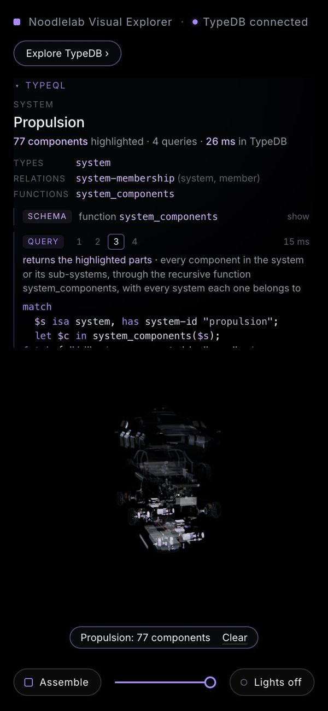

## 4. Finishing

- **Mirrors:** a sculpted head (rounded front, flat back holding the glass, slimmer by the arm) instead of a rounded
  box. The camera stays in its underside.
- **Rear bumper:** slim red reflectors at the corners and a fine gloss-black line across the satin-black face.
- **Tail-lamp split: not done.** Splitting each lamp at the tailgate shut line needs two new components, so the
  existing ids would no longer describe the parts one to one. It is left for a phase that changes TypeDB.

## 5. API changes (for the overlay)

- Every answer now also carries:
  - `purposes`: what each query was for;
  - `result-queries`: which queries returned the components the answer is about;
  - `processing`: the steps done in Python.
- New: `GET /api/schema/{name}`. It returns a type's or function's definition, with its supertypes'.
- Requests for the same answer made at the same moment (for example by the panel and the overlay) now share one
  fetch. Nothing is stored after the answer arrives.
- TypeDB is still the only database. No queries, data or ids changed: 423 components, 676 connections, 396
  dependencies.

## 6. Checks

- **Web:** 71 tests pass, plus the build. This includes new tests that read the concepts out of real query shapes.
- **API:** 115 pass. New tests cover:
  - every query having a purpose;
  - the result query matching the highlight;
  - schema definitions being read from the database.
- **Live TypeDB:** 7 pass.

## 7. Performance

All three versions were measured with the same method: one headless Chrome, high tier, `__perf` at 1440x900 x1.5,
three runs each. The D1.3 and D1.4 web apps were checked out temporarily, against the same API and database.
Frame times are render time per frame (not limited by the display).

| | D1.3 | D1.4 | D1.5 |
|---|---|---|---|
| Assembled: median / 90th percentile frame | 2.9 / 4.1 ms | 3.5 / 5.1 ms | 3.5 / 4.8 ms |
| Exploding (animation) | 9.1 ms | 9.1-13.6 ms | 9.2 ms |
| Exploded | 8.9 ms | 8.8-13.1 ms | 8.5 ms |
| Draw calls (assembled / exploded) | 886 / 868 | 934 / 913 | 936 / 914 |
| Triangles (assembled / exploded) | 1.43 M / 0.92 M | 1.44 M / 0.95 M | 1.44 M / 0.98 M |
| Download | 16.99 MB | 17.21 MB | 17.24 MB |
| Selecting a part: click to its name shown (median of 12) | 55 ms | 77 ms | 77 ms |
| Highlighting a system: click to highlight drawn (median of 12) | 78 ms | 83 ms | 77 ms |

- **Frame times:** this machine switches between a fast and a slow state, about 9 ms and 13 ms exploded. It happened
  in one D1.4 run and in a first D1.5 run (13.7 ms). On the same footing, D1.5 equals D1.3 and D1.4. The layered
  explosion costs nothing measurable.
- **Selection:** TypeDB answers in 25-45 ms; the rest is the browser.
  - The overlay adds about 15-20 ms of drawing.
  - A fix that stops the 3D scene re-rendering on unrelated page changes brought D1.5 back to D1.4's level.
- **Query latency in TypeDB** (median of 5; the HTTP round trip adds 3-5 ms):

| Answer | Queries | TypeDB |
|---|---|---|
| System (Propulsion) | 4 | 8 ms |
| Assembly (powertrain) | 5 | 5 ms |
| Type (sensor) | 5 | 3 ms |
| Part / its relationships | 2 / 5 | 1 / 2 ms |
| Schema definition (driver read) | 0 | 1 ms |
| Requirements (brake calliper) | 2 | 325 ms |
| Failure impact (brake calliper) | 5 | 1.1 s |
| "Which single failures stop all propulsion?" | 1 | 3.7 s |

The last two are known (docs/optimisation-backlog.md). The impact answer is where C3b left it. The propulsion question
has grown from 2.1-2.4 s at C3b to 3.7 s as parts and dependencies were added; D1.5 changed no query or dependency.
It is recorded, not optimised, as agreed for this phase.

## Outstanding

1. **Tail-lamp split** at the shut line (needs new components; see above).
2. **Three panels on a laptop:** with the explorer, the part panel and the overlay all open at 1280 wide, the vehicle
   is small. Collapsing the overlay or the explorer gives it room.
3. **Small highlighted parts** (current sensors, cell monitors) are hard to see in the ghosted vehicle. An outline or
   a camera move to them would help; that fits Phase F's guided questions.
4. **The propulsion question** takes 3.7 s (backlog options (b) and (a)).
5. **Out of scope here (Phase F):**
   - interactive schema browsing;
   - roles and inheritance explained;
   - TypeQL functions and reasoning walk-throughs;
   - guided questions.
