# Phase E cinematic introduction: review (2 November 2026)

**Status: for review. Not merged; the next phase not started.**

The app now opens on a country road. The vehicle drives in and stops, and **Begin** carries it into the black studio
where the explorer lives. Everything below is a live capture of the app (headless Chrome at 1440x900 unless noted;
`scripts/browser/intro_recording.py`).

**Recording** (25 s, animated WebP: road, Begin, studio, Expand): 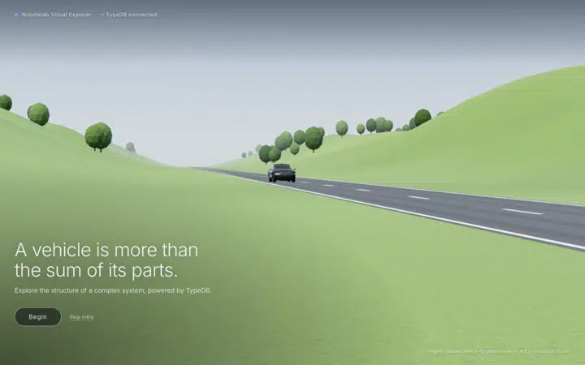

| | |
|---|---|
| 1. The opening road scene | 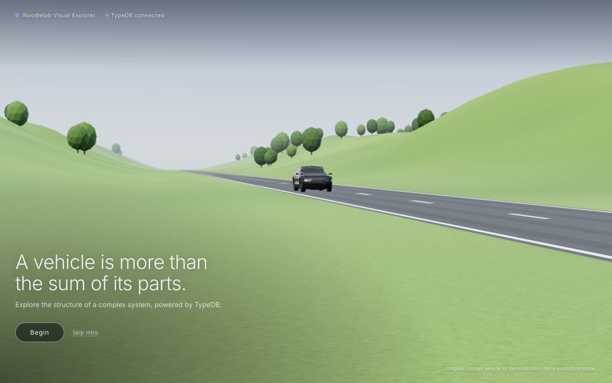 |
| 2. The vehicle approaching | 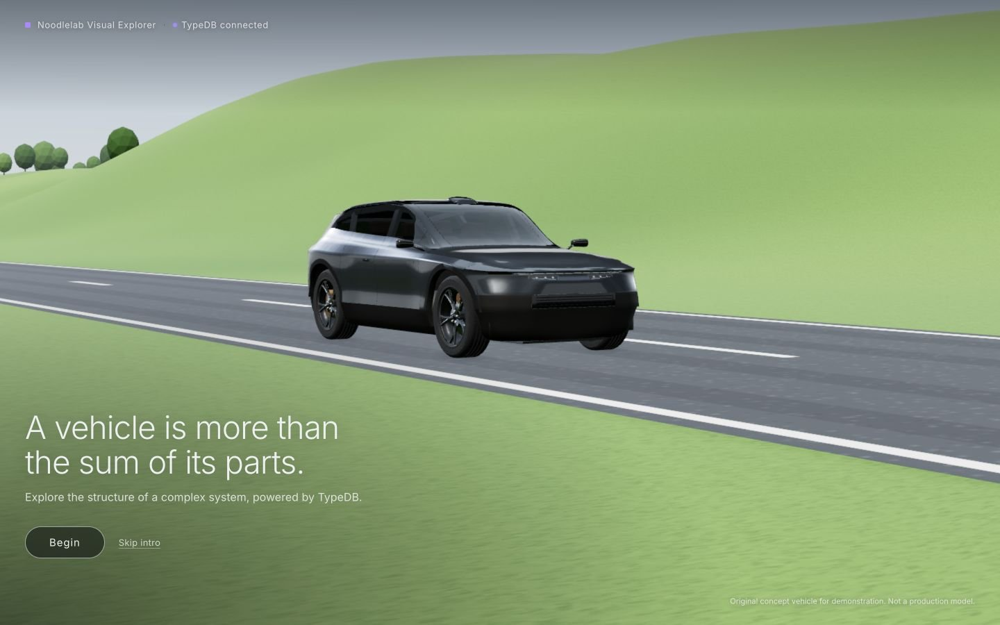 |
| 3. Parked, the Begin button | 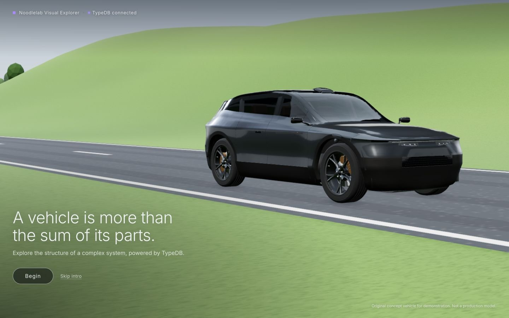 |
| 4. Begin: the camera starts its move, the light changes | 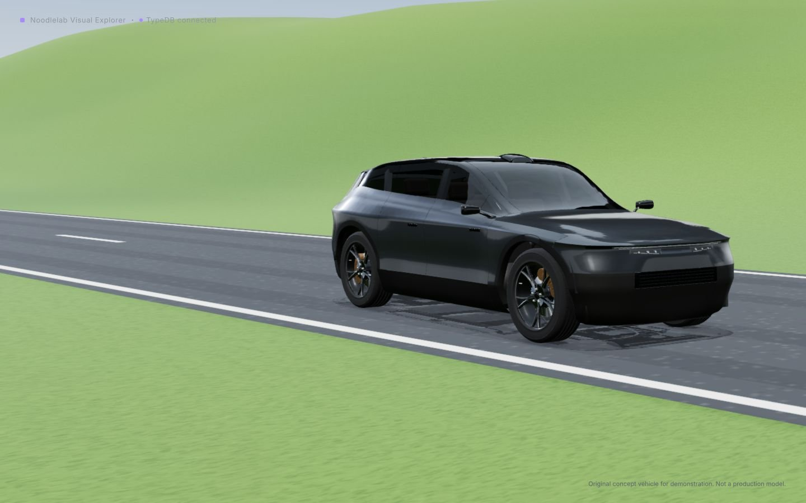 |
| 5. The black studio, explorer controls in place | 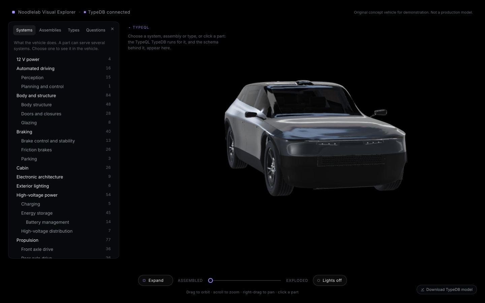 |
| 6. Expand: the D1.5 layers separating | 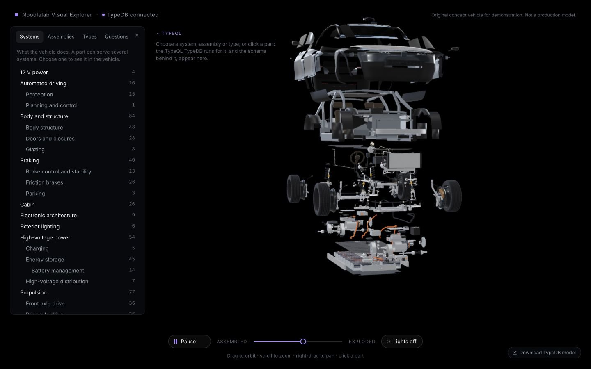 |
| 7. The interactive explorer, expanded | 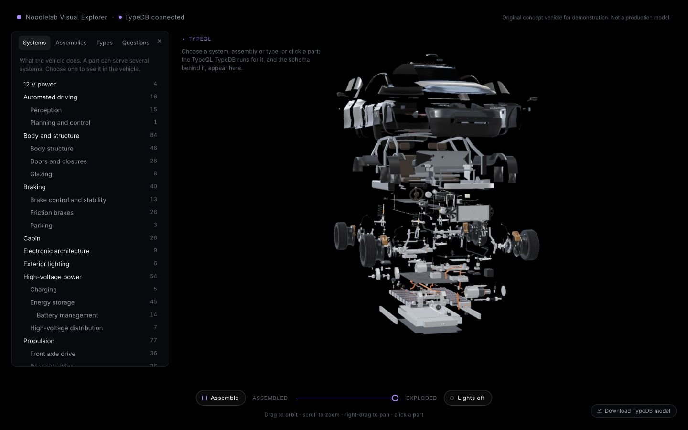 |

## What it does

- **The scene:**
  - rolling green hills (one terrain mesh with a fine grass texture);
  - a straight two-lane road to the horizon;
  - scattered trees (two instanced meshes);
  - a restrained gradient sky with distant haze;
  - an outdoor sun and sky light, and outdoor reflections in the paint and glass.

  All of it is built in code, so there is nothing new to download.
- **The vehicle:** the real model, with every part, its geometry and its materials. It drives in from 70 m at road
  speed and brakes smoothly to a stop. Its wheels roll as it moves, and its contact shadow travels with it.
  - It stops exactly where the studio shows the car, so no second copy of the vehicle exists.
  - The drive ends on a whole fifth of a wheel turn (five spokes, five nuts), so nothing jumps when the studio puts
    the wheels back to their modelled angle.
- **Begin:** available from the first moment, even while the car is still driving; the car then finishes its last
  metres during the transition. Over 2.8 s:
  - the camera glides to the studio view;
  - the car turns to the studio angle;
  - the haze turns black and closes in, the sky darkens and the ground dissolves;
  - the explorer's controls then appear, and the landscape is removed from the scene.

  No loading screen, and no camera jump.
- **Expand:** the explode button is now called **Expand**. It runs the D1.5 layered explosion. Selection, highlighting,
  the TypeQL overlay, failure analysis and the model download are all unchanged.

## Experience requirements

| Requirement | How |
|---|---|
| Skip for returning users | **Skip intro** beside Begin, the **Esc** key, or opening the app with `?intro=off`, which starts in the studio and never builds the landscape. The app can't remember a returning visitor by itself: the project's rule against browser storage (decision 0001, enforced by a test) rules that out. A link with `?intro=off` is the way to bookmark it. |
| Reduced motion | The car is already parked when the page appears, and Begin cuts to the studio behind a 0.7 s fade, with no camera flight. 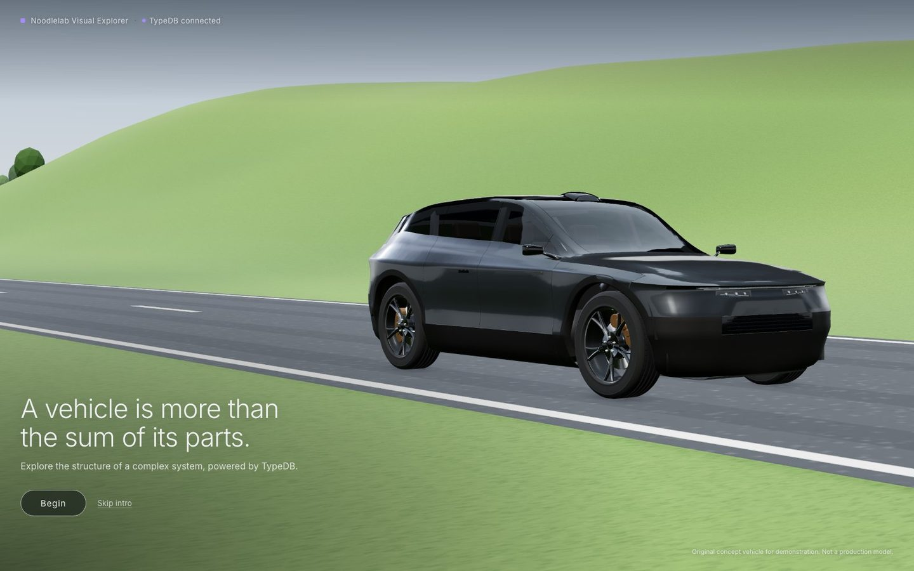 |
| Laptops and phones | On laptops (checked at 1280, 1440 and 1600 wide) the parked car sits clear of the headline. On phones, the car spans the width, the text and buttons sit below it, and the studio opens with the overlay collapsed.  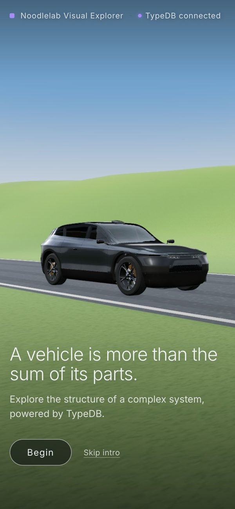 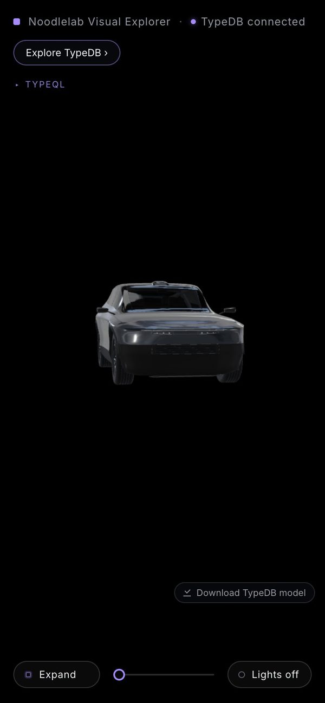 |
| No delay | Begin and Skip work as soon as the page shows. The scene uses the same model the studio needs, so nothing extra loads. |
| No TypeDB duplication | The introduction shows no domain data at all; the explorer's data still comes only from TypeDB. |

## Performance against D1.5

Same method as the D1.5 review (headless Chrome, high tier, `__perf` at 1440x900 x1.5, three runs; the road scene
measured the same way while parked).

| | D1.5 | Phase E |
|---|---|---|
| Studio, assembled (median frame) | 3.3-3.6 ms | 3.1-3.9 ms |
| Studio, expanding / expanded | 9.0-9.3 / 8.4-8.7 ms | 8.6-8.9 / 8.1-8.5 ms |
| Draw calls (assembled / expanded) | 936 / 914 | 936 / 914 |
| Download (models and textures) | 17.24 MB | 17.24 MB (no new assets) |
| JavaScript (gzip) | 502.9 KB | 506.6 KB (+3.7 KB) |
| Road scene (median frame) | n/a | 2.9-3.9 ms; 941 draw calls, 1.53 M triangles (+88 k for the landscape) |
| Selecting a part / highlighting a system | 77 / 77 ms | 81 / 81 ms (within run-to-run noise) |

The landscape is removed once the studio is reached, so the explorer renders exactly the scene it did before.

## Checks

- **Web:** 76 tests pass, plus the build. 5 are new: the drive's timing, stopping without a jolt, rolling without
  slipping, Begin landing in the studio.
- **Live TypeDB:** 7 pass.
- **API:** 119 pass.

The review scripts now click **Skip intro**.

## Notes

1. **During Expand** the camera's pull-back follows the explosion with a short lag, so the top layer briefly
   touches the top of the frame midway (frame 6). It settles once fully expanded. This is unchanged from D1.5.
2. **The landscape is deliberately simple** (low-poly trees, a straight road, no clouds), as asked: credible at the
   intro's distance and cheap to render. If you want more, the cheapest gains are a few cloud shapes, a hedge or
   fence line along the road, and tree variety.
3. **The car's lamps** stay off on the road. They could switch on as it approaches, which would show the D1.4 light
   signature.
