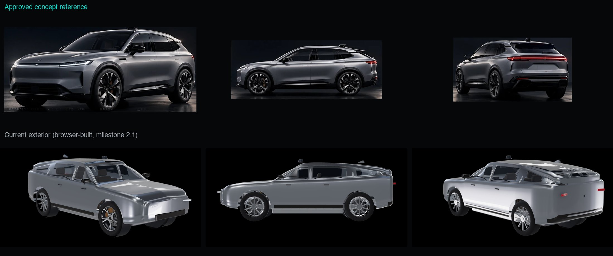

# Exterior feasibility assessment (Phase B, step 1, 30 October 2026)

Status: **for decision.** No exterior modelling has started.

Reference: the approved concept image, `docs/reference/concept-target.webp` (the original, without the
later robot-branding attempts). The emblems on its nose and wheel centres will be left out: the vehicle
stays unbranded.

## 1. Where we are against the reference

The current exterior (milestone 2.1, built in the browser from simple shapes) is far from the
reference. That is not a matter of polish: the proportions and surfaces are wrong.

| | Reference | Current |
|---|---|---|
| Overall length | about 4.74 m | 4.75 m (matches) |
| Wheelbase | about 3.03 m | 2.87 m |
| Front overhang | about 0.75 m (short, modern EV) | 0.90 m |
| Height | about 1.62 m | similar |
| Body side | Tall and muscular; a crisp shoulder line over the wheels; high beltline | Thin, slab-sided, low beltline |
| Glasshouse | Low, fast, tapering to the rear | Tall and boxy |
| Lights | Full-width light bars front and rear, thin LED headlamp | Small blocks |
| Wheels | Large, dark, multi-spoke, filling the arches | Smaller-looking, set back |

Measurements come from the side view, scaled from the 22-inch wheels; perspective in the image means
about ±5%.

Two things to note about the reference. It is an AI image, so its three views do not show exactly the
same car (the side view has a more sloping, coupé-like roof than the rear three-quarter). Whoever models
it must reconcile them. Its wheel is a dark multi-spoke design, while the Phase A wheel is a silver
five-way Y-spoke; a dark finish on the Phase A wheel would get close without new geometry.

## 2. Can our Blender scripting pipeline reach this quality?

**Smooth surfaces: yes.** Blender can build bodywork as subdivision surfaces: a coarse "cage" of
control points that Blender smooths into a mathematically continuous surface. That gives clean,
unbroken reflections, which our current body (assembled from primitive shapes) cannot. Panel gaps,
glazing, light units and flush handles are all achievable in code.

**Controlled design to the reference's standard: unlikely.** The hard part of car bodywork is not
smoothness but design: the exact tension of each surface and where the highlight lines run. Automotive
modellers achieve this by moving control points by eye, watching the reflections change, hundreds of
times. Writing those control points as numbers in a script, then rendering to check, is like sculpting
through a letterbox. I can iterate with renders, but each round is slow, and my judgement of subtle
surface quality from still images is the limiting factor.

My honest expectation for a scripted body:
- A clean, smooth, correctly proportioned SUV, clearly better than today: **likely**.
- "Comparable to a premium automotive visualisation" and to the reference image: **unlikely** (I would
  put it at roughly one chance in four). The likely result is a tidy but generic-looking body: correct
  but without the reference's surface sophistication.

The mechanical parts worked well in code because they are made of engineering shapes (cylinders,
profiles, patterns) that are naturally described by numbers. Car bodywork is sculpture.

## 3. The options

| Option | Quality against the reference | Cost | Time | Notes |
|---|---|---|---|---|
| **A. Commission a professional automotive 3D modeller** (work for hire, we own everything) | **High**: this is their job; they can match and resolve the reference | Quotes needed. Earlier estimate US$8,000 to $25,000 for exterior, glass, lights, closures and a modest interior; an exterior-focused brief may sit towards the lower end | 4 to 10 weeks | Built to our dimensions and named to our component ids. Needs your approval to send a brief for quotes |
| **B. Scripted subdivision body (our pipeline)** | Medium; uncertain (section 2) | None | A short trial (one or two working sessions) shows the trend; a full body is several more | No licence or vendor question. Risk: ending with a third exterior that still isn't good enough |
| C. Buy a marketplace model | High for some models, but none is this design | $100 to $500 plus licence | Days | Ruled out earlier: standard licences forbid delivering the model as a downloadable glTF file in a web app, and most good models are of real, branded cars |
| D. AI image-to-3D from the reference (Tripo, Meshy, Hunyuan3D and similar) | Low for this purpose | Low | Days | One fused, lumpy mesh with lighting painted in; wobbly reflections; not separable into panels. Usable at most as a rough proportion guide |
| E. Someone on your team models it by hand in Blender | Depends on the person | Their time | Weeks | Worth asking if TypeDB has a 3D or industrial designer |

## 4. Impact on what already exists (any option)

- **Component ids**: unchanged. The exterior panels already have stable ids in the parts list (bonnet,
  doors, wings, tailgate and so on). A new model is wired up through the mapping file, as the Phase A
  corner was: node names in the file are only visual keys. A commissioned model would use our ids as
  its object names to make that mapping trivial, but the mapping file stays the authority.
- **Explosion**: trajectories are calculated from each part's assembled position, so new panels slot in
  automatically. Composition will need tuning once the real panels are in place (planned for Phase E).
- **Mechanical work**: the corner geometry is unaffected. It just moves with the axle. But matching the
  reference means **moving the front axle forward about 16 cm** (wheelbase 2.87 m → about 3.03 m). That
  changes the space for the front motor, battery and suspension, so these dimensions should be fixed
  before Phase B's mechanical step (B3).
- **Performance**: a premium exterior at web quality is typically 150,000 to 300,000 triangles at full
  detail, plus a lighter version. Phase A showed geometry costs well under 1 ms per frame on the M2 Pro;
  download would grow by roughly 3 to 6 MB compressed. Both are acceptable. The paint (metallic flakes
  plus clear coat) is a material setting, not a performance risk.

## 5. Recommendation

1. **Freeze the vehicle's key dimensions now** (the "hard points"), taken from the reference: length
   4.75 m, wheelbase about 3.03 m, front overhang about 0.76 m, height about 1.63 m, track unchanged,
   22-inch wheels. I would draw these up as a simple side/top/front dimension sheet. The modeller,
   whoever it is, and the mechanical work both build to the same numbers, so neither waits for the other.
2. **Commission the exterior (option A).** It is the only route I am confident reaches the reference.
   The first step costs nothing and commits to nothing: I write a modelling brief (reference, dimension
   sheet, list of panels named by our ids, technical delivery rules, unbranded, full ownership), and you
   (or I, with your approval) send it to two or three automotive modellers for quotes.
3. **While quotes and modelling are under way, do the TypeDB integration (step 3).** It does not depend
   on the exterior. This swaps the order of steps 2 and 3, so it needs your agreement.
4. If you would rather not commission, the alternative is **option B as a short, bounded trial**: one
   side of the body (bonnet, front wing, front door, wheel arch) as a subdivision surface, rendered next to
   the reference, with a clear go/no-go at the end. I would expect it to confirm the concern in section 2,
   but it costs only time.

Not recommended: options C and D.

## Decisions needed

- Which route: commission (A, recommended) or scripted trial (B)?
- Approve freezing the dimensions above (front axle about 16 cm further forward).
- Agree to start the TypeDB integration while the exterior is being resolved.
- For the wheels: keep the Phase A wheel with a dark finish, or include a new wheel design in the
  exterior work?
