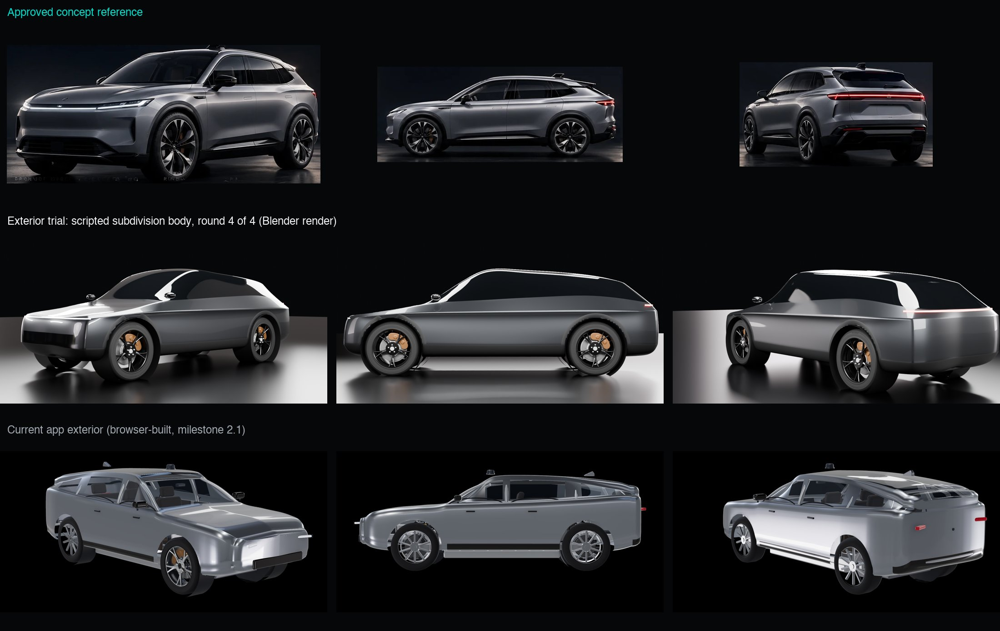

# Exterior trial: scripted subdivision body (30 October 2026)

Status: **for decision.** The trial stayed inside the agreed time box (one working day). Nothing in the app
has changed: the renders below come from Blender, and the app still shows the milestone 2.1 exterior.

## What was tried

`blender/exterior_trial.py` (run: `uv run --project blender python -I blender/exterior_trial.py`).

- **One subdivision surface for the whole body.** The script builds a coarse control cage: 12 lines
  ("rails") running the length of the car (underbody, rocker, cladding top, body side, a tucked line under
  the shoulder, shoulder, beltline, glass, roof edge, roof, roof centre). Each rail passes through points at
  9 landmarks (tail, rear corner, rear axle, C and B pillars, windscreen base, front axle, front corner,
  nose) and is smoothed between them. At the nose and tail every rail meets the centre line, so the mirrored
  halves close into one shell. Blender's subdivision then produces a mathematically smooth surface.
- **Feature lines** come from edge creases on the shoulder, beltline, roof edge and cladding line, and on
  the front and rear corners.
- **Materials follow the cage** (paint, dark glass, satin-black cladding, gloss-black intake), so their
  boundaries are smooth curves. The wheel openings are cut once from the finished surface, with black arch
  lips wrapped onto the body.
- **Provisional dimensions:** length 4.75 m, wheelbase 3.03 m, front overhang 0.76 m, roof 1.63 m, the
  Phase A 22-inch wheels and brakes in a darker finish.
- **Studio:** the same Poly Haven HDRI, an overhead softbox, side strip lights, a dark gloss floor; Cycles
  on the M2 Pro's GPU (about 15 seconds per image).

Four build-and-compare rounds:
1. First build: the shape works, but the arch lips are jagged (recoloured faces) and the nose is like a bus.
2. Real arch-lip geometry, lower nose, darker paint.
3. A shoulder ledge (a second rail tucked under the shoulder), a more coupé-like roof, more ground clearance.
4. Tighter front and rear corners (creases across the body), a dark gloss floor.

Final images: [front three-quarter](trial-front34.jpg), [side](trial-side.jpg), [rear three-quarter](trial-rear34.jpg),
[front corner close-up](trial-front-detail.jpg).

## What worked

- **Surface quality.** The surfaces are continuous, so highlights run cleanly along the sides, roof and
  bonnet with no faceting, seams or wobbles. The close-up of the front corner shows a crisp bonnet edge
  and a tight corner radius. This is the main thing the current browser-built body cannot do.
- **Proportions and dimensions** follow the provisional targets exactly, and are easy to change: the
  whole body is about 320 numbers (12 rails x 9 points x 3 coordinates) plus a few creases.
- **Integration is cheap**: about 80,000 triangles for the whole shell (fine for the web), built in a few
  seconds, reproducible, in the same pipeline as the Phase A parts.

## What did not work

Compared with the reference, the trial is still a **clean but generic, slightly toy-like clay model**:

- **Character.** The reference's front is defined by graphics: a thin full-width light blade on a sharp
  bonnet edge, a framed lower intake, vertical corner vents and a precise bumper split. The trial has a
  plain front face with a black band. Each graphic element needs its own modelled geometry and surface
  breaks.
- **Glasshouse.** The reference has a crisp window graphic: black pillars, a beltline kick at the
  C-pillar, a body-colour roof rail and a spoiler. The trial has one continuous dark band, like a visor.
- **Body side.** The reference side has tension: a sharp shoulder over the wheels, a concave lower door
  with a bright sill line, door cuts and flush handles. The trial's side is smooth but soft; its feature
  line reads only in some lights.
- **Stance.** The reference's wheels look larger and push to the corners, with tight arches. The trial's
  body looks taller and rounder around the same wheels, and the rear reads as a wagon.

Each of these is solvable in principle. But each needs many more control points and creases, placed by
numbers and checked by rendering. That is slow, and quality depends on judgement exercised through still
images. **The trend over four rounds was steady improvement in cleanliness, but slow convergence on
character.** Rounds 3 and 4 changed the shape and corners noticeably but not the overall impression.

## Assessment

**Is it close enough to the target to justify continuing? Not towards the reference.** My estimate:

- Another **3 to 5 working days** of the same method would plausibly give a convincing, clean, *generic*
  premium-SUV exterior: front light blade and intake, window graphic with pillars, door cuts and handles,
  better stance, and splitting into the panels the explosion needs (bonnet, doors, wings, tailgate...).
  That would be a big improvement on today's exterior.
- It would **still not match** the reference's design sophistication. The gap that remains is design
  judgement and surface tension, which this method approaches slowly.

## Options

| Option | Result | Effort | Notes |
|---|---|---|---|
| **A. Stop here; keep the current exterior** for now; continue mechanical work (B3) and the interface | Visual gap remains on the outside | None | Exterior revisited later; the mechanical work uses the provisional dimensions, which the trial confirms are workable |
| **B. Continue the scripted body with a fixed budget** (e.g. 3 days) aimed at a clean generic premium SUV, split into panels | Clearly better than today; not the reference | About 3-5 days | Worthwhile if a good-but-generic exterior is acceptable for demos |
| **C. Hand modelling** (an in-house designer, or a commission later) | Can reach the reference | External | The owner has decided against commissioning for now; listed for completeness |

**My recommendation: A now, with B as a deliberate later choice.** Proceed with the mechanical systems
and the semantic interface, which are where the project's distinctive value is. Revisit the exterior
when deciding between B (good, generic, ours) and C (closest to the reference). If a better exterior is
needed sooner for a specific demo, B with a fixed 3-day budget is the realistic route.

## Not done (outside the time box)

Panel splitting (doors, bonnet and so on as separate parts with stable ids), door cuts, handles, real
mirrors (the mirrors are placeholders), interior visible through glass, integration into the web app
(Three.js) and its quality tiers, and the darker wheel finish in the app (it is only in these renders).
