# Phase A checkpoint: wheel-corner benchmark (30 October 2026)

Status: **for review.** Scope: the front-right corner, the asset pipeline and the rendering settings that
every later phase reuses. Work is on `feature/m2.2-mechanical`; nothing is merged into `main`.

## Before and after

"Before" is the Blender prototype approved on 29 October (`docs/prototype/`). "After" is Phase A. Both
use the same cameras (the `__focus` dev tool) and are saved the same way, so the pair shows changes in
geometry and materials. They do not include ambient occlusion: the old capture helper skipped the
screen effects. That is now fixed (see "Dev tools"), and the tier comparison below shows the effects.

| | |
|---|---|
| 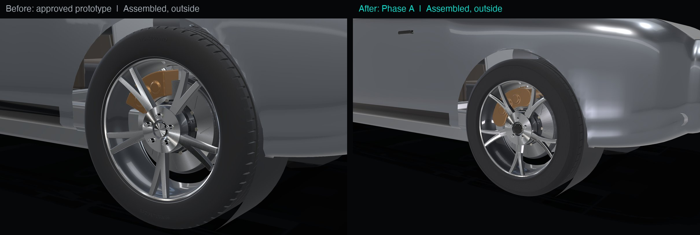 | Assembled, outside. New five-way Y-spoke wheel with sculpted, five-sided spokes and a deeper face; hub nut and cap visible. The view is slightly wider than before because the camera frames the parts' combined position, which the two new parts move a little. |
| 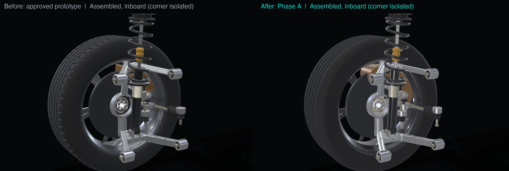 | Assembled, inboard. Brake hose with banjo fitting now runs from the calliper; I-section wishbones. |
| 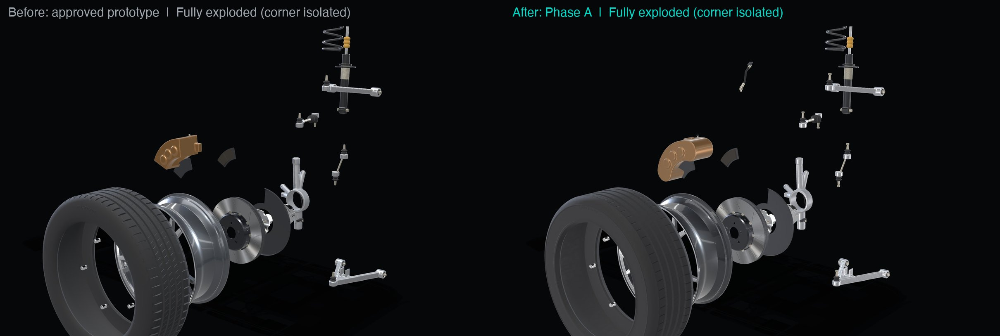 | Fully exploded corner. 25 parts (was 23). |
| 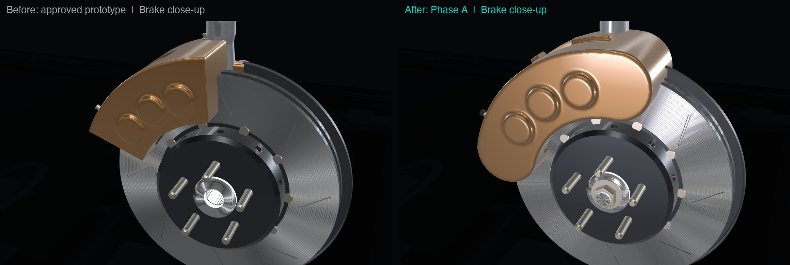 | Brake close-up. Redesigned six-piston calliper: wider, flowing cast body, two pad windows, crossover pipe, caps and anti-rattle spring. Axle nut on the hub. |
| 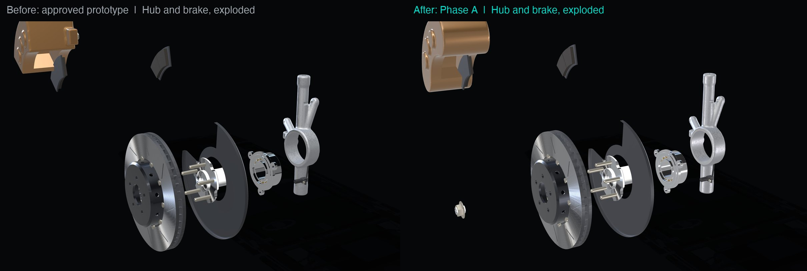 | Hub and brake, exploded. The axle nut separates on the axle line. |
| 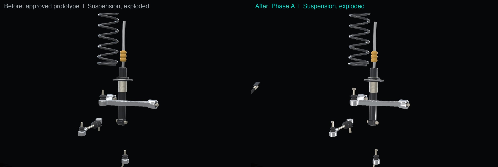 | Suspension, exploded. Finer damper thread, better bush and ball-joint detail. |

Close-ups of the new work:

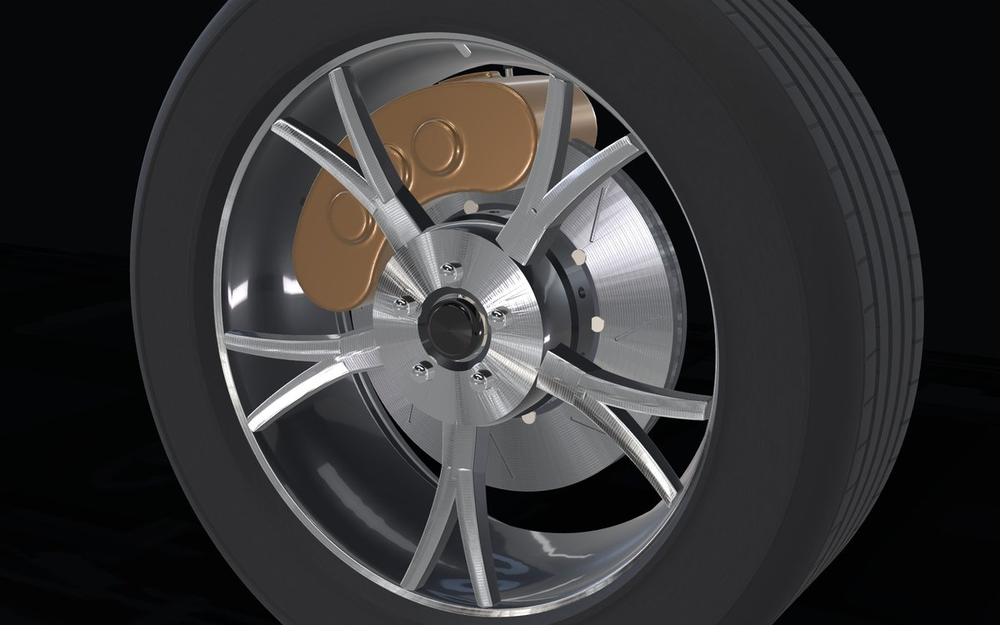
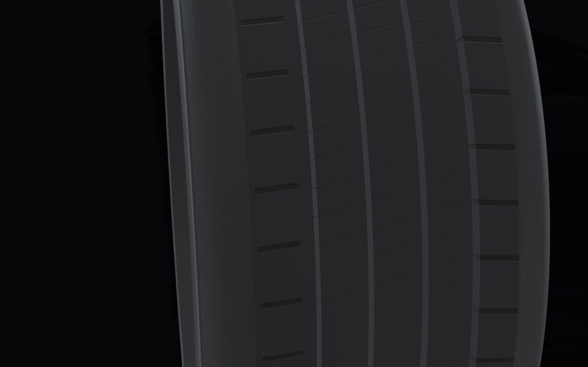
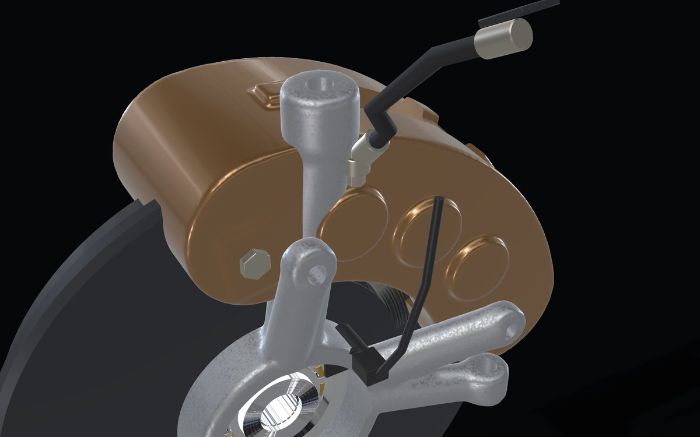

## Quality tiers

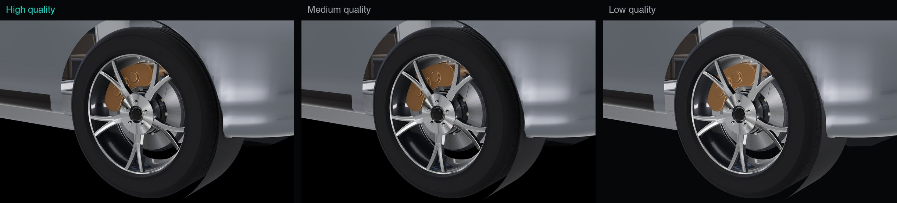
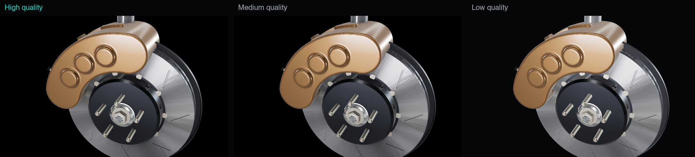

- **High**: ambient occlusion (soft shading where parts meet) at full resolution, 4x antialiasing, up to
  2x pixel density.
- **Medium**: half-resolution occlusion, 2x antialiasing, up to 1.5x pixel density. Close to high.
- **Low**: no screen effects; parts switch to their light version sooner. Flatter and slightly brighter,
  but the materials and shapes still read.

The tier is chosen from the device at start-up and steps down automatically when frames are slow.
`?quality=high|medium|low` fixes it for testing.

## Performance (Apple M2 Pro, 1440 x 900 at 1.5x = 2160 x 1350 pixels, the Claude browser pane)

| | Prototype (29 Oct) | Phase A |
|---|---|---|
| Corner triangles (full detail) | 311k | 302k |
| Corner triangles (light version) | none | about 90k |
| Corner download | 9.7 MB, uncompressed | 2.74 MB (1.96 MB full + 0.78 MB light), Meshopt-compressed |
| Corner load and parse | 0.6 s | 0.22 to 0.31 s |
| Studio lighting map (one-off) | none | 1.6 MB |
| Triangles drawn, whole vehicle | 551k | 335k to 515k, depending on view and tier |
| Draw calls | 362 | 375 to 397 |

Frame time (time to draw one frame and wait for the graphics chip; 16.7 ms = 60 frames per second):

| Tier | Assembled | Mid-explosion | Fully exploded |
|---|---|---|---|
| High | 1 to 10 ms | 4 to 15 ms | 1.5 to 15 ms (worst 90th percentile 20 ms) |
| Medium | 1.4 to 10 ms | 6 to 11 ms | 5.5 to 10 ms |
| Low | 0.8 to 4 ms | 0.9 to 1.4 ms | 0.7 to 1.1 ms |
| Effects off | 0.8 ms | 0.9 ms | 0.8 ms |

What the numbers say:
- **Geometry and materials cost almost nothing** (under 1 ms with effects off). The new detail is not a
  performance risk.
- **The screen effects are the whole cost.** I tested half-resolution occlusion, lower occlusion quality
  and 2x antialiasing on the high tier separately: each saves only about 2 ms, so no single setting is the
  cause. The combination is.
- **These timings are not precise.** The same test ranged from 1.5 ms to 15 ms between runs because the
  browser pane shares the graphics chip with the desktop app and may not wait fully for the frame. The
  ranges above are honest; the medians are not reliable to better than a factor of two. Even at the top
  of the range, high stays near the 60 fps budget on this machine, and the automatic step-down protects
  slower machines.
- **Compared with "neutral or better" (the plan's goal):** download, load time and triangles are better;
  effects-on frame time is similar to or somewhat above the prototype's 7 ms. A proper measurement in a
  stand-alone browser window (frames per second over a recorded explosion) is planned for Checkpoint B.

## Asset-pipeline changes

1. **One build command**: `scripts/build-assets.sh` runs the Blender scripts, then compresses every model
   with gltfpack (Meshopt) inside the dev container. Blender writes to `web/assets-src/` (not committed);
   only the compressed results go into `web/public/assets/`.
2. **Compression**: Meshopt with quantised positions, normals and UVs (`-cc -kn -km -ke -kv -vtf`). The
   corner went from 9.7 MB to 1.96 MB. The UV flags matter: without them gltfpack dropped the texture
   coordinates and machined faces rendered black.
3. **Levels of detail**: each model has a light copy (`<name>.lod1.glb`, about 30% of the triangles). The
   app switches per part by on-screen size; the switch distance depends on the tier.
4. **Visual mapping file**: `<name>.map.json` says which component id each node draws. Node names are
   only visual keys and never become database identifiers (decision 0001). In the TypeDB phase this
   table moves into TypeDB and the file is checked against it.
5. **Shared geometry**: the five wheel nuts use one mesh (instancing in the file); the exporter no longer
   recentres shared meshes.
6. **Studio lighting**: Poly Haven "Monochrome Studio 02" (CC0, recorded in `docs/third-party-assets.md`),
   plus strip lights for the long body reflections and faint surrounding walls so metal never reflects
   pure black.
7. **Generated textures**: tyre tread detail (a normal map and cavity shading repeated 64 times around the
   tyre), radial machining rings, brushing direction for anisotropic metal, and grain, all drawn in code at
   start-up. No texture files to download.
8. **Modelling library** (`blender/kit.py`): new I-section tubes, a reusable cast-finish step, material
   assignment by face direction, and UV clean-up for joined meshes.
9. **New parts and ids**: `brake-hose-fr` and `hub-nut-fr`, recorded
   in `docs/component-ids.md`. All earlier ids unchanged.
10. **Tests**: `web/src/scene/assets.test.ts` checks the file against the parts list: every node mapped,
    the light copy has the same nodes, materials are known, the file is compressed and under 4 MB.
    27 tests pass.

## Dev tools

- `await __perf()` is the checkpoint benchmark: frame time, triangles and draw calls assembled,
  mid-explosion and exploded from the standard camera, plus download size and load time.
- `__save` now renders through the full pipeline, so saved pictures include the tier's effects.
- All helpers share one clock that only moves forward. Before this, a helper could render at an earlier
  time than the last frame, which broke the camera smoothing and gave a blank picture.

## Not done in Phase A (compared with the plan)

- **Normal-map baking from high-detail models**: not done. The detail stayed in geometry (302k triangles
  against the 180k estimate) because the frame cost of geometry turned out to be negligible, while
  headless baking would have slowed every build. I suggest revisiting this only if download size becomes
  a problem.
- **Calliper retaining-hardware set and ABS cable clip**: not added (25 parts, against about 27).
- **Splitting the parts list into visual manifest and domain seed**: not done. It belongs with the
  minimal TypeDB backend in Phase B, which is where the seed starts being used.
- **Measurement on other browsers (Safari, Firefox)**: not done; M2 Pro in the Claude browser pane only.

## Remaining weaknesses

- The **tyre** is still dark and uniform up close: the tread is right, but the rubber needs subtle
  variation (wear, mould sheen) to look real.
- The **calliper** body is smooth and slightly soft in silhouette; a sharper machined edge along the
  bridge would help.
- The rest of the vehicle is still browser-built, so the corner stands out. Phases B to F address this.
- The **low tier** looks flatter and brighter than the others (no occlusion, different tone mapping);
  acceptable as a fallback, but it could match better.
