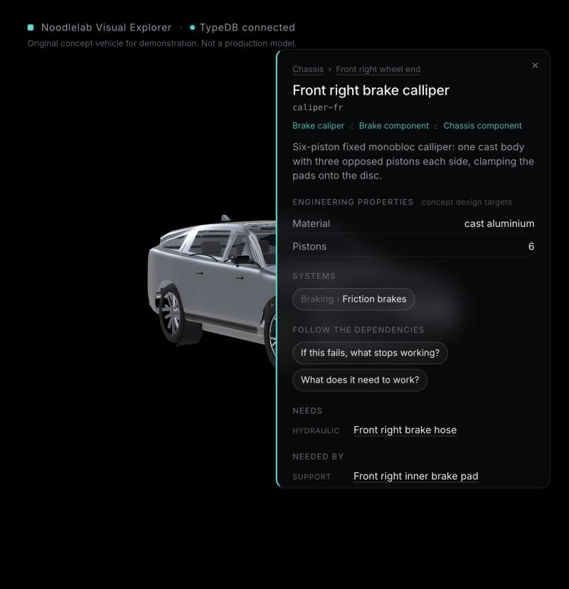
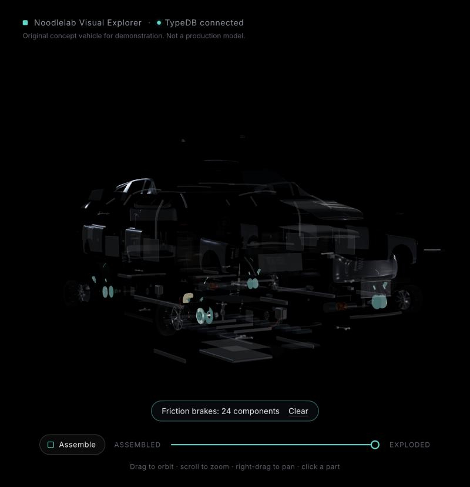
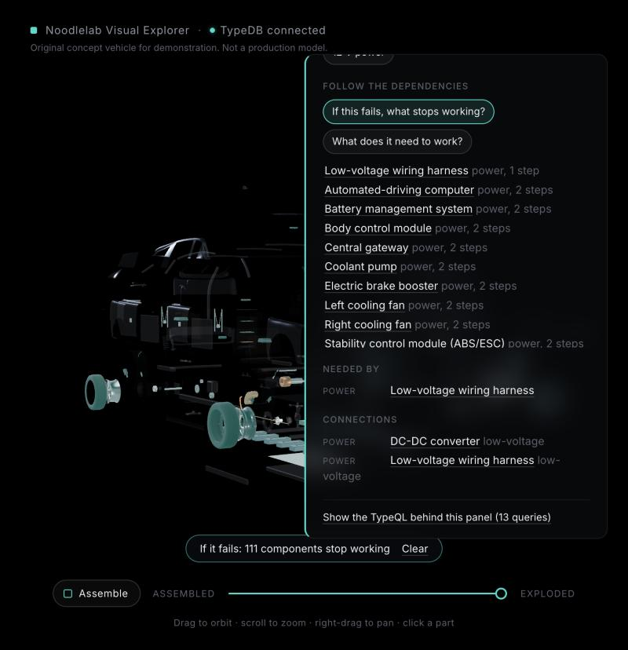
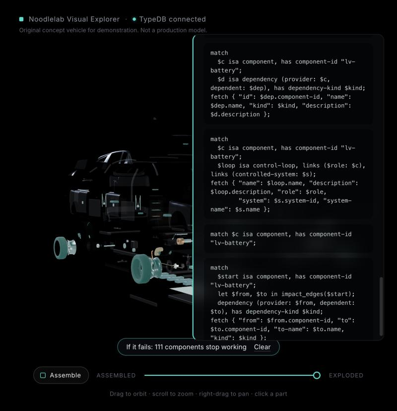
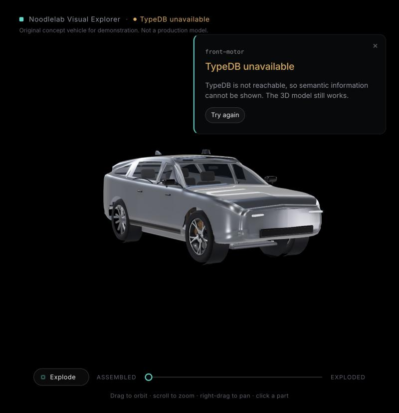

# Phase B checkpoint: first working TypeDB integration (30 October 2026)

Status: **for review.** Branch `feature/m2.2-mechanical`; nothing merged into `main`.

## In one paragraph

The vehicle's engineering knowledge now lives in TypeDB 3.14.1, and the explorer gets it only from
there. Clicking a part asks TypeDB, through a small read-only API, what the part is, where it sits,
which systems it serves, what it is connected to, what it needs and what stops working if it fails.
The answers appear beside the model together with the exact TypeQL that produced them, and the 3D
view can highlight any of those answers. If TypeDB is stopped, the model still renders and every
semantic feature says "TypeDB unavailable"; nothing is made up.

## What you can do

| | |
|---|---|
|  | **Select a part.** Name, type hierarchy (*Brake caliper ⊂ Brake component ⊂ Chassis component*), description, engineering properties (labelled as concept design targets), assembly path, systems, what it needs, what needs it, connections and control loops. All from TypeDB. |
|  | **Highlight a system or assembly.** Click a system (here *Friction brakes*, 24 components) or a step in the assembly path: TypeDB returns the members, including those of sub-systems, and the rest of the car is ghosted. |
|  | **Follow dependencies.** *If this fails, what stops working?* walks the dependency graph to any depth. For the 12 V battery: 111 components, the furthest 14 steps away. *What does it need to work?* walks the other way. |
|  | **See the TypeQL.** Every panel lists the queries that ran, exactly as sent (here the recursive `impact_edges` function). |
|  | **TypeDB stopped.** The model renders from static files; the header and panel say TypeDB is unavailable, with a retry. When TypeDB comes back, the next request reconnects by itself. |

## How it fits together

```
Browser (3D model + panel)  --GET /api/...-->  Semantic API (Python, read-only)  --TypeQL-->  TypeDB 3.14.1
        |                                       named queries only; returns data + the TypeQL that ran
        +-- static files: 3D models, textures, explosion choreography (no domain facts)
```

- The browser never sends TypeQL and never sees database credentials. The API has 11 GET endpoints, each
  running fixed, named queries with validated ids (lower-case words and hyphens, at most 64 characters).
- Seed data lives in `data/seed/*.yaml` (readable, reviewable files). `api/explorer/seed.py` checks it,
  writes one TypeQL `insert`, and commits only if TypeDB confirms every item arrived.
- The visual side keeps only how each id is drawn (`web/src/vehicle/manifest.ts`: shape, position,
  material). Names, types, assemblies and relationships were removed from the web app.

## The schema in brief (`schema/schema.tql`, `schema/functions.tql`)

Three independent ways of organising the same components, plus behaviour and the 3D link:

| Concept | TypeDB construct | Why this construct |
|---|---|---|
| Components | `entity component @abstract` with a hierarchy of 42 types beneath it: `sensor` > `camera`, `radar`, `lidar`...; `brake-component` > `brake-disc`, `brake-caliper`, `brake-pad`; `powertrain-component` > `electric-motor`, `gearbox`, `inverter`... | Questions can be asked at any level ("every sensor") and properties attach only where they make sense (only a calliper has a piston count) |
| Physical structure | `assembly` + `assembly-membership (assembly, member)` | Sub-assemblies play `member` too, so one relation builds the whole tree. The schema enforces that every component sits in exactly one assembly |
| Function | `system` + `system-membership (system, member)` | A component can serve several systems: the wheel-speed sensor is in brake control, traction control and perception |
| Joints and lines | `connection @abstract` with `mechanical-`, `power-`, `data-`, `fluid-connection`; role `endpoint @card(2..2)` | Undirected, exactly two ends, each kind with its own attribute (joint type, voltage class, network, fluid) |
| Dependencies | `dependency (dependent, provider)` with a kind (power, torque, control, data, hydraulic, cooling, support) | Directed: the basis of failure impact |
| Control loops | `control-loop (controller, sensor, actuator, controlled-system)` | Genuinely four-sided: no pair of these makes sense alone. Only control units can be controllers, only sensors sensors (schema-enforced) |
| 3D link | `visual-representation (represented, asset)` with a node key | TypeDB says which model node draws each component; node names are never identities |

Functions (stored in the database, recursive): `assembly_ancestors`, `assembly_components`,
`system_ancestors`, `system_components`, `impact_edges`, `requirement_edges`.

**In the database:** 326 components, 29 assemblies, 32 systems, 354 assembly memberships, 349 system
memberships, 371 connections, 160 dependencies, 4 control loops, 326 visual references.

## Example questions and real answers

**Which systems does the front-left wheel-speed sensor serve?** (`/api/components/wheel-speed-sensor-fl/systems`)
```
match
  $c isa component, has component-id "wheel-speed-sensor-fl";
  system-membership (system: $s, member: $c);
fetch { "id": $s.system-id, "name": $s.name, "description": $s.description };
```
Answer: brake control (under braking), traction control (under propulsion), perception (under
automated driving). One part, three functions.

**What stops working if the 12 V battery fails?** (`/api/components/lv-battery/impact`)
```
match
  $start isa component, has component-id "lv-battery";
  let $from, $to in impact_edges($start);
  dependency (provider: $from, dependent: $to), has dependency-kind $kind;
fetch { "from": $from.component-id, "to": $to.component-id, "to-name": $to.name, "kind": $kind };
```
Answer: 111 components. The longest chain, reconstructed from the steps TypeDB returns:
lv-battery → lv-harness → vcu → rear gate driver → rear power module → rear stator → rear rotor → rotor
shaft → pinion → reduction gear → differential → drive shaft → hub → wheel → tyre (14 steps). It also
reaches the battery management system, which holds the main contactors closed, so the whole high-voltage
system is lost. That is how real EVs behave.

**What makes up the automated-driving control loop?** (`/api/systems/automated-driving`)
```
match
  $s isa system, has system-id "automated-driving";
  { $loop isa control-loop, links (controlled-system: $s); }
  or { system-membership (system: $s, member: $sub); $sub isa system;
       $loop isa control-loop, links (controlled-system: $sub); };
  $loop links (controller: $ctrl);
fetch { "name": $loop.name, ..., "sensors": [ match $loop links (sensor: $sensor); fetch { "id": $sensor.component-id }; ], ... };
```
Answer: controller `ad-compute`; 15 sensors (cameras, radars, lidar, satellite antenna, wheel-speed
sensors); actuators: power-steering motor, brake booster, both drive motors.

**Pack energy, calculated by TypeDB** (run in TypeDB Studio; not yet in the app):
`match $m isa battery-module, has energy-capacity-kwh $e; reduce $total = sum($e);` → 100.0 kWh.

## Tests (all against a real TypeDB server)

| Suite | Result | What it covers |
|---|---|---|
| `api/tests` (pytest), run with `docker exec noodlelab-api python -m pytest -q` | **23 passed** | The six tests from decision 0001: (1) metadata changed only in TypeDB appears in the API; (2) moving a component in TypeDB changes its assembly path; (3) every id an answer shows is produced by the TypeQL it lists; (4) TypeDB's 3D references match the model files both ways; (5) no other database in the backend; (6) unreachable TypeDB gives 503 "typedb-unavailable" with no data. Plus (7) the explosion grouping matches TypeDB; oracle tests that recompute assembly membership, system membership, connections, failure impact and requirements independently from the seed files; read-only (GET only); id validation; seed validation |
| Web unit tests (vitest) | **28 passed** | Visual manifest holds no semantic data; its ids match the TypeDB-generated grouping; architecture guard (no other database or client, no browser storage, no seed files loaded by the web app); assets; explosion |
| Web against the live API (`TYPEDB_INTEGRATION=1`) | **3 passed** | Every drawn part is a TypeDB component and vice versa; TypeDB's visual references equal the model file's mapping; answers carry their TypeQL |
| Manual check in the browser | Done | TypeDB stopped → explicit unavailable state, 3D still renders; restarted → recovers without restarting anything |

Each test run uses its own temporary database (`vehicle-test-…`) and deletes it, so the real data is
never touched. Type checks and the production build pass.

## Speed

API answers on the M2 Pro, median of five (TypeDB queries included): component details 2 ms; systems 4 ms;
relationships (5 queries) 4 ms; assembly with all sub-assembly members 5 ms; failure impact (recursive,
111 components) 17 ms; full component list 13 ms. TypeDB is not a bottleneck.

## TypeDB friction found (logged in ../typedb-cyber-intel/notes/typedb-feedback.md)

- **Planner bug QPL1** ("this is a bug!") on `{ $x is $s; } or { system-membership (system: $s, member: $x); ... }`.
  Worked around by repeating the pattern in each branch.
- Relation roles default to at most one player; control loops needed explicit `@card(0..)` / `@card(1..)`.
  Documented behaviour, but the error appears only at commit time.
- `insert` needs concrete types for matched variables (already known from the other project).

## Known limitations

- **The data is a concept model.** Dependencies are simplified: no partial degradation or redundancy
  (a failed module stops its series string, which is true; a cooling loss is treated as a stop rather than a
  power limit). Specifications are invented targets and labelled as such.
- **Exploring needs a selected part.** There is no system or assembly browser yet (the API has the system
  list; the UI does not use it), no search, and one perspective at a time.
- **Presentation:** the highlight glow is subtle at small sizes; on narrow screens the panel covers part of
  the model and the camera does not reframe around the panel; the impact list shows the first 40 entries
  (all are highlighted). Polish items for Phase E.
- **Not yet in the app:** the schema itself as a panel (decision 0001 mentions schema definitions),
  aggregate answers such as pack energy, and safety-requirement and maintenance relationships.
- **Development setup only:** the API runs in development mode (auto-reload, test tools in the image) with
  TypeDB's default local login, reachable only from this computer. A production setup (port 8092) comes later.
- **One manual step:** after changing assemblies, the explosion grouping file must be regenerated (one
  command); a test fails until it is.

## Commits on `feature/m2.2-mechanical`

| Commit | Step |
|---|---|
| `1b56d09` | docs: exterior decisions and provisional design targets |
| `ed964ff` | feat(typedb): schema, seed data, read-only API and integration tests |
| `e410a4f` | feat(web): component panel and 3D perspectives driven by TypeDB |
| `35de40d` | refactor(web): remove front-end semantic data; TypeDB is the only source |
| (this report) | docs: Phase B TypeDB checkpoint |

## Next (as agreed)

1. One-day Blender exterior trial (silhouette, body-side surfacing, reflections; dark wheel finish),
   with comparison renders and an honest assessment, then **stop for review**.
2. Then the mechanical systems (drive units, battery, power electronics, high-voltage distribution),
   added to TypeDB as they are modelled.
