# Desktop layout and camera stability: diagnosis and plan (2 November 2026)

Branch `feature/ui-desktop-stability`, from `main` at 690bc53 (D1.5).

## What was measured

- **The jolt.** At 1512x860, selecting five parts one after another, about a second apart:
  - The overlay's bottom edge jumped between 129 px and 632 px.
  - The camera's lens angle swung between 41.8° and 51.3°, a zoom of about 23% in and out.
  - The camera's vertical offset swung between -50 and +5 px.
  - The camera moved in 315 of 358 frames over 6 s.
- **The squeeze.** With a part selected (explorer, overlay and part panel all open), the car spans:

  | Viewport | Car width | Car height |
  |---|---|---|
  | 1280x720 | 24% | 22% |
  | 1440x900 | 37% | 27% |
  | 1512x982 | 27% | 19% |
  | 1920x1080 | 39% | 32% |

## Root causes

1. **The overlay empties while it loads.**
   - Its views read their answers with `useAnswer`, which goes back to "loading" whenever the id changes. So on every
     selection the overlay collapses to one line ("Asking TypeDB…"), then grows in steps:
     - the component answer;
     - then the relationships;
     - then the schema block, which loads after it opens.
   - It is also re-mounted (keyed by the selection), which restarts its entry animation.
2. **The camera's zoom follows the overlay's content.**
   - `Framing` (in `Stage.tsx`) re-measures the overlay's current bottom edge, through a ResizeObserver, on every
     change. Every frame, it then re-targets the lens angle and the vertical offset so the car fits the space left.
   - Every intermediate height of the overlay is a new target, with no threshold and no waiting for the layout to
     settle.
   - Its choice between framing the car beside or below the overlay can flip from one height to the next.
3. **Fixed panel widths.**
   - The explorer is 330 px, the part panel 360 px and the overlay 440 px, at every desktop size. None of them
     collapses by default.
   - At 1512 px the three leave about 770 px between the panels, and the overlay takes the top half of that, so the
     car is framed in the band below it.

The camera's position itself is never moved by these. Orbit, pan and zoom stay the user's; only the lens angle and
offsets change. But a changing lens angle looks exactly like a zoom.

## The fix (smallest coherent)

1. **The overlay keeps its content until the new content is ready.**
   - Each view holds on to its last complete answer; while the next loads, that content stays, slightly dimmed, with
     a small "updating" mark.
   - When everything for the new selection has arrived, the content cross-fades. There is no unmounting and no
     collapse.
   - Answers for a selection that has since been replaced are dropped, as now (each request is aborted).
2. **The camera frames from the layout, not from the overlay's content.**
   - The free area is computed from the panels' and the overlay's slots: the space each may occupy (open or
     collapsed), not the size of its current content. So content changes cannot move the camera.
   - Opening, closing and collapsing panels, or resizing the window, does re-frame. The new target is only taken
     once the layout has settled (no change for 150 ms).
   - It is ignored if it changes the car's size by less than 8% or moves it by less than 24 px. Otherwise the camera
     glides there; a new target simply replaces the old one, so there are never two competing animations.
   - The user's orbit, pan and zoom are untouched.
3. **A compact laptop layout.** Below 1700 px wide:
   - **Narrower panels:** the explorer is 290 px and the part panel 320 px.
   - **The TypeQL overlay starts collapsed** to a one-line summary ("TypeQL · Right rear quarter panel · 7 queries ·
     46 ms ▸"). Opened, it floats over the upper part of the free area. Its slot is reserved, so opening it re-frames
     the car once, smoothly.
   - **The part panel can be minimised** to a small tab at the right edge without losing the selection; the tab
     reopens it.
   - **The explorer can be closed** to its existing "Explore TypeDB" button, as now.
   - Each of the three collapses independently. Long content scrolls inside its panel, as now.

   At 1700 px and wider, the D1.5 layout stays as it is. It gets the same overlay and camera fixes.

No information or function is removed; this is not a redesign.

---

# Result: review (2 November 2026)

**Status: for review. Not merged; Phase F not started.**

## What changed

- **The overlay:**
  - It keeps its current view while a part's next view loads out of sight, dimmed slightly, with a small "updating"
    mark; then it cross-fades.
  - A system, assembly, type, question or failure arrives with its answer complete, so it goes straight on screen.
  - No collapse, no remount; a newer selection replaces a pending one.
- **The camera:**
  - It frames from the panels' measured edges and the overlay's reserved slot, never from the overlay's content.
  - It re-frames only for a settled, significant change; the explosion is still followed continuously.
  - It glides to each target and settles exactly.
  - Orbit, pan and zoom stay the user's.
- **The layout below 1700 px wide:**
  - narrower panels (explorer 290 px, part panel 320 px, tighter tabs);
  - the TypeQL overlay starts as a one-line summary (kind, name, counts), with ▸ to open it;
  - the part panel can be minimised to a tab (– in its corner) without losing the selection.

  Each of the three collapses independently, and long content scrolls inside its panel.
- **Wide screens (1700 px and over)** keep the D1.5 layout, with the same overlay and camera fixes.

## Before and after

Left: D1.5 (`main`, 690bc53). Right: this branch. Both are taken with a part selected and with a system highlighted.

| Viewport | A part selected | A system highlighted |
|---|---|---|
| 1280x720 (small laptop) | 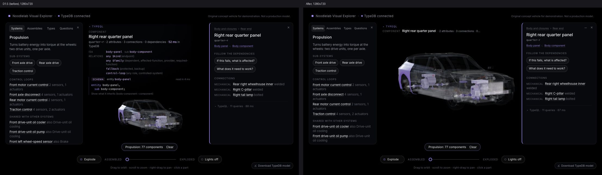 | 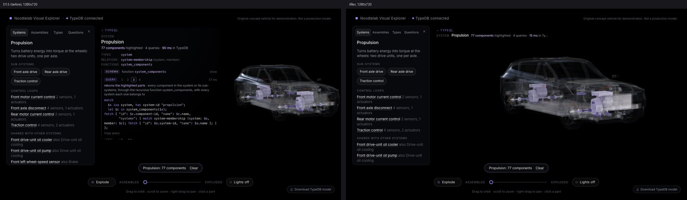 |
| 1440x900 (typical laptop) | 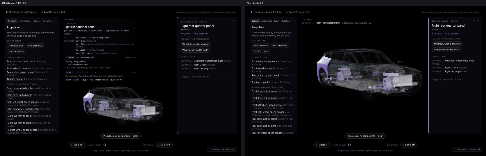 | 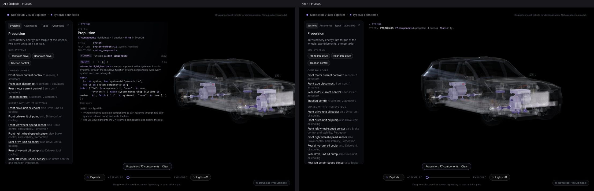 |
| 1512x982 (MacBook class) | 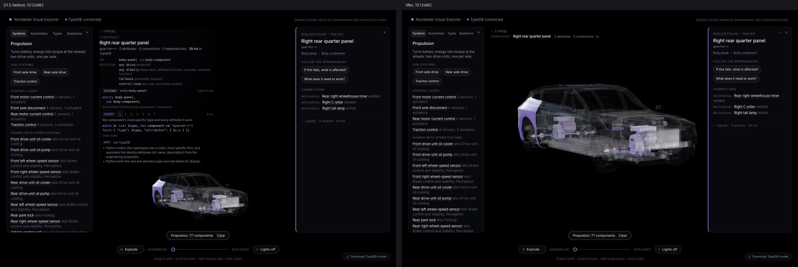 | 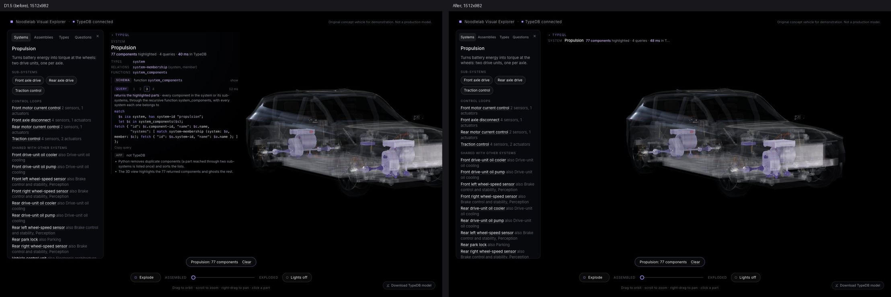 |
| 1920x1080 (desktop monitor) | 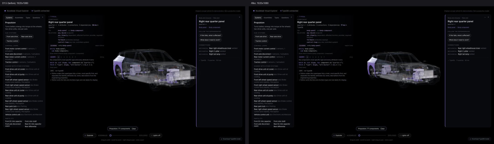 | 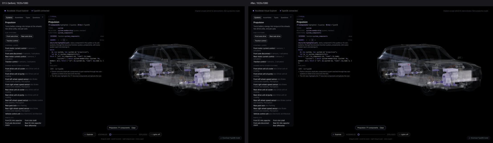 |

**Rapid switching** (1512x860, ten selections about 0.8 s apart: parts, Propulsion, Braking): 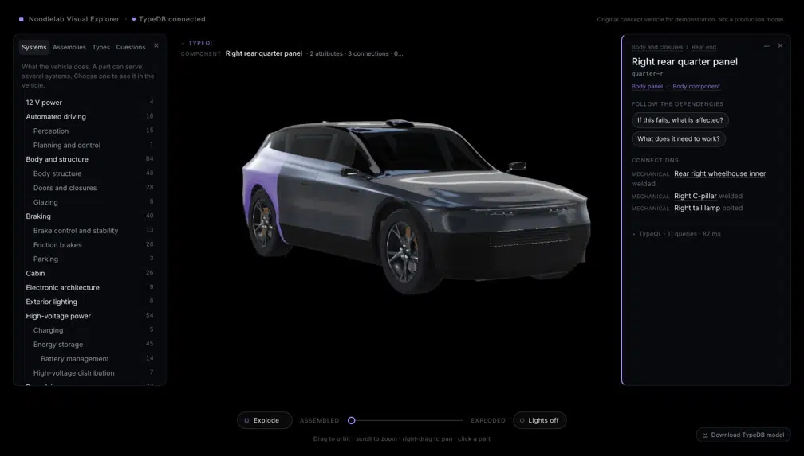

## Measurements

`scripts/browser/ui_stability.py` traces the camera every frame (lens angle, offsets, position), and the same script
was run on D1.5 and on this branch.

| Viewport | Car, part selected (width × height of window) | Camera frames moved, 10 rapid selections (overlay collapsed / expanded) |
|---|---|---|
| 1280x720 | 26% × 22% → **43% × 36%** | 315 / 375 → **0 / 2*** |
| 1440x900 | 37% × 27% → **49% × 36%** | 301 / 331 → **0 / 0** |
| 1512x982 at 90% zoom | 36% × 26% → **54% × 39%** | 371 / 417 → **0 / 0** |
| 1512x982 at 100% | 27% × 19% → **50% × 36%** | 371 / 418 → **0 / 0** |
| 1512x982 at 110% | 38% × 27% → **46% × 34%** | 303 / 341 → **0 / 0** |
| 1920x1080 | 39% × 32% → 33% × 28% (overlay open), **48% × 40%** (overlay collapsed) | 324 / 357 → **0 / 0** |

\* The 2 frames are the last 0.02° of the glide from opening the overlay just before, not the switching.

Other checks, at every size and zoom:
- **Panels and the explosion:**
  - minimising and restoring the part panel, closing and reopening the explorer, and expanding and assembling each
    give one smooth glide per change;
  - resizing the window re-frames once the resize stops.
- **Controls:** no control (explode, lights, download, panel close or minimise, overlay toggle, tabs, focus bar) is
  outside the window.
- **Tests:** web 71 pass, plus the build; API 119; live TypeDB 7.

**Performance against D1.5** (same benchmark, high tier, 1440x900 x1.5, three runs each):

| | D1.5 | After |
|---|---|---|
| Frame, assembled / expanded | 3.3-3.6 / 8.4-8.7 ms | 3.1-3.7 / 8.3-10.0 ms (one noisy run) |
| Draw calls, download | 936 calls, 17.24 MB | 936 calls, 17.24 MB |
| JavaScript (gzip) | 502.9 KB | 503.8 KB |
| Selecting a part (to its name shown) | 77-81 ms | **61-62 ms** |
| Highlighting a system (to the highlight drawn) | 77-83 ms | 92-114 ms |

Highlighting measures 15-25 ms slower over several runs. It is still under a tenth of a second and not visible; I
looked for the cause (the overlay's preparation was ruled out) and stopped there.

## Limitations

1. **At 1920x1080 with the overlay open and a part selected,** the car is smaller than on D1.5 (33% against 39% of the
   width).
   - The overlay's reserved slot sits beside the car, and D1.5's larger figure only lasted while the overlay happened
     to be short; it jolted as soon as the content changed.
   - With the overlay collapsed it is 48%. The overlay could start collapsed on wide screens too; that is a one-line
     change, for you to decide.
2. **Resizing to a smaller window keeps the overlay in its current state.** An overlay opened on a large window stays
   open after shrinking it; it does not collapse by itself.
3. **The part panel's own content** still shows "Asking TypeDB…" briefly while a new part loads (the camera is not
   affected). Keeping its previous content, like the overlay, would be a small follow-up.

---

# Refinement: larger vehicle, visible TypeQL, stable panels (2 November 2026)

**Status: for review. Not merged; Phase F not started.** Commits 601ffd4 and 770b634, compared with 1161f22.

## Why the query text was not visible

On laptops the overlay started collapsed. Opened, it was at most 46% of the window tall, and the query was its last
block, after the "explores" summary and the schema. So the TypeQL itself sat below the fold and needed scrolling.

## The layout now

- **The vehicle is a full-width background.**
  - The three areas (explorer, TypeQL overlay, part panel) float over it.
  - The vehicle is centred between the side panels, in the band between the title line and the controls.
  - It may be up to 1.3 times the free width, so it reaches behind the panels and the overlay rather than shrinking
    to fit beside them.
  - The overlay plays no part in the framing, so its content can never move the camera.
- **TypeQL is visible by default** on every screen wider than a phone (below 640 px it starts as its one-line
  summary).
  - The query text comes first, then the schema, then what it explores and what the app adds.
  - Query switching (1–7), internal scrolling and the manual collapse (▾) are unchanged.
  - It never collapses by itself, by width or on a selection.
- **The overlay is narrower on laptops:** 320–360 px instead of 440 (about 18% less), as tall as the space above
  the controls. The font size is unchanged.
  - Code keeps its indentation; long lines scroll sideways. Explanations wrap.
  - Its background is 84% opaque with a blur, so it reads clearly over the vehicle.
- **Denser side panels at the same widths:** slightly smaller text, tighter spacing, smaller chips. Each scrolls
  inside and collapses on its own.
- **The part panel no longer flashes "Asking TypeDB…".**
  - It keeps the previous part's details, dimmed, with a small pulsing dot, while the next part loads out of sight.
    Then it swaps in place.
  - A part replaced before it loaded is dropped.
  - The 3D highlight follows the click at once, as before.
- **The overlay's part view** now also waits for its schema definition before it is shown, so no "Reading the
  schema…" line flashes either.

## Before and after

Left: 1161f22. Right: this refinement. Each pair shows a part selected (Propulsion highlighted, the right rear
quarter panel selected) and a system highlighted.

| Viewport | A part selected | A system highlighted |
|---|---|---|
| 1280x720 | 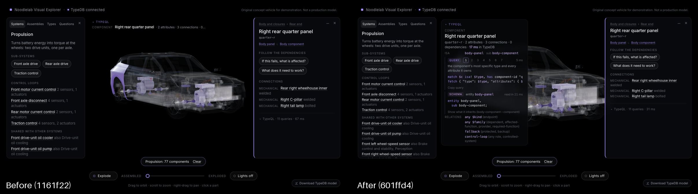 | 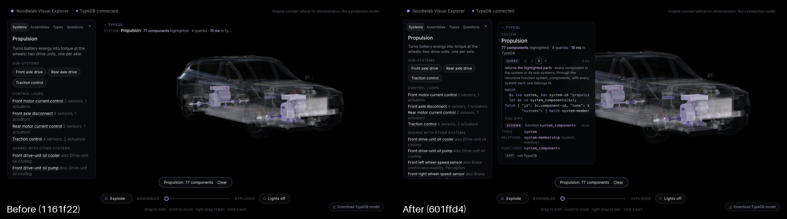 |
| 1440x900 | 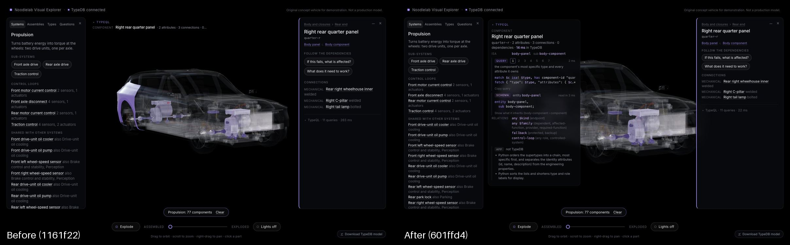 | 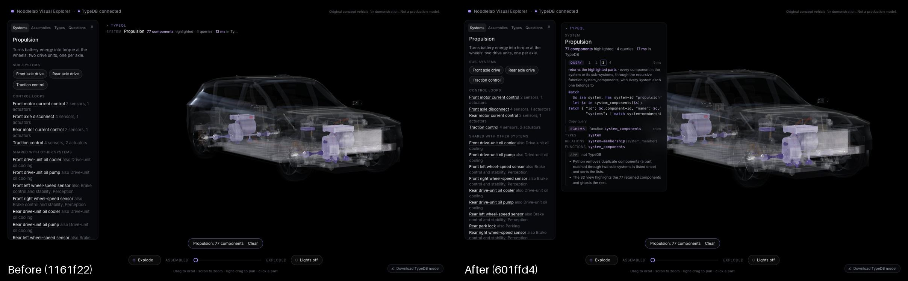 |
| 1512x982 | 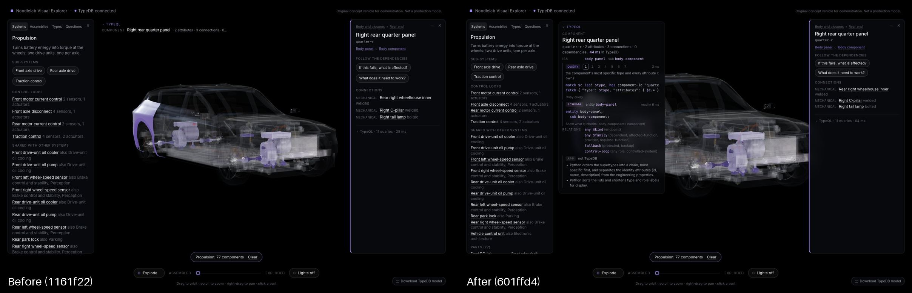 | 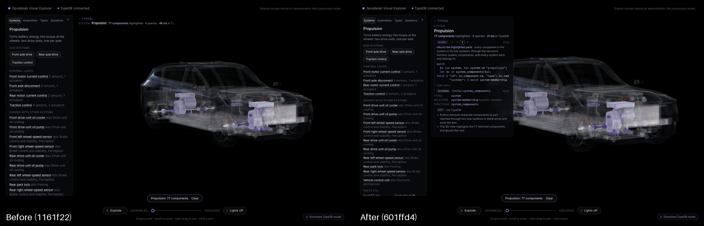 |
| 1920x1080 | 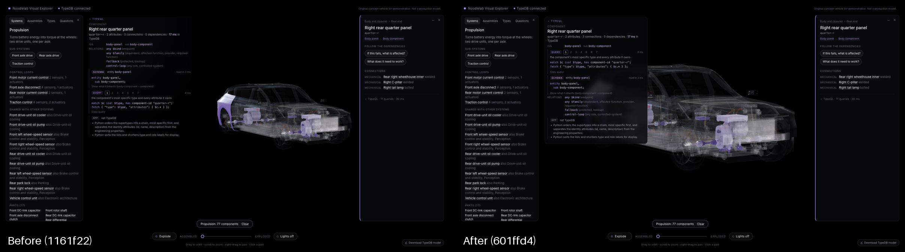 | 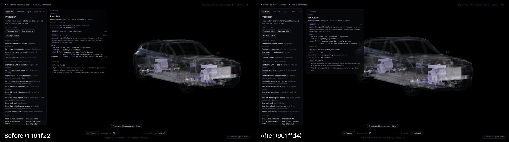 |

**Rapid switching** (1512x860, ten selections about 0.8 s apart: parts, Propulsion, Braking):
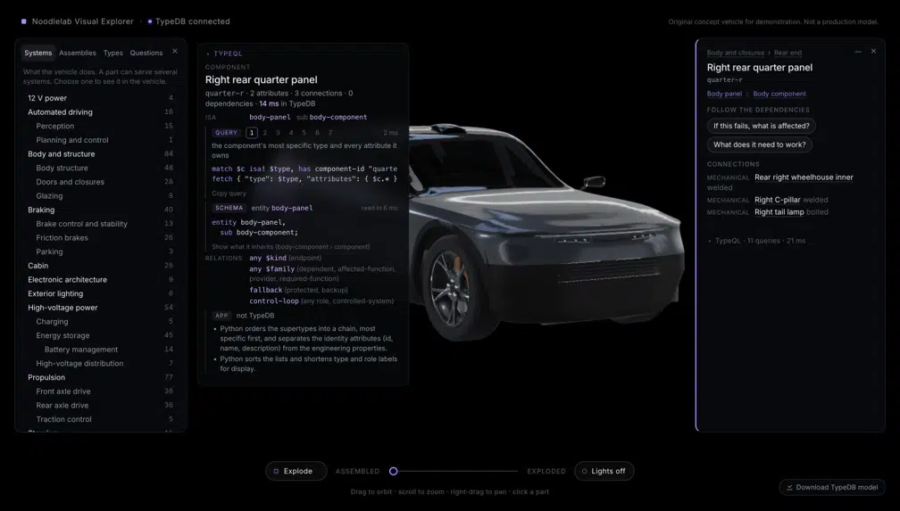. A frame from mid-switch is below: the panel already shows the new part, and the
overlay still shows the previous one, dimmed, until the new one is ready.

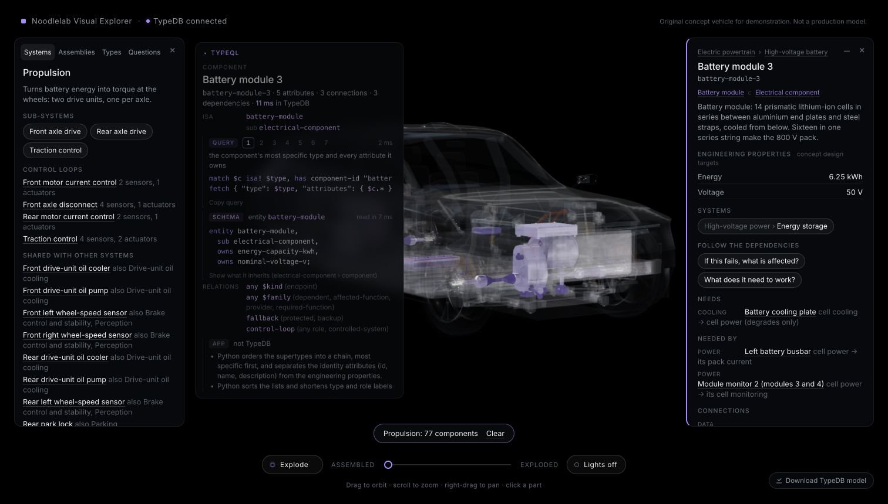

## Measurements

`scripts/browser/ui_stability.py`, which now also checks the query text and counts loading flashes.

| Viewport | Car width × height, part selected (1161f22 → now) | Width clear of the side panels / of panels and overlay | Overlay (w × h) |
|---|---|---|---|
| 1280x720 | 43% × 36% → **53% × 44%** | 90% / 42% | 320 × 468 px |
| 1440x900 | 49% × 36% → **59% × 44%** | 90% / 50% | 338 × 611 px |
| 1512x982 at 90% zoom | 54% × 39% → **61% × 44%** | 94% | 360 × 577 px |
| 1512x982 at 100% | 50% × 36% → **61% × 44%** | 90% / 52% | 355 × 577 px |
| 1512x982 at 110% | 46% × 34% → **61% × 44%** | 86% | 323 × 611 px |
| 1920x1080 | 33% × 28% → **53% × 44%** | 100% / 69% | 440 × 544 px |

At every size and zoom:

- **The query text** is in view, without scrolling, with a part selected, with a system selected, and for the
  longest query (a failure impact).
- **Rapid switching,** assembled and exploded:
  - the camera moved in 0 frames;
  - 0 frames showed a loading state in the overlay or the part panel.
- **Collapsing and reopening the overlay** moves the camera in 0 frames.
- **Panel and explosion changes:**
  - minimising and restoring the part panel, and closing and reopening the explorer, each give one smooth glide per
    change (at 1512 the explorer's two changes measured 3 glides, a glide's slow tail split in two);
  - expanding and assembling follow the explosion.
- **Exploded,** the vehicle is 28–37% of the width and 60–70% of the height, all of it clear of the side panels.
- **Controls:** none outside the window.

**Tests:** web 79 pass (8 new, for the overlay's default and the part panel's swap), plus the build; API 119; live
TypeDB 7.

**Performance** (same benchmark, high tier, three runs each, 1161f22 and now back to back):

| | 1161f22 | Now |
|---|---|---|
| Frame, assembled / animating / exploded (median) | 2.4–4.1 / 9.1–9.4 / 7.9–9.5 ms | 2.5–2.9 / 8.8–9.5 / 7.8–8.5 ms |
| Triangles, draw calls, download | 1.44 M, 936, 17.24 MB | the same |
| JavaScript (gzip) | 503.8 KB | 504.1 KB |
| Selecting a part (to its name shown), median | 59 ms | 56 ms |
| Highlighting a system, median | 81 ms | 77 ms |

## For your decision: the overlay covers one end of the vehicle

With all three areas open on a laptop, they cover about 980 of 1280 px, or 1,000 of 1512. The vehicle reaches
behind the overlay, and the overlay covers its rear end: a part there, such as the right rear quarter panel, is
hidden until you collapse the overlay (▾) or orbit the vehicle.

One setting, `OVERLAY_SHARE` in `web/src/scene/Stage.tsx`, moves the vehicle away from the overlay, at the cost of
its size. Measured:

| OVERLAY_SHARE | Car width (1280 / 1440 / 1512 / 1920) | Width clear of panels and overlay | A rear part clear of the overlay |
|---|---|---|---|
| **0 (now)** | 53 / 59 / 61 / 53% | 42 / 50 / 52 / 69% | 0% |
| 0.6 | 46 / 47 / 48 / 53% | 48 / 63 / 66 / 71% | 0–23% |
| 1 (vehicle beside the overlay) | 46 / 46 / 46 / 46% | 48 / 65 / 69 / 82% | 15–88% |

Following the selected part with the camera would conflict with "no camera movement when switching", so I have not
done it.

## Limitations

1. The overlay hides the vehicle's rear end on laptops, as above.
2. The overlay's part view now waits for three answers (part, relationships, schema) before it swaps. So it updates
   a few milliseconds later than the part panel.

---

# Final refinement: TypeQL presentation and vehicle framing (2 November 2026)

**Status: for review. Not merged; Phase F not started.** Code commit 718cbea, compared with afa5e60.

## What changed

- **TypeQL is back on the studio's black,** with no box, border, rounded corners or panel background.
  - Its position, narrower width, content order and behaviour are unchanged:
    - open by default;
    - the selected query and its timing first;
    - schema with inheritance, query selectors and the app-side notes;
    - longer content scrolls inside.
  - Where the vehicle passes behind it, a feathered darkening keeps the text readable. It is 80% at the text and
    fades to nothing 36–80 px outside it on every side, so there is no edge. The vehicle stays faintly visible
    through it, and purple accents and syntax colours are untouched.
  - The darkening only exists where the overlay is, so highlighted parts elsewhere are not dimmed.
- **The vehicle moves right while the TypeQL is open,** by 0.4 of the overlay's slot (`OVERLAY_SHIFT` in
  `web/src/scene/Stage.tsx`).
  - Its size is unchanged: 53% of the width at 1280, 59% at 1440, 61% at 1512, 53% at 1920.
  - Its front now reaches behind the part panel rather than the TypeQL.
  - With no part panel open, the shift is capped so the vehicle never runs off the window.
  - The slot comes from the overlay's styles, never its content or the selection, so clicking parts never moves
    the camera.
- **A camera glide now finishes on a step too small to see,** so each panel change is one movement. Before, a last
  tiny snap about 2 s in counted as a second one.

## Screenshots

| | 1280x720 | 1512x982 |
|---|---|---|
| A part selected (Propulsion highlighted) | 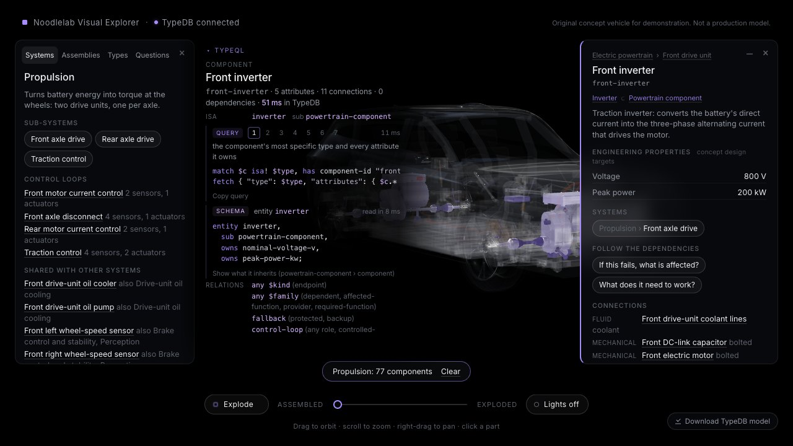 | 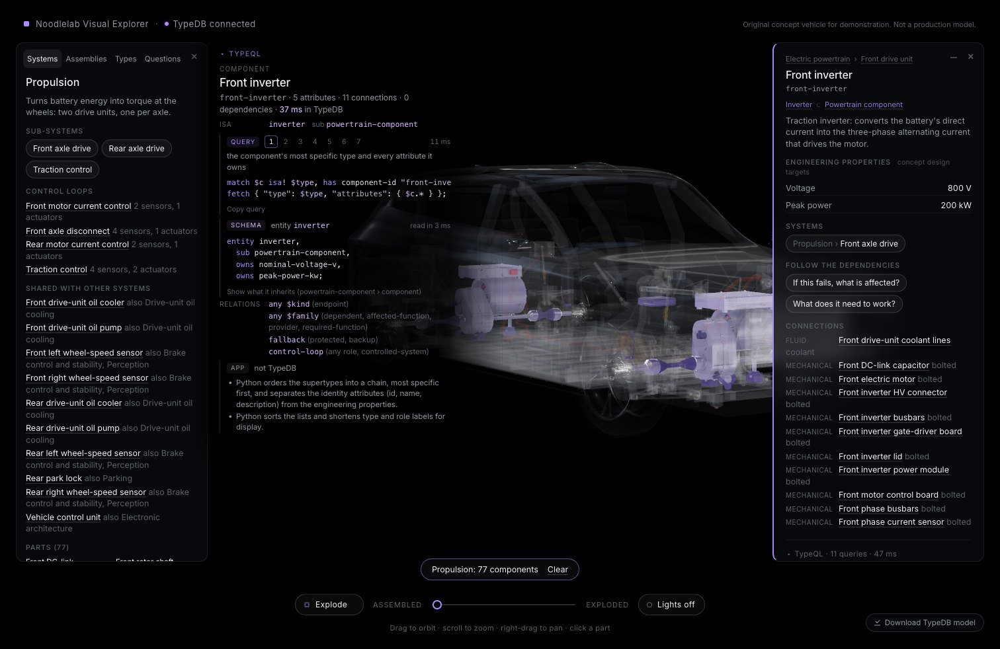 |
| A system selected | 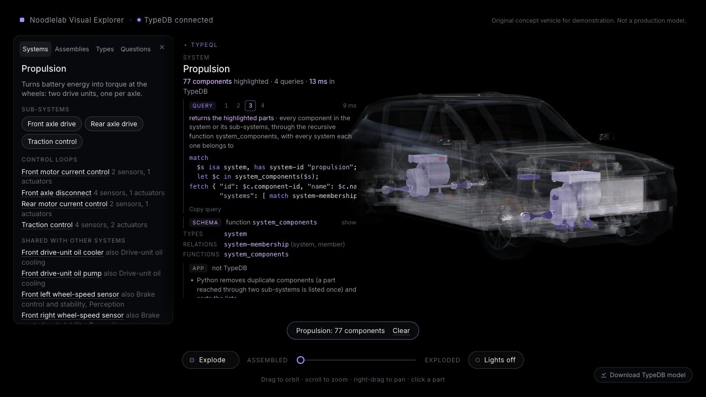 | 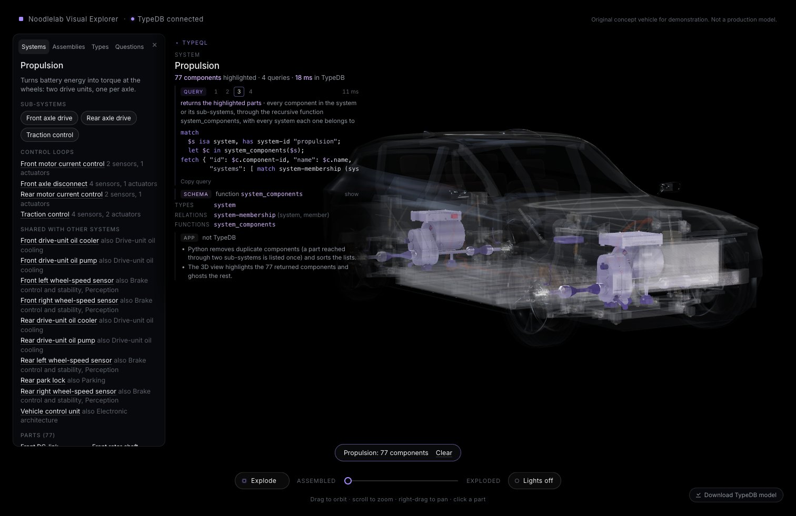 |
| A long query (12-volt battery failure impact) | 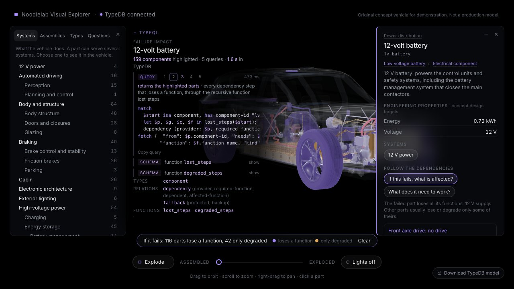 | 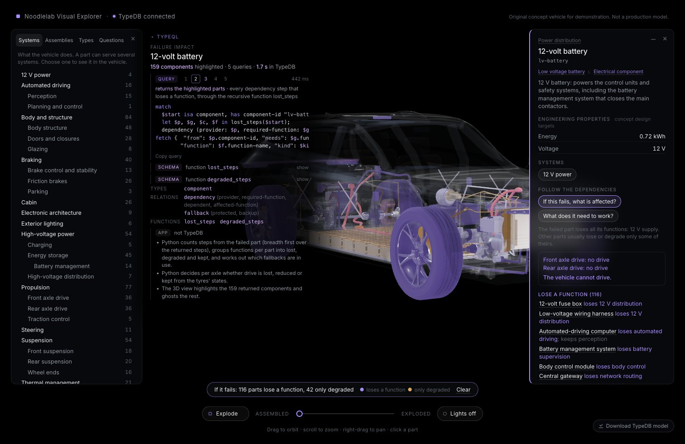 |
| Exploded, a part selected | 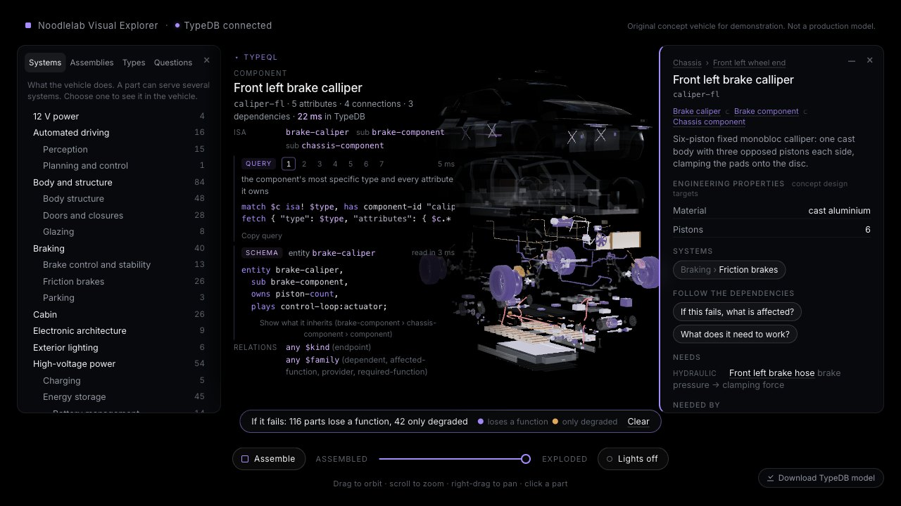 | 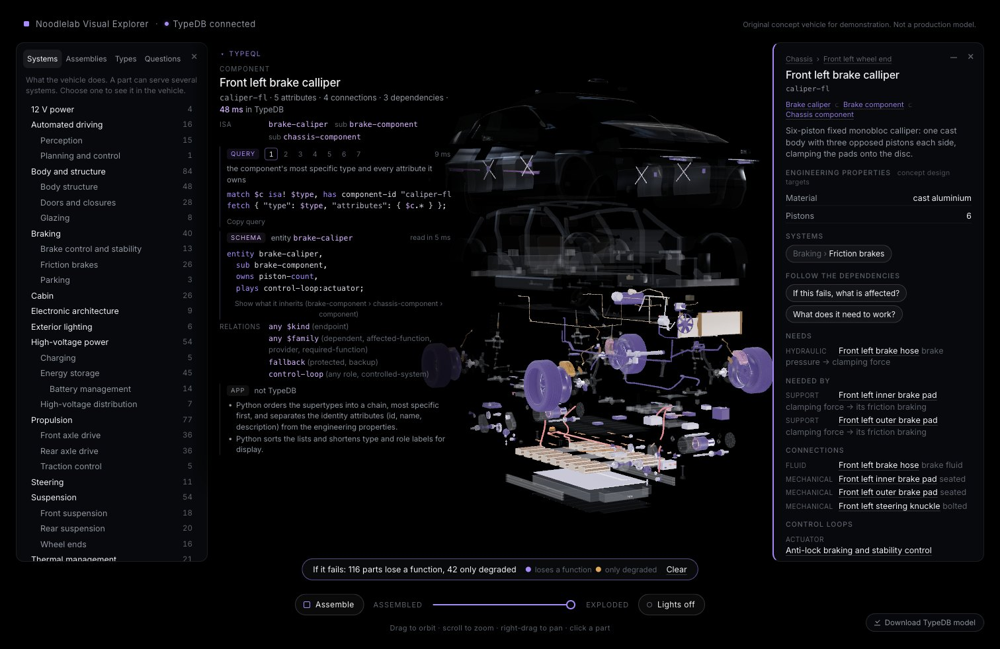 |

## Validation

`scripts/browser/ui_stability.py` was run at 1280x720, 1440x900, 1512x982 (90%, 100% and 110% zoom) and 1920x1080.
At every one:

- **The query text is in view without scrolling:** for a part, a system and the longest query.
- **Rapid switching** (ten selections, parts and systems, 0.3–0.8 s apart), assembled and exploded:
  - the camera moved in **0 frames**;
  - **0 frames** showed a loading state in the TypeQL or the part panel.
- **One smooth glide per change:**
  - collapsing or reopening the TypeQL (it now moves the vehicle, by design);
  - minimising or restoring the part panel;
  - closing or reopening the explorer.
- **Expanding and assembling** follow the explosion as before.
- **No control is outside the window.**

| Viewport | Car (width × height) | Car width clear of the TypeQL and both panels | Exploded: clear of the TypeQL and panels |
|---|---|---|---|
| 1280x720 | 53% × 44% | 42% | 80% |
| 1440x900 | 59% × 44% | 50% | 88% |
| 1512x982 | 61% × 44% | 52% | 88% |
| 1920x1080 | 53% × 44% | 70% | 100% |

The share of the car covered has not changed. What moved is which part is covered: the front, behind the details
panel, instead of the rear, behind the TypeQL.

**Tests:** web 79 pass, plus the build; API 119; live TypeDB 7.

**Performance** (high tier, 1440x900, three runs each, run twice in alternating order):

| | afa5e60 | 718cbea |
|---|---|---|
| Frame, assembled / animating / exploded (medians, second pair) | 3.2–7.7 / 10.8–11.2 / 9.6–11.0 ms | 3.1–4.7 / 10.3–11.0 / 9.7–9.9 ms |
| Triangles, draw calls, download | 1.44 M, 936, 17.24 MB | the same |
| JavaScript (gzip) | 504.1 KB | 504.1 KB |
| Selecting a part / highlighting a system (medians) | 58–64 / 81–87 ms | 61–64 / 80–105 ms |

- **The first pair** measured the new version about 1–2 ms slower while animating. In the reverse order the
  difference disappeared, so it was the machine's state, not the change.
- **TypeQL execution** is unaffected; no query or API code changed.
- **The model download** (`/api/export/model.zip`) returns its 3-file ZIP as before.
