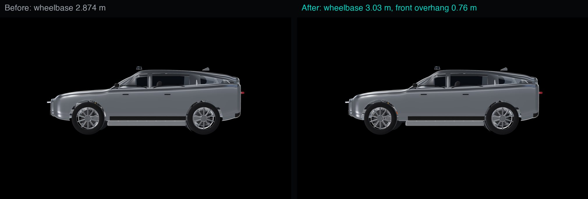
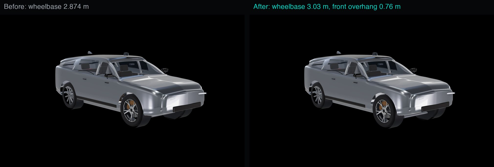
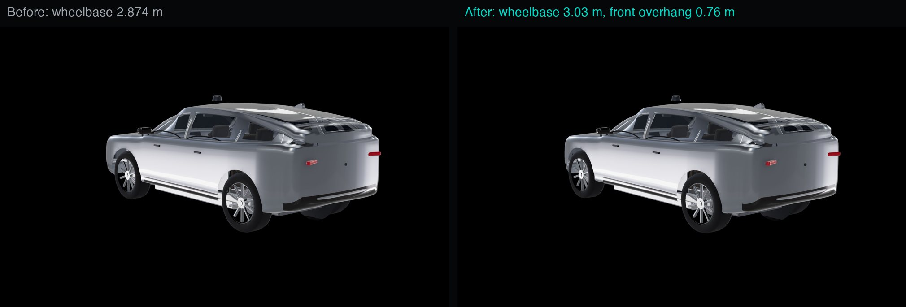
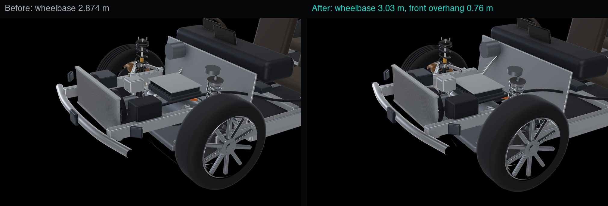
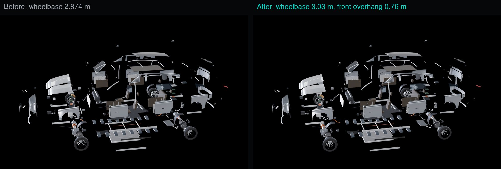
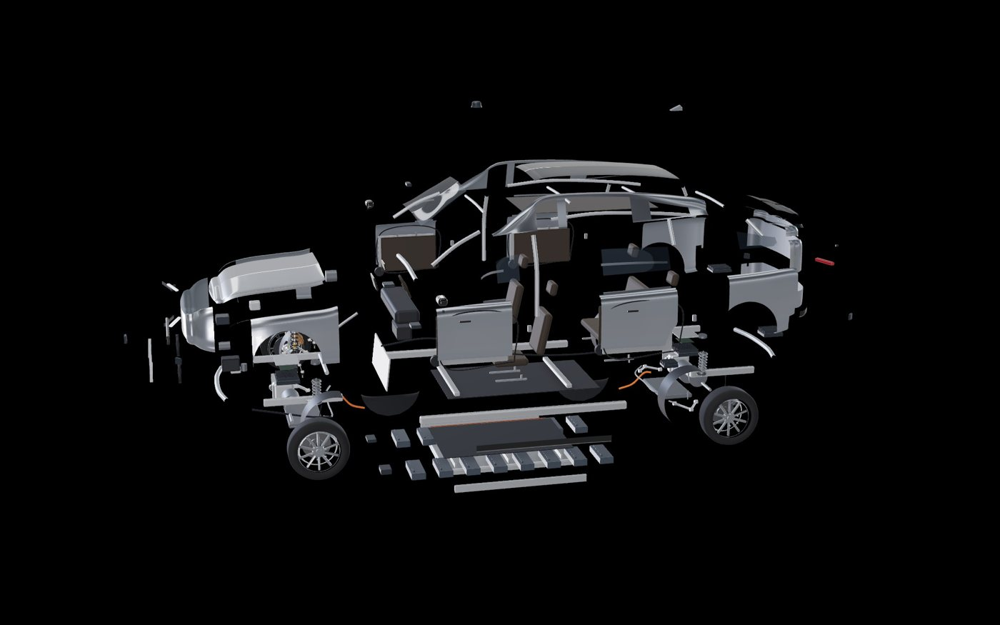

# Wheelbase moved to the 3.03 m engineering baseline (30 October 2026)

Approved by the owner: apply the provisional targets (docs/design-targets.md) before the new mechanical work,
as the current engineering baseline, revisable when the exterior is revisited.

## What changed

| | Before | After |
|---|---|---|
| Wheelbase | 2.874 m | **3.03 m** |
| Front axle (app x) | 1.437 | **1.58** (+14.3 cm) |
| Rear axle (app x) | -1.437 | **-1.45** (-1.3 cm) |
| Front overhang | 0.90 m | **0.76 m** |
| Rear overhang | 0.97 m | **0.96 m** |
| Length (nose 2.34, tail -2.41) | 4.75 m | 4.75 m (body unchanged) |

- **The axles moved, not the body.** `web/src/vehicle/dimensions.ts` now places the front axle from the nose
  by the front overhang, and the rear axle from the front axle by the wheelbase. The vehicle's origin became a
  fixed body reference point rather than the midpoint between the axles. Everything built from the axle
  positions followed: wheels, tyres, brakes, hubs, knuckles, suspension, anti-roll bars, subframes,
  steering rack and tie rods, drive units and drive shafts, and the body's wheel-arch cut-outs.
- **The Phase A corner model** was rebuilt at the new axle (`blender/corner.py` AXLE; same size and triangle
  count); its test now reads the axle from `dimensions.ts`.
- **Packaging check:** a bounding-box test of every moving front part against the fixed front-compartment
  parts found four 1-2 cm overlaps (front gearbox with the heat-pump compressor, front inverter with the ESC
  module). Both units moved 4 cm forward; no overlaps remain.
- **Component ids:** unchanged. TypeDB data unchanged (it holds no positions).
- Tyre width corrected to 275 mm (to match the Phase A tyre, 275/45 R22).

## Before and after

The explosion still works (scrubbed to 0, 0.5 and 1; all explosion tests pass): 

## To revise later

Change `WHEELBASE`, `FRONT_OVERHANG` (and `NOSE_X`/`TAIL_X` for the body) in `dimensions.ts`, set `AXLE` in
`blender/corner.py` to the new front axle, run `sh scripts/build-assets.sh`, and re-run the packaging check.
